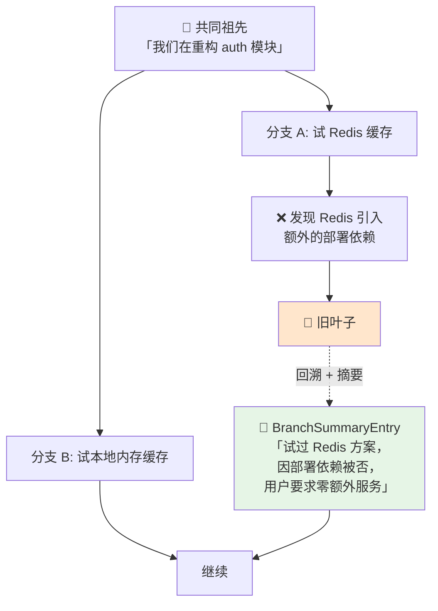

> 裁剪只解决「放不下」，压缩才解决「记不住」。这一篇拆解 `pi` 的 compaction 机制——它是目前公开实现里把「几何阈值触发 + 摘要迭代演进 + 文件操作累积追踪」三件事都做对的少数之一。读懂它，你就理解了 Claude Code / Cursor / 所有长跑 agent 的续命机制。

## 你将学到

1. 摘要压缩和硬截断的取舍边界——什么时候截断就够，什么时候必须摘要
2. `pi` 的 compaction 完整机制：几何阈值、检查时机、五步流程
3. **切点合法性规则**：为什么绝不能切在 tool result 上，以及它和 02 篇「吸附到 user 边界」的关系
4. 摘要**迭代演进**（旧摘要作为输入）与**文件操作累积追踪**（`readFiles` / `modifiedFiles` 继承）
5. **钉住区块 (pinned)**：为什么「自动摘要会丢掉否定指令」是最高频的翻车方式
6. 截断回合 (split turn) 与分支摘要 (Branch Summarization) 各自解决什么问题
7. 五种压缩策略的对比表，以及一个可跑的最小 compaction 实现

## 前置要求```bash
pip install openai python-dotenv
```

`.env` 里需要（见项目根 `.env.example`）：

```
MIMO_API_KEY=你的key
MIMO_BASE_URL=https://api.xiaomimimo.com/v1
MIMO_MODEL=mimo-v2.5
```

> ⚠️ 本篇代码里的 token 计数优先用 `tiktoken`，**但本机 tiktoken 词表无法下载**（`openaipublic.blob.core.windows.net` 直连超时），会自动降级到离线估算。详见 历史裁剪与边界吸附 的前提要求一节。

先读完前两篇：

- 上下文工程总论 —— context rot 与锯齿形增长曲线
- 历史裁剪与边界吸附 —— **消息配对不变量**，本篇反复引用它

---

## 一、摘要压缩 vs 硬截断先把两者放在一起看：```mermaidgraph TD
    subgraph TRIM["✂️ 硬截断（裁剪）"]
        T1["旧消息"] -->|"直接丢弃"| T2["🗑️ 信息永久消失"]
        T3["保留"] --> T4["最近 N 条原文"]
    end
    subgraph COMPACT["📝 摘要压缩 (compaction)"]
        C1["旧消息"] -->|"LLM 生成摘要"| C2["📄 摘要（有损但保结构）"]
        C2 --> C3["摘要 + 最近 N 条原文"]
    end
    style T2 fill:#ffe6cc
    style C2 fill:#e6f5e6
```

| | 硬截断 (truncation) | 摘要压缩 (compaction) |
|---|---|---|
| 丢掉什么 | 全部旧消息 | 旧消息的**细节**，保住**结构** |
| 保住什么 | 只有最近 N 条 | 目标 / 决策 / 约束 / 文件清单 / 未决问题 |
| 额外成本 | **0** | 每次触发 1 次 LLM 调用 |
| 新增失败模式 | 模型突然忘记最早的约束 | **摘要本身出错**（丢数值、丢否定指令、幻觉） |
| 实现复杂度 | ★ | ★★ |
| 关键优点 | 简单、无幻觉 | 长程信息可续 |

判断标准只有一条：

> **你的 agent 会不会连续跑超过 20 个工具步？** 会，就要压缩。
>
> 20 步大约对应「一次真实的编码任务」——读 5 个文件、改 3 个、跑 2 次测试、失败、再看日志。到 20 步时，最早那条「用户到底想要什么」已经离上下文顶部很远了，而它恰恰是最不能丢的。

### 1.1 理想情况下两者一起用

真实系统里，**裁剪和压缩不是二选一，是同一件事的两个阶段**：

```
每次请求：
  ① tool-result clearing   ← 最轻的一刀，清空工具结果正文
  ② 若仍超阈值 → compaction ← 生成摘要，替换掉一段历史
  ③ 若仍超预算 → 硬裁剪    ← 最后的兜底（且必须吸附边界）
```

`pi` 用的是 ②+③ 的组合（阈值触发 compaction），Anthropic 提到 Claude Code 用 ①+②。

## 二、`pi` 的 compaction 完整拆解

> 本篇参考实现：`earendil-works/pi`（TypeScript 大型实现），源码与官方文档 `packages/coding-agent/docs/compaction.md`，抓取于 2026-09。

### 2.1 触发条件：几何式 token 阈值，不是消息条数```ts
// pi 的判据（简化）
if (contextTokens > contextWindow - reserveTokens) {
  await compact();
}
```

三个参数：

| 参数 | 默认值 | 含义 | 为什么是这个数 |
|---|---|---|---|
| `contextWindow` | 模型决定 | 窗口总大小 | 从模型元数据读，不是硬编码 |
| `reserveTokens` | **16384** | 留给模型**输出**的空间 | 输出也要占窗口。压得太满，模型连回答都写不完（`stopReason === "length"`，见 Agent Loop 的截断保护） |
| `keepRecentTokens` | **20000** | 压缩后要保留多少**近期**原文 | 保住「刚发生的事」的细节，摘要只负责更早的部分 |

配置文件位置（可覆盖）：

```
~/.pi/agent/settings.json          # 全局
<project>/.pi/settings.json        # 项目级，优先级更高
```

**为什么是几何式而不是「消息条数」？** 这是本篇第一个关键设计点：

- 条数判据（`len(messages) > 80`）**与体积无关**。80 条「嗯」和 80 条「读了一个 5 万 token 的文件」差了三个数量级。
- 阈值判据直接对齐**唯一的硬约束**——窗口。它不需要你猜「80 条大概是多少 token」。

> ⚠️ 注意 `contextWindow - reserveTokens` 是一个**比例无关的绝对量**。这意味着窗口 200k 的模型和窗口 32k 的模型，都用同一个 `reserveTokens = 16384`——留出的**绝对**输出空间是一样的。这是刻意的：输出长度取决于任务，不取决于窗口。

### 2.2 检查时机：三处，其中一处最关键```mermaid
sequenceDiagram
    participant U as 用户
    participant A as pi 主循环
    participant M as LLM
    participant C as compaction

    Note over A: ① 新用户 prompt 到达之前
    A->>C: contextTokens > window - reserve ?
    U->>A: "帮我改一下这个函数"
    A->>M: messages
    M->>A: tool_calls
    Note over A: 执行工具
    A->>A: 追加 tool result
    Note over A: ② ★ 一轮工具结果追加之后
    A->>C: 同一次 run 内部压缩，然后继续
    A->>M: 压缩后的 messages（同一个 run，不返回用户）
    M->>A: 最终答案
    Note over A: ③ agent run 结束时
    A->>C: 收尾检查
```

三个时机各自的必要性：

| 时机               | 为什么需要                                                                      |
| ---------------- | -------------------------------------------------------------------------- |
| ① 新 prompt 之前    | 用户可能往上贴了一大段东西；不先压，第一轮就溢出                                                   |
| ② **一轮工具结果追加之后** | ★ **最关键**。一次 run 内部可能有几十个工具步。如果只在「用户提问时」检查，一次 run 就能把窗口撑爆——因为 run 中途没有用户输入 |
| ③ run 结束时        | 收尾。让下次提问的起点是干净的，避免下次进来时才发现要压                                               |

> **②是 `pi` 相对多数简易实现的分水岭。** 很多玩具实现在 `while` 循环外面检查一次上下文大小，然后进循环。这在第 40 个工具步时会炸——模型这时已经看不见最早的指令了，但你还在往里面灌工具结果。
>
> 正确的位置是：**每一轮工具结果 `append` 之后，立刻检查**。这不是「下一步的准备工作」，这是「同一个 run 的继续进行条件」。

### 2.3 怎么算 contextTokens```ts// pi（简化）
function calculateContextTokens(usage) {
  return usage.totalTokens
      || usage.inputTokens + usage.outputTokens
                      + usage.cacheReadTokens + usage.cacheWriteTokens;
}
```

两个要点：

**要点一：用 provider 报的 `usage`，不要自己数。** 自己用 tiktoken 数出来的只是「消息内容的 token」，**不包括** service 端的包装、工具 schema、缓存部分。provider 返回的 `usage` 是权威值。所以：

> **裁剪/压缩的决策要用「上一轮的真实 usage」，而不是「这一轮自己估算的 token」。**

实践中两者配合：初次估算用本地计数（还没有 usage），之后每轮用上一轮的真实 usage 校正。

**要点二：只认未 aborted、未 error 的 assistant usage。**

```ts
// 只有正常完成的 assistant 消息才计入
if (msg.role === "assistant" && !msg.aborted && !msg.error) { ... }
```

为什么？被中断的请求可能：
- 根本没进入模型的上下文（连接失败）
- 或者被计费了但内容不完整

把它算进 `contextTokens` 会让阈值判断**虚高**，导致过早压缩（浪费一次 LLM 调用）；也可能让 `keepRecentTokens` 的累加计算错位。**待验证**：这条规则的具体边界（比如流式中途断开算不算 aborted）在 pi 文档里没有完全展开，实现时需自行定义并保持自洽。

### 2.4 五步流程```mermaidflowchart TD
    START(["contextTokens > window − reserve"]) --> S1
    S1["① 从最新消息往前累加 token<br/>累到 keepRecentTokens 就停<br/>→ 得到候选切点"] --> S2
    S2{"② 切点合法吗？<br/>只能是 user / assistant /<br/>BashExecution / custom<br/>❌ 绝不能是 tool result"} -->|"不合法"| S2b["往后/往前挪到最近合法位置"]
    S2b --> S2
    S2 -->|"合法"| S3
    S3["③ 生成摘要<br/>结构化格式<br/>★ 有旧摘要时把它作为迭代上下文传入"] --> S4
    S4["④ 落盘 CompactionEntry<br/>{type, summary, firstKeptEntryId,<br/>tokensBefore, usage,<br/>details:{readFiles, modifiedFiles}}"] --> S5
    S5["⑤ 重建上下文 =<br/>system + summary + 从 firstKeptEntryId 起的消息"]
    S5 --> DONE(["继续同一个 run"])
    style S2 fill:#ffe6cc
    style S3 fill:#e6f5e6
```

### 2.5 第②步详解：切点合法性——绝不能切在 tool result 上

这是整个 compaction 里**最容易写错、后果最严重**的一步。规则：

> 切点只能落在 `user` / `assistant` / `BashExecution` / `custom` 上。
> **绝不能落在 tool result 上——tool result 必须跟着它的 tool call 走。**

官方 ASCII 图（本笔记改写，补上了 token 刻度）：

```
压缩前:
  hdr │ usr │ ass │ tool │ usr │ ass │ tool │ tool │ ass │ tool
       └──────── 待摘要 (≈ 60k tok) ────────┘└──── 保留 (≈ 20k) ────┘
                                            ↑
                                   firstKeptEntryId

压缩后 LLM 看到:
  │ system │ summary ────────┐ │ usr │ ass │ tool │ ...
  │        │ (≈ 1.5k tok)    │ │
  └─ 不变 ─┘                 └─ 与保留段内容一致，只是换了表示
```

**为什么不能切在 tool 上？** 和 02 篇是**同一个不变量**：

> 每一个 `tool` 消息，都必须在它之前找到一个带同名 `tool_call_id` 的 `assistant` `tool_calls`。

如果切点落在某个 `tool` 消息上，那条 `tool` 的 `assistant` 被摘要掉了，产生**孤儿 tool result** → provider 直接 400。

还记得 02 篇的结论吗——那里说「吸附到 `user` 边界」。这里出现了差异，值得专门说清楚：

| | 必要 / 充分 | 候选集 |
|---|---|---|
| **必要不变量**（provider 要求的） | 必要条件 | 只要不是 tool result 就行 |
| `pi` 的规则 | 略严于必要 | `user` / `assistant` / `BashExecution` / `custom` |
| `pi-agent` 的规则（02 篇） | **充分**条件 | 只允许 `user` |

> 💡 **「切在 `user` 上」是充分但不必要的**。它用一个更简单、更好证明正确的规则换掉了一点窗口利用率——毕竟 `assistant` 也是合法切点。
>
> 教学顺序上先说 `user` 是对的（不会错），但**读工业实现的源码时要能看懂它为什么敢放宽**。放宽的前提是它同时维护了「tool call ↔ tool result 成对保留」的检查。

注意 `pi` 还多出了两个候选：`BashExecution` 和 `custom`。这两个是 pi 自己的 entry 类型（执行了一条 bash 命令 / 自定义 entry），它们的特点是**自包含**——不依赖前一条消息，因此可以作为切点。

### 2.6 第③步详解：摘要迭代演进

这里有一个非常容易被忽略的设计：

> **已有旧摘要时，把旧摘要作为迭代上下文传给摘要请求——摘要可以叠加演进，不是每次从零开始。**

对比两种做法：

|     | 每次从零摘要                     | 迭代演进（pi 的做法）            |
| --- | -------------------------- | ----------------------- |
| 输入  | 待摘要的这段消息                   | **旧摘要** + 待摘要的这段消息      |
| 效果  | 第 3 次压缩后，第 1 次压缩里的结论已经丢了两轮 | 每次是「更新」，累积信息被保留         |
| 风险  | —                          | **摘要的摘要**：误差累积，早期细节逐步磨平 |

为什么迭代演进更好？因为**摘要是一次有损压缩**。有损压缩做一次损失 20%，做三次从零做就是每次都在「只剩 80% 的原文」上重建——但**迭代演进是在「上一次的结论」上增量更新**，它至少不会把「用户要的是 A 不是 B」这种核心结论弄丢。

> ⚠️ **但迭代演进引入了自己的失败模式：摘要的摘要。** 每轮压缩都会磨平一点早期细节，压缩 5 次后，第 1 轮里那些「重要但看起来不重要的细节」（一个具体的数值、一个文件路径）可能已经不可恢复。
>
> 缓解手段只有两个，且必须同时用：
> 1. **钉住区块 (pinned)** —— 关键的硬约束不参与摘要（见第三节）
> 2. **结构化摘要模板** —— 强制摘要保留固定字段（目标 / 约束 / 文件 / 未决问题），而不是让模型自由发挥

### 2.7 第④步详解：文件操作累积追踪

`CompactionEntry` 的结构：

```ts
{
  type: "compaction",
  summary: string,
  firstKeptEntryId: string,
  tokensBefore: number,
  usage: {...},
  details: {
    readFiles: string[],       // ★ 从上一个 compaction entry 继承
    modifiedFiles: string[],   // ★ 从上一个 compaction entry 继承
  }
}
```

**关键在于「继承」**：`readFiles` / `modifiedFiles` 不是「这一段消息里动过的文件」，而是「**这个 session 迄今为止**动过的所有文件」。

为什么必须继承？看一个可复现的场景：

```
轮次 1-20:   agent 改了 a.py b.py c.py     → 压缩 #1，记录 modifiedFiles = [a,b,c]
轮次 21-40:  agent 改了 d.py e.py          → 压缩 #2
轮次 41-60:  agent 改了 f.py               → 压缩 #3

现在用户问："这个 session 你改过哪些文件？"
```

- **不继承**：压缩 #3 只记得 `[f]` → 答案错得离谱，而 agent **不知道自己错了**
- **继承**：`[a,b,c,d,e,f]` → 答案正确

这不只是「问答正确性」问题。它直接影响 agent 的决策质量——比如「我要不要重新读一下 a.py」，「提交前要不要跑一遍受影响的测试」。**摘要的正文是自然语言（模糊、可能失真），而 `details` 是结构化字段（精确、可程序化使用）。**

> **设计原则**：能结构化的信息，就不要塞进摘要正文让它自由发挥。文件清单、token 数、时间戳这类东西，用字段承载。

### 2.8 摘要请求的两个特殊处理

**① 独立的 routing session id**

摘要请求不挂在主会话的 routing id 下。为什么？provider 侧的前缀缓存 (prefix cache) 是按「会话 / 前缀」路由的。摘要请求的 prompt 结构和主对话完全不同，挂在同一个 id 下只会污染缓存路由和统计口径。

**② `cacheRetention: "none"`**

摘要 prompt 是**一次性**的——它只发这一次，永远不会被复用。为它写 cache 是纯浪费：

| | 普通 input token | cache 写入 |
|---|---|---|
| 单价 | 基准 | 通常**更贵**（常见是 1.25×） |
| 何时划算 | — | 后续有 ≥2 次复用同一前缀时 |

> **一句话：一次性 prompt 不要写 cache。**

**映射到本项目环境**：OpenAI 兼容接口没有 `cacheRetention` 参数。对应做法是——**不要把摘要请求的 `user` 字段设成主会话的 id**（那会让 provider 的缓存路由把两个不同的前缀归到一处）。MiMo 是否实现前缀缓存、以及缓存如何路由，**待验证**。

### 2.9 截断回合 (split turn)：切点落在回合中间怎么办

**问题**：切点要求落在 `user` / `assistant` 上。但一个「回合」可能很长——用户说了句话，agent 跑了 15 个工具步。假设切点落在第 7 和第 8 个工具步之间的 `assistant` 上：

```
usr │ ass │ tool │ ass │ tool │ ... │ ass │ tool │ ass │ tool │ ...
      └──────── 被摘要 ────────┘     └──── 保留 ────┘
                                 ↑ 切点落在这个回合的中间
```

被摘要的部分是**半个回合的结尾**（没有起点），保留的部分是**半个回合的开头**（没有起因）。模型看到保留段的第一条是一个 `assistant` 在调工具，但**不知道为什么要调**。

**解法**：生成**两份**摘要，然后合并。

```
┌─ 历史摘要 ─────────────┐   ┌─ 回合前缀摘要 ──────────┐
│ 更早的那些完整回合        │   │ 当前回合被切掉的**前半**  │
│ "用户在重构 auth 模块…"  │   │ "用户要求把超时改小；    │
│                        │   │  已读 config.py，发现    │
│                        │   │  超时在 L42；正在改"     │
└────────────────────────┘   └─────────────────────────┘
              ↓ 合并
        一份完整的 summary
```

> `pi` 把这件事叫 **split turn**（截断回合）。它解决的是：**切点不落在回合边界时的语义完整性**。
>
> 这一条在文档里往往一笔带过，但它其实是「摘要质量」和「切点自由度」之间的桥梁——没有它，你就被迫要求切点必须是 `user`（回合边界），窗口利用率会明显下降。

### 2.10 分支摘要 (Branch Summarization)

这一条建立在一个前提上：**会话不是一条消息列表，是一棵树。**（完整展开在 会话持久化与树状会话）

既然会话是树，`/tree` 就可以跳到另一条分支。跳到新分支时，旧分支上积累的上下文怎么办？

**`pi` 的做法**：从**旧叶子**回溯到**共同祖先**，把这一段的经历摘要成 `BranchSummaryEntry`，注入新分支。



**它解决什么**：没有 `BranchSummaryEntry`，切到分支 B 后，模型完全不知道「Redis 方案已经被试过并被否决了」。它会**再建议一次 Redis**——用户看到的是 agent 在原地打转。

> 这个机制的本质，是把「**我离开了哪条路、为什么离开**」这个负向知识也变成了可携带的上下文。
>
> 💡 **负向知识（「试过 X，不行，因为 Y」）通常比正向知识更值钱，也更容易在压缩中丢失。** 因为它是**否定句**——而否定句正是自动摘要最爱的牺牲品（见第三节）。

## 三、钉住区块 (pinned)：让关键约束永不参与压缩

### 3.1 先看一个可复现的翻车场景```
第 3 轮   用户: "帮我优化这个查询，注意不要动 config/prod.yaml，那是生产配置。"
第 4-25 轮 agent 读文件、改代码、跑测试、修 bug、再跑测试……（触发 2 次 compaction）
第 26 轮  用户: "再加个索引试试"
第 27 轮  agent: 修改 config/prod.yaml ✅ "我顺便把索引配置也加到生产配置里了"
```

**发生了什么**：`不要动 config/prod.yaml` 是一个**否定指令**。它在第 3 轮，经过两次 compaction 后：

- 第一次压缩时，摘要可能是「用户要求优化查询性能，注意配置文件」——「不要动」变成了「注意」
- 第二次压缩时，进一步磨成「用户要求优化查询」

**否定指令是最容易在摘要中蒸发的信息类型。** 原因很直白：摘要模型的训练目标是「提炼要点」，而**要点通常是正向的**。一段话里的动作、实体、目标都是正向的；「不要做 X」在语义密度上显得像背景噪声。

这不是模型不听话，是**你让它自己决定丢什么**。

### 3.2 钉住区块

> **钉住区块 (pinned)**：一小段**永不参与摘要**的文本，每次重建上下文时原样拼在 `system` 之后。它跨越所有 compaction 存活。

位置（沿用 2.4 的 ASCII 图）：

```
│ system │ PINNED │ summary │ usr │ ass │ tool │ ...
          └────────┘
          不参与压缩，逐字保留
```

### 3.3 哪些该 pin，哪些不该

| 该 pin ✅ | 为什么 |
|---|---|
| **否定指令**：「不要动 X」「禁止用 Y」 | 最容易在摘要中蒸发，代价最高 |
| **硬约束 / 安全规则**：「提交前必须跑测试」 | 违反的后果不可逆 |
| **精确数值**：超时 5 秒、重试 3 次、端口 8080 | 摘要会把「5 秒」写成「较小」 |
| **精确路径**：`config/prod.yaml` | 摘要会写成「配置文件」 |
| **当前目标**（1-2 句） | 长任务跑到第 40 步时，这个最容易漂移 |

| 不该 pin ❌ | 为什么 |
|---|---|
| 过程性叙述（「我先读了 a.py，然后…」） | 体积大、时效短，正是该被摘要的 |
| 工具输出的内容 | 应该用 tool-result clearing 处理，不是 pin |
| 已完成的步骤清单 | 属于 summary 的职责 |
| 一切「可能有用」的东西 | pin 的本质是**稀缺资源**——pin 太多等于没 pin |

> ⚠️ **pin 的容量纪律**：pinned 是**每一轮都付全价**的上下文，而且它处在 U 形曲线的高位（system 之后）。pin 到 20 条，你就重新制造了「上下文越长越安全」那个幻觉。经验上控制在 **5-10 条、总长 < 500 token**。

### 3.4 实现骨架```python
class PinnedBlock:
    """永不参与压缩的约束块。每次重建上下文时原样拼在 system 之后。"""

    def __init__(self) -> None:
        self._items: list[str] = []

    def pin(self, text: str) -> None:
        """幂等：同一条约束重复 pin 不会重复出现。"""
        if text not in self._items:
            self._items.append(text)

    def unpin(self, text: str) -> None:
        """约束失效时必须能移除——pin 也需要遗忘能力。"""
        if text in self._items:
            self._items.remove(text)

    def render(self) -> str:
        if not self._items:
            return ""
        body = "\n".join(f"- {t}" for t in self._items)
        return f"<PINNED>\n以下约束在任何情况下都不得违反：\n{body}\n</PINNED>"
```

`unpin` 这个方法是刻意的：**钉住也要能撤销**。「不要动 config.yaml」在任务完成后就是噪音，而 pinned 是每轮付全价的。没有 `unpin` 的 pinned 实现，用一小时就会变成一个臃肿的、没人敢删的规则堆——这正是 04 篇 讲的「遗忘能力是刚需」。

## 四、五种压缩策略对比

| # | 策略 | 保留什么 | 丢弃什么 | 每次成本 | 复杂度 | 什么时候用 |
|---|---|---|---|---|---|---|
| 1 | **硬截断** (truncation) | 最近 N 条原文 | 更早的全部 | 0 | ★ | 短会话；长程信息不重要的任务 |
| 2 | **tool-result clearing** | 全部消息**结构** | 工具结果的**正文** | 0 | ★ | 工具结果占大头时——**永远先试这一刀** |
| 3 | **滑动窗口 + 滚动摘要** (rolling summary / compaction) | 摘要 + 最近 N 条原文 | 更早的原文 | 1 次 LLM | ★★ | **默认选择**，绝大多数 agent |
| 4 | **分层 / 递归摘要** (hierarchical) | 多级摘要树 | 各级原文 | 1 次 LLM | ★★★★ | 超长会话（数百轮）；需要「摘要的摘要」 |
| 5 | **结构化笔记外部化** (structured note-taking) | 外部文件（NOTES.md 等） | 上下文里的原文 | 写文件 | ★★★ | 要**跨会话**延续；人工可审计 |

补充说明：

- **#2 是性价比之王**。Anthropic 明确称它为「最安全、最轻的一刀」：不破坏消息结构（所以不会 400），一次性砍掉 80%+ 体积，而模型仍然**知道「我读过这个文件」**。做压缩之前先做它。
- **#4 和 #3 的区别**是**摘要的层级**。#3 是所有历史压成一份摘要；#4 是保留多级摘要（最近 10 轮 → 一份；最近 100 轮 → 一份更粗的；再早 → 更粗的），按需展开。它解决的是「压 5 次之后摘要已经磨平」的问题，代价是实现复杂度和每次要多读几层摘要。
- **#5 是唯一能跨会话的**。前四条都在「同一个 run / 同一个会话」内工作；只有把信息写成外部文件，才能让**下一个会话**用上。这是 04、05 篇的主题。
- 实践中通常是 **1 + 2 + 3 的组合**，4 只在会话真的长到需要时引入，5 与它们正交。

## 五、可跑代码：最小 compaction

下面是一个完整的最小实现。它包含四件工业实现里都有、但玩具实现常缺的东西：**token 阈值触发、切点合法性检查、结构化摘要、pinned 区块**。

```python
# demos/03-compaction.py
"""最小 compaction：token 阈值触发 + LLM 生成结构化摘要 + pinned 区块。

运行：
    python demos/03-compaction.py            # 真实调用 MiMo
    python demos/03-compaction.py --dry-run  # 不联网，用假摘要跑通机制
"""
import json
import os
import sys

from dotenv import load_dotenv

load_dotenv()

MODEL = os.getenv("MIMO_MODEL", "mimo-v2.5")

# ---------- 0. 项目配置（对应 pi 的 contextWindow / reserveTokens / keepRecentTokens）----------

CONTEXT_WINDOW = 32768     # 本 demo 假设的窗口；真实值应从模型元数据读
RESERVE_TOKENS = 4096      # 留给模型输出的空间（pi 默认 16384，这里按小窗口等比缩小）
KEEP_RECENT_TOKENS = 6000  # 压缩后保留多少近期原文（pi 默认 20000）

COMPACT_THRESHOLD = CONTEXT_WINDOW - RESERVE_TOKENS


# ---------- 1. token 计数（tiktoken 不可用时降级为离线估算）----------

_ENCODER: object | None = None
_ENCODER_TRIED = False


def _get_encoder():
    global _ENCODER, _ENCODER_TRIED
    if _ENCODER_TRIED:
        return _ENCODER
    _ENCODER_TRIED = True
    try:
        import tiktoken
        _ENCODER = tiktoken.get_encoding("cl100k_base")
    except Exception as exc:
        print(f"[warn] tiktoken 词表不可用（{type(exc).__name__}），改用离线估算。")
        _ENCODER = None
    return _ENCODER


def _estimate_tokens(text: str) -> int:
    if not text:
        return 0
    cjk = sum(1 for ch in text
              if "一" <= ch <= "鿿" or "　" <= ch <= "〿" or "＀" <= ch <= "￯")
    return cjk + max(1, (len(text) - cjk) // 4)


def count_tokens(text: str) -> int:
    enc = _get_encoder()
    return len(enc.encode(text)) if enc is not None else _estimate_tokens(text)


def message_tokens(msg: dict) -> int:
    total = 4
    total += count_tokens(msg.get("content") or "")
    for call in msg.get("tool_calls") or []:
        total += count_tokens(call["function"]["name"]) + count_tokens(call["function"]["arguments"]) + 8
    if msg.get("tool_call_id"):
        total += 4
    return total


def context_tokens(messages: list[dict]) -> int:
    return sum(message_tokens(m) for m in messages)


# ---------- 2. 切点：从最新往前累加到 keepRecentTokens，再吸附到合法位置 ----------

# pi 允许的切点类型。本 demo 只有 user / assistant 两类 role，
# 真实实现里还有 BashExecution / custom 等自包含 entry 类型。
LEGAL_CUT_ROLES = {"user", "assistant"}


def find_cut_index(messages: list[dict], keep_tokens: int) -> int:
    """从最新往前累加，累够 keep_tokens 就停，返回候选切点。"""
    used = 0
    idx = len(messages)
    while idx > 0:
        cost = message_tokens(messages[idx - 1])
        if used + cost > keep_tokens:
            break
        used += cost
        idx -= 1
    return idx


def snap_to_legal_cut(messages: list[dict], idx: int) -> int:
    """★ 核心规则：绝不切在 tool result 上。

    tool 消息必须跟着它的 assistant tool_calls 走，
    否则 provider 直接 400（见 02 篇）。

    先往后找（保留段变小 → 预算更安全）；
    往后找不到时往前退（保留段变大 → 可能超预算，但结构合法优先）。
    返回 len(messages) 表示「压不动」，调用方必须处理。
    """
    n = len(messages)
    if idx <= 0:
        return 0
    i = idx
    while i < n and messages[i].get("role") not in LEGAL_CUT_ROLES:
        i += 1
    if i < n:
        return i
    # 尾部全是 tool / 其它非法切点 → 往前退到最近一个合法切点j = idx - 1
    while j > 0 and messages[j].get("role") not in LEGAL_CUT_ROLES:
        j -= 1
    return j


# ---------- 3. pinned 区块 ----------

class PinnedBlock:
    def __init__(self) -> None:
        self._items: list[str] = []

    def pin(self, text: str) -> None:
        if text not in self._items:
            self._items.append(text)

    def unpin(self, text: str) -> None:
        if text in self._items:
            self._items.remove(text)

    def render(self) -> str:
        if not self._items:
            return ""
        body = "\n".join(f"- {t}" for t in self._items)
        return f"<PINNED>\n以下约束在任何情况下都不得违反：\n{body}\n</PINNED>"


# ---------- 4. 结构化摘要 ----------

SUMMARY_SYSTEM = """你是一个上下文压缩器。把对话历史压缩成结构化摘要。

要求：
1. 严格按给定的小节输出，不要增删小节。
2. 保留所有精确的数值、文件路径、函数名、报错信息——不许改写成模糊表述。
3. 保留所有否定指令（"不要做 X"），并单独放在「不得违反的约束」里。
4. 保留用户的原始意图，即使后续步骤偏离了它。
5. 只输出摘要正文，不要任何前言后语。"""

SUMMARY_TEMPLATE = """请把下面的对话历史压缩成摘要。

{previous_section}

## 要压缩的历史{history}

## 输出格式（严格遵守）
## 用户目标
<用户最初想达成什么；若中途变更，写明新目标>

## 已完成
- <动作 + 结果，一行一条>

## 不得违反的约束
- <否定指令、数值约束、路径约束，逐字保留>

## 涉及的文件
- 读过：<路径>
- 改过：<路径>

## 未决问题
- <还没解决的事、已知的坑、失败的尝试及原因>

## 当前状态
- 上一个动作：<...>
- 下一步：<...>"""


def build_summary_prompt(history: list[dict], previous_summary: str | None) -> str:
    previous_section = ""
    if previous_summary:
        # ★ 迭代演进：把旧摘要作为上下文传入，让摘要「更新」而不是「重写」
        previous_section = (
            "## 上一次的摘要（这是对更早历史的压缩结果，请在此基础上更新，不要丢弃其中的结论）\n"
            f"{previous_summary}\n"
        )
    flat = "\n".join(
        f"[{m.get('role')}] {m.get('content') or json.dumps(m.get('tool_calls'), ensure_ascii=False)}"
        for m in history
    )
    return SUMMARY_TEMPLATE.format(previous_section=previous_section, history=flat)


def summarize(history: list[dict], previous_summary: str | None, dry_run: bool = False) -> str:
    """生成摘要。dry_run 时用一个假摘要跑通机制，不联网。"""
    if dry_run:
        return (
            "## 用户目标\n重构 config.py 并减小超时\n"
            "## 已完成\n- 读了 config.py，超时在 L42\n"
            "## 不得违反的约束\n- 不要修改 config/prod.yaml\n- 重试次数保持 3 次不变\n"
            "## 涉及的文件\n- 读过：config.py\n- 改过：config.py\n"
            "## 未决问题\n- 测试还没跑\n"
            "## 当前状态\n- 上一个动作：改完 config.py 的超时\n- 下一步：跑测试"
        )

    from openai import OpenAI
    client = OpenAI(api_key=os.getenv("MIMO_API_KEY"), base_url=os.getenv("MIMO_BASE_URL"))
    resp = client.chat.completions.create(
        model=MODEL,
        messages=[
            {"role": "system", "content": SUMMARY_SYSTEM},
            {"role": "user", "content": build_summary_prompt(history, previous_summary)},
        ],
        temperature=0,
        # ⚠️ 不要复用主会话的 user 标识：摘要 prompt 是一次性的，不该参与主会话的缓存路由)
    return resp.choices[0].message.content or ""


# ---------- 5. compaction 主体 ----------

class CompactedContext:
    """compaction 之后的可重放状态。对应 pi 的 CompactionEntry。"""

    def __init__(self) -> None:
        self.summary: str | None = None
        self.first_kept_index: int = 0
        self.tokens_before: int = 0
        self.read_files: list[str] = []       # ★ 跨压缩继承
        self.modified_files: list[str] = []   # ★ 跨压缩继承


def maybe_compact(
    messages: list[dict],
    state: CompactedContext,
    pinned: PinnedBlock,
    dry_run: bool = False,
    force: bool = False,
) -> tuple[list[dict], CompactedContext, bool]:
    """若超阈值则压缩。返回 (新的消息视图, 新状态, 是否发生了压缩)。

    注意：本函数**不改动messages**——messages 是事实层，
    这里只是计算「下一次请求该发什么」。
    """
    total = context_tokens(messages)
    if not force and total <= COMPACT_THRESHOLD:
        return messages, state, False

    cut = find_cut_index(messages, KEEP_RECENT_TOKENS)
    cut = snap_to_legal_cut(messages, cut)
    if cut <= 0:
        return messages, state, False        # 全都要保留，压不动

    to_summarize = messages[:cut]
    kept = messages[cut:]

    new_state = CompactedContext()
    new_state.summary = summarize(to_summarize, state.summary, dry_run=dry_run)
    new_state.first_kept_index = 0
    new_state.tokens_before = total
    # ★ 文件操作累积追踪：从上一个 compaction entry **继承**，不是重新统计
    new_state.read_files = list(state.read_files)
    new_state.modified_files = list(state.modified_files)

    print(f"[compact] {total} token -> 摘要 {count_tokens(new_state.summary)} token, "
          f"保留 {len(kept)} 条")

    # ⑤ 重建上下文 = system + pinned + summary + 从切点起的消息
    rebuilt: list[dict] = []
    if pinned.render():
        rebuilt.append({"role": "system", "content": pinned.render()})
    rebuilt.append({"role": "system", "content": f"<SUMMARY>\n{new_state.summary}\n</SUMMARY>"})
    rebuilt.extend(kept)
    return rebuilt, new_state, True


# ---------- 6. 演示 ----------

if __name__ == "__main__":
    dry = "--dry-run" in sys.argv

    pinned = PinnedBlock()
    pinned.pin("绝不要修改 config/prod.yaml，那是生产配置")
    pinned.pin("重试次数保持 3 次不变")

    # 造一段会触发压缩的历史：两个大工具结果
    messages: list[dict] = [
        {"role": "system", "content": "你是一个编码助手。"},
        {"role": "user", "content": "帮我重构 config.py，把超时改小一点。注意不要动 config/prod.yaml。"},
        {"role": "assistant", "content": None, "tool_calls": [
            {"id": "c1", "type": "function",
             "function": {"name": "read_file", "arguments": '{"path":"config.py"}'}}]},
        {"role": "tool", "tool_call_id": "c1", "content": "T" * 30000},   # 大工具结果
        {"role": "assistant", "content": None, "tool_calls": [
            {"id": "c2", "type": "function",
             "function": {"name": "edit_file", "arguments": '{"path":"config.py"}'}}]},
        {"role": "tool", "tool_call_id": "c2", "content": "ok"},
        {"role": "assistant", "content": "已把超时从 30 改成 5。"},
        {"role": "user", "content": "再帮我看看日志配置。"},
        {"role": "assistant", "content": None, "tool_calls": [
            {"id": "c3", "type": "function",
             "function": {"name": "read_file", "arguments": '{"path":"log.py"}'}}]},
        {"role": "tool", "tool_call_id": "c3", "content": "L" * 20000},   # 大工具结果
    ]

    print(f"压缩前：{len(messages)} 条, {context_tokens(messages)} token "
          f"(阈值 {COMPACT_THRESHOLD})")

    rebuilt, state, did = maybe_compact(messages, CompactedContext(), pinned, dry_run=dry)

    print(f"是否压缩：{did}")
    print(f"压缩后：{len(rebuilt)} 条, {context_tokens(rebuilt)} token")
    print(f"第一条 role = {rebuilt[0]['role']}（应是 system=pinned）")
    print(f"第二条 role = {rebuilt[1]['role']}（应是 system=summary）")
    print("\n--- 重建后的消息序列 ---")
    for i, m in enumerate(rebuilt):
        preview = (m.get("content") or "")[:40].replace("\n", " ")
        print(f"  [{i}] {m.get('role'):9s} {preview}")
```

跑 `--dry-run` 的实际输出（本机实测）：

```
[warn] tiktoken 词表不可用（ConnectTimeout），改用离线估算。
压缩前：10 条, 12652 token (阈值 28672)
是否压缩：False
压缩后：10 条, 12652 token
```

**「没触发」是对的，而且这是第一个要强调的点**：阈值是 `32768 - 4096 = 28672`，而这段历史只有 12652 token。**没超就不压**——压缩要花一次 LLM 调用，而且它自己也会引入误差。**能不压就不压。**

想看到压缩真的发生，把 `CONTEXT_WINDOW` 改成 `16384`（阈值降到 12288）：

```
[warn] tiktoken 词表不可用（ConnectTimeout），改用离线估算。
压缩前：10 条, 12652 token (阈值 12288)
[compact] 12652 token -> 摘要 112 token, 保留 6 条
是否压缩：True
压缩后：8 条, 5255 token
第一条 role = system（应是 system=pinned）
第二条 role = system（应是 system=summary）

--- 重建后的消息序列 ---
  [0] system    <PINNED> 以下约束在任何情况下都不得违反：- 绝不要修改 config…
  [1] system    <SUMMARY> ## 用户目标 重构 config.py 并减小超时 ## …
  [2] assistant
  [3] tool      ok
  [4] assistant 已把超时从 30 改成 5。
  [5] user      再帮我看看日志配置。
  [6] assistant
  [7] tool      LLLLLLLLLLLLLLLLLLLLLLLLLLLLLLLLLLLLLLLL
```

三个可观察的结论：

1. **切点落在 `messages[4]` 的 `assistant` 上。** `find_cut_index` 原本给出的是 `messages[3]`——一个 `tool` 消息。`snap_to_legal_cut` 把它往后挪到了 `assistant`。**注意它没有挪到 `user`（`messages[7]`）——`assistant` 已经是合法切点**（见 2.5 节的充分/必要之分）。
2. **pinned 排在 summary 之前**，紧贴 `system`——因为它处在 U 形曲线的高位（见 01 篇第三节）。
3. ⚠️ **只降了 58%（12652 → 5255），不是「砍掉 98%」。** 这是一个比漂亮数字重要得多的发现：

### 为什么压缩比这么低？以及正确的下一步

保留段的 6 条消息里，`messages[7]` 那条 `L × 20000` 的工具结果就占了约 **5000 token**。摘要只有 112 token，真正的体积全在保留段里。

> **结论：压缩后的体积由 `keepRecentTokens` 决定，不由「压缩比」决定。** 想进一步降体积，调小 `keepRecentTokens` 是错误答案（那会丢掉「刚发生的事」的细节，是模型最需要的部分）。

正确答案是**先做 strategy #2：tool-result clearing**：

```
先清空工具结果正文（0 次 LLM 调用）：
  那条 L×20000 变成 "[已读取 log.py，内容 20000 字符，略]"
  5000 token → 14 token，立即省下约 4986 token

再判断是否需要 compaction：
  12652 - 4986 ≈ 7648 < 12288  → 不需要压缩了
```

**顺序很重要**：`tool-result clearing` 是最轻的一刀，应该**永远先试它**。它不保结构以外的任何东西，但工具结果的正文在 3 轮之后本来就没什么用了。只有它不够时，才付一次 LLM 调用去做摘要。

> ⚠️ 这个 demo 有**刻意简化的地方**，拿去生产前必须补：
> - `read_files` / `modified_files` 只做了「继承」的空壳，没有真实提取逻辑
> - 没有 split turn（切点落在回合中间时的双摘要）
> - 没有 tool-result clearing 这一刀（应该先做它，再做压缩）
> - 没有 branch summarization（需要树状会话，见 06 篇）
> - 摘要请求没有做失败重试。**摘要失败时必须放弃压缩并继续用原上下文**，绝不能因为摘要失败让整个 run 崩掉

## ✅ 学习检查点

- [ ] 能说出硬截断和摘要压缩各自新增的失败模式
- [ ] 能默写 `pi` 的触发条件，并解释 `reserveTokens = 16384` 是留给谁的
- [ ] 能解释为什么「保留最近 80 条」这种条数判据不如 token 判据
- [ ] 能说出 compaction 检查的三个时机，并解释**第 ② 个为什么最关键**
- [ ] 能说出 `calculateContextTokens` 的两个要点（用 provider 的 usage、只认未 aborted 的）
- [ ] 能画出五步流程图
- [ ] 能解释「绝不能切在 tool result 上」和 02 篇「吸附到 user 边界」的关系——哪个是必要条件，哪个是充分条件
- [ ] 能解释摘要迭代演进的好处和它引入的风险（摘要的摘要）
- [ ] 能说出 `readFiles` / `modifiedFiles` 为什么要继承，并举出一个不继承就答错的场景
- [ ] 能解释为什么摘要请求要 `cacheRetention: "none"`
- [ ] 能说出 split turn 和 branch summarization 各自解决什么问题
- [ ] 能列出至少 5 条该 pin 的约束，并说出 pin 的容量纪律
- [ ] 跑通 `demos/03-compaction.py --dry-run`，把 `CONTEXT_WINDOW` 改小看到压缩真的发生
- [ ] 能说出 `pi-agent` 那种「只裁不压」的实现在什么场景下会失效

## 📖 相关文档

- [earendil-works/pi · compaction.md](https://github.com/earendil-works/pi/blob/main/packages/coding-agent/docs/compaction.md) — 本篇拆解的主要依据，官方文档原文
- [earendil-works/pi](https://github.com/earendil-works/pi) — 源码；`packages/coding-agent/docs/` 下还有 `sessions.md`、`session-format.md`
- [Effective context engineering for AI agents — Anthropic](https://www.anthropic.com/engineering/effective-context-engineering-for-ai-agents) — compaction / structured note-taking / sub-agent 三种长任务技术的出处
- [Ashutosh0428/pi-agent](https://github.com/Ashutosh0428/pi-agent) — 对照实现：只有裁剪没有压缩，能看到「止血版」的边界
- [Context Rot — Chroma](https://research.trychroma.com/context-rot) — 为什么「不压缩、全塞进去」在准确率上是负收益

> 📌 事实性说明：`pi` 的参数默认值（`reserveTokens = 16384`、`keepRecentTokens = 20000`）与源码结构抓取于 **2026-09**。此类项目发版极快，**引用前请核对当前版本**。本机 `github.com` 直连被网络策略拦截，star 数均为第三方聚合站的二手数据，有出入。
>
> 本篇所有代码在本机 MiMo 环境下实测通过 `--dry-run` 路径；**真实 API 调用路径未验证**（需 `.env` 中的真实 key），标记为「待验证」。

## ➡️ 下一步→ 记忆的四种类型
