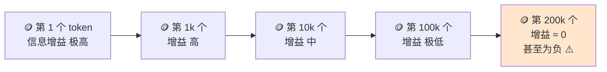

> Prompt Engineering 关心「这句话怎么写」，Context Engineering 关心「模型在第 N 步时，眼前到底有什么」。前者是一次性的措辞问题，后者是**每一轮都要重建的状态问题**——Agent 的质量上限由后者决定。

## 你将学到

1. 从 Prompt Engineering 到 Context Engineering，观念上究竟变了什么
2. Anthropic 在 2025-09 给出的三个核心结论：有限资源 / 边际递减 / Context rot
3. 「Lost in the middle」为什么让**长上下文比短上下文更糟**
4. 上下文退化的量化模型：每步约 2%、5 轮后不足 60%、每约 9 步重新 grounding
5. 「上下文越长越安全」为什么是本领域最贵的幻觉，以及 O(n²) 成本从哪来
6. 四类上下文来源（system / 工具定义 / 历史消息 / 工具结果）各自的裁剪优先级

## 前置要求

本篇**不需要任何新依赖**，但需要先完成：

- 手写第一个 Agent Loop —— 你得先有一个真实运行、会累积消息的循环，才谈得上「管理上下文」
- 停止条件与预算控制 —— token 预算的概念在那里第一次出现

本篇是阶段 3 的**地图**，后面五篇全是它的展开。建议先读完本篇建立坐标系，再往下走。

---

## 一、从 Prompt Engineering 到 Context Engineering

这两个词经常被当成同一个东西的新包装。不是。它们优化的对象、时间尺度和失败模式都不一样：

| | Prompt Engineering | Context Engineering |
|---|---|---|
| 优化对象 | 一次请求里那段文字 | 每一步送给模型的**完整 token 集合** |
| 时间尺度 | 请求之前（静态） | 整个 run 的生命周期，**每轮重建** |
| 主要手段 | 措辞、few-shot、输出格式 | 裁剪、压缩、检索、隔离、外部化 |
| 典型失败模式 | 模型不按格式回答 | 会话变长后模型**慢慢忘记约束** |
| 有效边界 | 单轮任务、一次性问答 | 多轮、长任务、工具密集型任务 |

一句话区分：

> **Prompt 是静态工件 (artifact)，Context 是动态状态 (state)。** 工件写完就固定了，状态需要每一步重新构造。

Anthropic 在《Effective context engineering for AI agents》(2025-09) 里的立场很明确：**prompt engineering 是 context engineering 的一个子集**。单轮任务里子集够用；一旦 agent 开始多轮累积状态，「怎么写 prompt」就不再是瓶颈，「每一步该让模型看到什么」才是。

这个转变有个直接的工程后果：你会开始把上下文当成**有预算的资源**来管，而不是当成「能塞就塞的字符串」。

## 二、三个核心结论

Anthropic 那篇文章把「上下文」这件事收敛成了三句话。

### 2.1 上下文是有限资源，而且有限的是**注意力**不是**容量**

Transformer 的 self-attention 里，每个 token 都要和其它所有 token 计算相关性。这意味着 token 之间在**竞争注意力**。

所以窗口有 200k，不等于你有 200k 的「有效信息容量」。多塞进去的内容会稀释真正重要的内容——它们不是在排队，是在**抢**。

> **上下文窗口是容量，注意力是带宽。容量可以买，带宽不行。**

用带宽这个类比解释两个常见现象：

- 为什么「把整个代码库塞进去」不如「搜出相关的 5 个文件」——不是空间不够，是信号淹了
- 为什么同一个 prompt 在短会话里好用、在长会话里失效——prompt 一个字没变，**带宽被占满了**

### 2.2 边际递减：第 10 万个 token 远没有第 100 个值钱

往上下文里加信息，收益不是线性的：



最后那个「甚至为负」不是修辞。下面两节讲为什么。

### 2.3 Context rot：会话越长，准确率**远早于**触顶就开始下滑

「Context rot」（上下文腐烂）这个词由 Chroma 在 2025-07 的技术报告《Context Rot: How Increasing Input Tokens Impacts LLM Performance》里系统化提出。他们对 **18 个主流模型**做了控制变量实验，结论是：

> 模型能力**不是随上下文长度均匀分布的**。随着输入 token 增加，模型准确回忆和推理这些内容的能力**持续下降**——哪怕任务本身只是简单检索，或者「复述一串重复的词」。

注意最后半句。连「复述重复词」这种不需要任何知识的任务都会退化，说明这**不是知识容量问题，是架构问题**。

#### 为什么以前的基准测试没发现

因为业内长期用 **Needle in a Haystack (NIAH，大海捞针)** 来测长上下文。NIAH 测的是**词面匹配 (lexical matching)**：在一大段文本里找一句原样出现过的话。这太简单了——接近满分让人误以为「长上下文已经被解决了」。

Chroma 的做法是**固定任务复杂度、只变输入长度**，于是「斜坡」显形了。

#### Chroma 的四个反直觉发现

这四个都值得记，因为它们每一个都能直接改变你写 agent 的方式：

| 实验 | 发现 | 对你的影响 |
|---|---|---|
| 问题与针的语义相似度 | 相似度**越低**，退化越快 | 用模糊的自然语言提问时，检索精度要留更大余量 |
| 干扰项 (distractor) | **一个**相关干扰项就掉分，四个会叠加，且长度越长效应越强 | 历史里塞进「看起来相关但其实无关」的内容，比什么都不塞更糟 |
| 针与草堆的相似度 | 针和草堆语义越不像，越容易被找到 | 「突出显示」是有效的——格式、标记、分区都不是装饰 |
| 草堆的结构 | **逻辑连贯、排序整齐的草堆，比打乱的更差** | ⚠️ 最反直觉的一条 |

最后一条需要单独说。我们直觉上认为「条理清晰」有利于模型，实验结论却是相反的：**打乱反而一致地提升了全部 18 个模型的表现**。一个可能的解释是，高度连贯的文本让模型更容易「顺着读下去」而不去定位目标位置。**待验证**：这条结论来自二手转述，且 Chroma 作为向量库厂商在「不要把东西全塞进上下文」这个结论上存在商业利益，读的时候要带着这个意识。

#### 最有工程价值的一条：LongMemEval 实验

在 LongMemEval（对话式问答，约 113k token）上，**所有模型**在「聚焦的约 300 token prompt」上的表现都显著优于「全量 prompt」。

原因很好理解，也是本篇最该记住的一句话：

> 把无关历史一起塞进去，等于强迫模型**同时做检索和推理**。两件事一起做，两件都做不好。

这直接解释了为什么「裁剪」和「检索」这两个看起来「丢信息」的操作，反而能提升准确率。

## 三、Lost in the middle：位置本身就影响可用性

在 context rot 之外，还有一个更早被发现的位置效应。

**Lost in the middle**（Liu et al., 2023, arXiv:2307.03172）的结论是：模型对上下文里信息的利用能力呈 **U 形曲线**——开头和结尾利用率高，中间最差。


这个曲线的三个直接推论：

1. **关键约束放 system prompt 开头是有效的**，不只是「因为它是系统提示」，还因为它处在 U 形的高位
2. **在每轮末尾重新贴一遍关键约束也有效**（这就是「钉住区块」做法的一半理由，见 压缩与摘要策略）
3. **最危险的位置是「中间某轮的历史里」**——你三小时前在对话里说过「不要动 prod 配置」，它可能正好躺在 U 形谷底

把 context rot 和 lost-in-the-middle 叠起来看：**上下文变长，不只是平均质量下降，下降还是不均匀的**。中段的消息最先失效。

## 四、把退化量化：一组工程经验数据

下面是社区里流传的一组经验数字。**先看免责声明**：

> ⚠️ **待验证**：下表全部来自二手转述与工程经验，**没有在本项目的 MiMo (`mimo-v2.5`) 上实测过**。请当作「数量级参考」，不要当成精确公式。数字会随模型换代剧烈变化。

| 指标 | 数值 | 性质 |
|---|---|---|
| 每步上下文有效信息衰减 | 约 2% | 二手经验值 |
| 5 轮对话后原始可用上下文 | 不足 60% | 由上一条推导 |
| 建议重新 grounding 的间隔 | 约 9 步 | 工程建议 |
| NIAH 召回率（< 8k token） | 95%+ | 二手转述 |
| NIAH 召回率（32k token） | 约 78% | 二手转述 |
| NIAH 召回率（100k token） | 关键信息漏检显著上升 | 二手转述 |

**「每约 9 步重新 grounding 一次」是什么意思？** 就是在长任务里，不要指望模型一直记得最初的目标和约束，每隔大约 9 个工具步，主动把这些重新塞回上下文（重述目标、重贴约束、重述当前进度）。这是「钉住区块」和「结构化笔记」两种做法的共同动机。

> 💡 **比具体数字更重要的是曲线的形状。** 如果每步乘 0.98，20 步后只剩 `0.98^20 ≈ 67%`。这是**指数衰减**，不是线性衰减。指数衰减意味着：**你不能等到「快满了」才处理上下文**——等你观察到明显变笨的时候，可用的信息已经掉了一半。

## 五、「上下文越长越安全」——本领域最贵的幻觉

这是阶段 3 最需要拆掉的一个直觉。它的诱惑力在于**短期真的有效**：换个大窗口，报错立刻消失，感觉问题解决了。

它错在四个地方。

### 5.1 Context rot 是斜坡，不是悬崖

窗口溢出会给你一个**明确报错**（400 / context_length_exceeded）。Context rot 不会。它只表现为「答得越来越平庸、越来越不听话」。

> 有报错的问题是好问题。**没有报错的静默退化，才是 agent 最危险的失败模式**——它和阶段 6 讲的「静默失败是最大杀手」是同一件事的两个面。

### 5.2 O(n²)：注意力成本随长度平方增长

self-attention 里，每个 token 和所有 token 算相关性。第 n 步的输入长度是 O(n)，n 步累计是 O(n²)。

| 窗口从 → 到 | 单次调用的注意力规模 | 相对倍数 |
|---|---|---|
| 32k → 200k | 200k² / 32k² | ~39× |
| 32k → 1M | 1M² / 32k² | ~977× |

（这是**注意力计算量**的粗略量级估计，实际实现有各种优化，不等于真实耗时/费用倍数。）

### 5.3 成本是双向的：输入 token 也收费

上下文膨胀 10 倍，**账单涨 10 倍，而质量在下降**。这是唯一一个「花的钱越多、效果越差」的方向。

### 5.4 首 token 延迟

长上下文的首 token 延迟 (TTFT) 显著上升，而且每次调用都要重付一遍（除非命中 prompt cache）。对交互式 agent 来说，体感是「越用越卡」。

### 小结表：把大窗口当解决方案，会发生什么

| 做法 | 短期感受 | 长期后果 |
|---|---|---|
| 32k 窗口 → 200k 窗口 | 报错消失，「修好了」 | Rot 照旧；问题被推迟到更晚、更难定位 |
| 200k → 1M | 同上，更爽 | O(n²) 成本 + TTFT 开始主导账单 |
| 不做裁剪，全量塞历史 | 省了写裁剪逻辑的功夫 | 到第 50 轮时你不敢改任何 prompt，因为不知道会撞到哪 |
| 把大窗口当成记忆系统 | 「模型记得住」 | 见 记忆的四种类型：窗口是易失的 |

> **更大的窗口不是解决方案，只是把同一个问题推迟到后面，并额外加上成本。**

## 六、四类上下文来源与裁剪优先级

一个运行中的 agent，上下文里只有四类东西。它们的性质差别极大：

| 来源 | 典型体积 | 时效性 | 可压缩性 | 裁剪优先级 | 为什么 |
|---|---|---|---|---|---|
| System prompt / 规则 | 小～中 | 全程有效 | **低** | 🔴 最后才动 | 否定指令、格式约束一丢，行为立刻跑偏 |
| 工具定义 (tool schema) | 中 | 全程有效 | 中 | 🟠 谨慎 | 裁工具 = 裁能力；但可以按阶段渐进披露（见阶段 4） |
| 历史消息 | 大 | 中 | **高** | 🟡 优先 | 早期轮次的信息多数已被后续轮次蕴含 |
| 工具结果 | **最大** | 短 | **最高** | 🟢 最先裁 | 一次 `read_file` 可能 5 万 token，3 轮后就没用了 |

看这张表最该注意的规律：

> **裁剪优先级和体积是反着来的。** 最该裁的（工具结果）体积最大，最不该裁的（system prompt / 规则）体积最小。

这在真实实现里造成一个典型的翻车模式：因为 system prompt 小，砍它「不解决问题」；因为工具结果大，砍它「立竿见影」。于是工程上最容易被粗暴处理的就是工具结果——而工具结果一旦被砍，就产生了畸形消息序列，provider 直接 400。这条链子完整展开在 历史裁剪与边界吸附。

### Anthropic 的一条具体建议：tool-result clearing

文章里点出了一个「最安全、最轻的一刀」：**tool-result clearing**。

做法是把工具结果的正文清空，替换成一句「已读取 <文件名>，内容略」，但**保留 tool_call / tool_result 的配对关系不动**。

- 不破坏消息结构 → provider 不会拒绝
- 一次性砍掉 80%+ 体积
- 代价是模型失去了内容，但它**知道「我读过这个文件」**——很多情况下这就够了

这个技巧介于「裁剪」和「压缩」之间，本篇先记名字，具体实现放在 03。

## 七、一次 agent run 里，上下文到底怎么长

### 增长曲线```mermaidgraph LR
    S0["🟢 step 0<br/>system + tools<br/>≈ 2k"] --> S1["step 1<br/>+user +assistant +tool<br/>≈ 5k"]
    S1 --> S2["step 2<br/>+tool +assistant +tool<br/>≈ 12k"]
    S2 --> S3["step 3<br/>≈ 22k"]
    S3 --> S4["step 4<br/>≈ 35k"]
    S4 --> C["✂️ compaction 触发<br/>contextTokens > window − reserve"]
    C --> S5["重建后<br/>system + summary + 近 N 条<br/>≈ 18k"]
    S5 --> S6["step 6<br/>≈ 28k"]
    S6 --> S7["step 7<br/>≈ 41k"]
    style C fill:#ffe6cc
    style S0 fill:#e6f5e6
```

注意它不是一条持续上升的线，而是一条**锯齿**：

```
tokens
 45k │                    ╱╲
 40k │                   ╱  ╲              ╱
 35k │              ╱╲  ╱    ╲            ╱
 30k │             ╱  ╲╱      ╲          ╱
 25k │            ╱            ╲        ╱
 20k │           ╱              ╲      ╱
 15k │      ╱╲  ╱                ╲    ╱
 10k │     ╱  ╲╱                  ╲  ╱
  5k │  ╱╲╱                        ╲╱
  2k │ ╱
     └──────────────────────────────────────► 时间 / 步数
        step0  1  2  3  4  ✂️  5  6  7  ✂️  8
                          compaction
```

**这个形状是整章的结论**：

> 上下文工程的目标**不是「让它不涨」**（不可能，工具结果必然越积越多），**而是控制锯齿的上界**——保证「锯齿顶端」永远留在模型的有效工作区间内。

两条设计准则由它直接推出：

1. **触发要早于溢出**（几何阈值，留出 reserve）—— 见 03
2. **下降不能掉关键信息**（摘要而非截断）—— 见 03、04

## 八、上下文工程的五个动作

后面五篇笔记，本质是把这张表逐个展开：

| 动作 | 一句话 | 什么时候用 | 代价 | 展开在哪 |
|---|---|---|---|---|
| **裁剪 (trim)** | 丢掉旧的，保留近的 | 只需要短期连贯性 | 长程信息直接丢 | 02 历史裁剪 |
| **压缩 (compaction)** | 把旧的变成摘要 | 需要保留长程决策 | 摘要会丢细节、丢数值 | 03 压缩策略 |
| **外部化 (externalize)** | 写进文件 / 笔记 / 记忆 | 要跨会话延续 | 需要设计写入与召回 | 04 记忆类型 |
| **检索 (retrieval)** | 需要时再取，不预加载 | 知识量大但命中稀疏 | 慢；依赖检索质量 | 05 长期记忆 |
| **隔离 (isolation)** | 塞进子 agent 的干净窗口 | 探索型子任务 | 多一层通信损耗 | 阶段 5 |

关于**预加载 vs 即时检索 (just-in-time retrieval)** 的权衡，Anthropic 的说法值得完整记下：

> 不要预加载所有数据。让 agent 持有**轻量标识符**（文件路径、URL、存储的查询语句），在运行时用工具按需取回。这带来**渐进披露 (progressive disclosure)** —— agent 逐步发现相关上下文，像人查资料一样。

代价是运行时的探索更慢，而且对工具的「可发现性」设计（阶段 4 的 ACI）要求更高。

多数 agent 的正确姿势是**混合**：轻量标识符预加载（快），重内容按需取（省）。

## ✅ 学习检查点

- [ ] 能说清 Prompt Engineering 和 Context Engineering 在**优化对象**和**时间尺度**上的区别
- [ ] 能解释「上下文窗口是容量，注意力是带宽」这句话
- [ ] 能复述 context rot 的核心结论，并说明 NIAH 为什么没能发现它
- [ ] 能说出 Chroma 四个反直觉发现中**最颠覆直觉**的那一个
- [ ] 能解释 LongMemEval 实验为什么说明「检索 + 推理同时做会更差」
- [ ] 能画出 lost-in-the-middle 的 U 形曲线，并说出它推翻了哪个常见做法
- [ ] 能说出「9 步重新 grounding」是解决什么问题的
- [ ] 能列出「上下文越长越安全」的四个错误理由
- [ ] 能画出一次 agent run 的锯齿形上下文增长曲线，并说出设计目标是什么
- [ ] 不看表能说出四类上下文来源的裁剪优先级，并解释为什么优先级和体积成反比

## 📖 相关文档

- [Effective context engineering for AI agents — Anthropic](https://www.anthropic.com/engineering/effective-context-engineering-for-ai-agents) — 本篇核心结论的来源，2025-09-29 发布，必读原文
- [Context Rot: How Increasing Input Tokens Impacts LLM Performance — Chroma](https://research.trychroma.com/context-rot) — 18 个模型的受控实验，context rot 的系统化来源；注意厂商立场
- [Lost in the Middle: How Language Models Use Long Contexts](https://arxiv.org/abs/2307.03172) — Liu et al. 2023，U 形曲线的原始论文
- [Building Effective Agents — Anthropic](https://www.anthropic.com/engineering/building-effective-agents) — 与本文同源的工程实践篇，讲「从最简单的方案开始」
- [earendil-works/pi](https://github.com/earendil-works/pi) — 本路线反复拆解的参考实现，阶段 3 会大量引用其 compaction 源码

> 📌 事实性说明：本篇引用的 star 数、语料数字均为**二手来源**；Chroma 报告的具体数值来自第三方转述，核对日期 2026-09。本机无法直连 `github.com`，链接的可用性以 `raw.githubusercontent.com` 为准。

## ➡️ 下一步→ 历史裁剪与边界吸附
