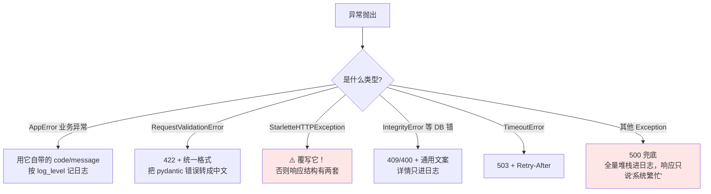
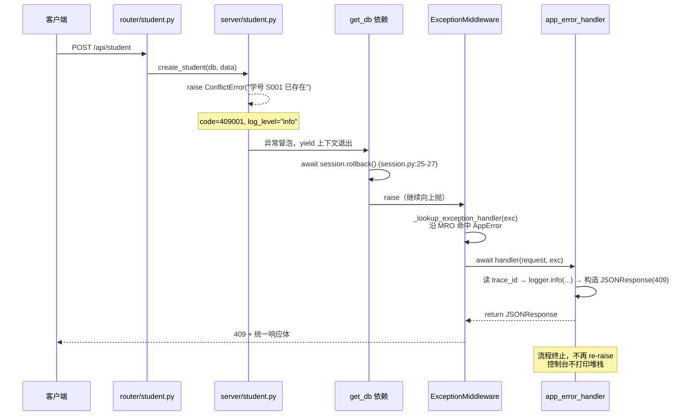

上级：00-首页 · 相关：全局异常处理 · Q-05-工程化实践清单 · Q-06-企业级技术体系全景

> **❓ 问题：原始问题**
> 「企业的工程化处理异常的方法是怎么的」

> **ℹ️ 信息：一句话结论**
> 企业处理异常**不是写更多 `try/except`，而是把异常当成一条流水线来设计**：
> **分类 → 抛出 → 拦截 → 记录 → 转换 → 响应 → 告警**，
> 每一环有唯一负责人，业务代码只负责「抛」，边界只负责「转」。
>
> 你现在只有一个 `core/exceptions.py`（约 8 行）承担了「拦截 + 转换 + 响应」三件事，
> **分类、记录、告警三环是空的** —— 这就是和企业的差距所在，
> 而不是"代码写得太简单"。

---

## 🧭 一、先给结论：企业版的六层模型
```
    A["① 定义层<br/>错误码表 + 异常类体系"] --> B["② 抛出层<br/>业务代码 raise，绝不 catch"]
    B --> C["③ 事务边界<br/>rollback 后继续向上抛"]
    C --> D["④ 拦截层<br/>全局处理器按类型分派"]
    D --> E["⑤ 记录层<br/>logger + trace_id + 脱敏"]
    E --> F["⑥ 响应/告警层<br/>统一响应体 → 前端 / Sentry"]

    style A fill:#e3f2fd
    style B fill:#e3f2fd
    style C fill:#fff3e0
    style D fill:#c8e6c9
    style E fill:#ffe6e6
    style F fill:#f3e5f5
```

| 层       | 谁负责                  | 你的项目现状                                                          |
| :------ | :------------------- | :-------------------------------------------------------------- |
| ① 定义    | 团队约定的错误码表 + 异常基类     | ❌ 没有，直接用 `HTTPException` + 硬编码中文                                |
| ② 抛出    | 业务/service 层         | ✅ 已做，`server/*.py` 抛得很规范                                        |
| ③ 事务    | DB 会话依赖              | ✅ 已做，`db/session.py:25-27` 有 rollback（有小瑕疵，见 §4.4）              |
| ④ 拦截    | 全局 exception_handler | 🟡 只有一个 `Exception` 兜底，**不分类型**                                 |
| ⑤ 记录    | 日志系统                 | ❌ **全项目零日志**（`grep logging` 只在 `seed_data.py` 出现，还是用来关 SQL 日志的） |
| ⑥ 响应/告警 | 统一响应体 + Sentry       | 🟡 响应有包装但**泄漏内部信息**；❌ 无告警                                       |

> **📝 说明：最重要的一句话**
> **企业工程化的核心动作只有一个：把「异常」变成「可分类、可追踪、可告警的数据」。**
> 其余都是这句话的实现细节。

---

## 📌 二、逐个拆：企业到底怎么做

### 2.1 定义层：自定义异常 + 错误码

**你现在的问题**（可指向源码）：`server/student.py:12`

```python
raise HTTPException(status_code=status.HTTP_409_CONFLICT, detail=f"学号 {data.student_id} 已存在")
```

三个工程化隐患：

| 隐患              | 说明                                                                                            |
| :-------------- | :-------------------------------------------------------------------------------------------- |
| 🔴 业务层依赖 Web 框架 | `server/` 里 `from fastapi import HTTPException`。将来要写定时任务 / 消费者复用这层逻辑时，抛出 `HTTPException` 毫无意义 |
| 🔴 前端只能靠中文文案判断  | `detail` 是给人看的字符串，前端**没法可靠地做分支**（改一个字前端就挂）                                                    |
| 🔴 无法国际化 / 无法统计 | 没有稳定的错误码，日志里没法按错误类型聚合告警                                                                       |

**企业做法**：定义一棵异常树 + 一张错误码表。

```python
# core/errors.py —— 业务层只依赖这个文件，不依赖 fastapi
from enum import IntEnum


class ErrorCode(IntEnum):
    """错误码规范：{HTTP状态码}{3位业务序号}，全局唯一、只增不改。"""
    # 400 参数
    PARAM_INVALID      = 400001
    # 401 认证
    TOKEN_MISSING      = 401001
    TOKEN_EXPIRED      = 401002
    TOKEN_INVALID      = 401003
    LOGIN_FAILED       = 401004
    # 403 权限
    PERMISSION_DENIED  = 403001
    # 404 资源
    STUDENT_NOT_FOUND  = 404001
    COURSE_NOT_FOUND   = 404002
    SCORE_NOT_FOUND    = 404003
    # 409 冲突
    STUDENT_EXISTS     = 409001
    COURSE_EXISTS      = 409002
    SCORE_EXISTS       = 409003
    # 500 系统
    INTERNAL_ERROR     = 500001
    DB_ERROR           = 500002


class AppError(Exception):
    """所有业务异常的基类。子类只需覆盖 code，http_status 自动推导。"""

    code: ErrorCode = ErrorCode.INTERNAL_ERROR
    message: str = "服务器内部错误，请稍后重试"

    def __init__(self, message: str | None = None, *, log_level: str = "error"):
        self.message = message or self.message
        self.log_level = log_level
        super().__init__(self.message)

    @property
    def http_status(self) -> int:
        # 400001 → 400，401002 → 401：从错误码前三位直接推导，不用手写
        return int(str(self.code)[:3])


# ---- 按语义分类的子类，业务代码尽量抛这些 ----
class NotFoundError(AppError):     code = ErrorCode.STUDENT_NOT_FOUND; message = "资源不存在"; log_level = "info"
class ConflictError(AppError):     code = ErrorCode.STUDENT_EXISTS;     message = "资源已存在"; log_level = "info"
class ValidationError(AppError):   code = ErrorCode.PARAM_INVALID;      message = "参数不合法"; log_level = "info"
class AuthError(AppError):         code = ErrorCode.LOGIN_FAILED;       message = "认证失败";   log_level = "info"
class ExternalServiceError(AppError): code = ErrorCode.DB_ERROR;        message = "依赖服务异常"; log_level = "error"
```

调用方从此变成：

```python
# 业务层，零 fastapi 依赖
raise ConflictError(f"学号 {data.student_id} 已存在")
# 更细：让子类带上具体错误码
raise NotFoundError(f"学生 {student_id} 不存在")
```

> **💡 提示：`log_level` 是容易被忽略但很值钱的设计**
> **「用户输入错」和「系统坏了」必须用不同级别记录**：
> - 404 / 409 / 401 → `info` 或 `warning`（正常业务流转，不该告警）
> - 500 / DB 错误 → `error` + 触发告警
>
> 不分级的话，线上 `ERROR` 日志会被用户的错误输入刷屏，真正的故障被淹没。

---

### 2.2 抛出层：业务代码只抛，绝不吞

**企业铁律**（这几条能挡住 90% 的线上事故）：

```python
# ❌ 反模式 1：吞掉异常，返回 None，让调用方在几百行之外炸掉try:
    do_something()
except Exception:
    pass

# ❌ 反模式 2：把异常转成字符串再抛，堆栈全丢
except Exception as e:
    raise Exception(str(e))          # ← 原始 traceback 从这里断裂

# ❌ 反模式 3：用 HTTPException 包装所有异常，把内部信息当 detail
except Exception as e:
    raise HTTPException(500, detail=str(e))   # 就是你现在 core/exceptions.py 干的事

# ❌ 反模式 4：裸 except（捕获 BaseException，连 Ctrl+C 都吃）
except:                              # ← 你的 utils/password.py:9 就是这个
    return False

# ✅ 正确：能处理的才 catch，处理不了直接放行try:
    await send_email(...)
except SMTPException as e:           # 只捕预期内的类型
    logger.warning("邮件发送失败，已忽略: %s", e)   # 记下来，但要说明为什么可以忽略
```

> **⚠️ 注意：「能处理的才 catch」的判定标准**
> 问自己三个问题，**有一个答不上来就别 catch**：
> 1. 我知道这个异常为什么发生吗？
> 2. 我 catch 之后要做什么**有意义的补救**？
> 3. 补救失败了我还能交代清楚吗？
>
> 答不上来 → 让它往上冒，交给全局处理器。

**你项目里做对的地方**：`server/score.py:10-13` 先查存在性再插，抛出的是**有业务含义**的异常，而不是让 MySQL 报错。这才是正确的姿势。

---

### 2.3 拦截层：全局处理器要「按类型分派」

**你现在只有这一个**（`core/exceptions.py:4-8`）：

```python
@app.exception_handler(Exception)          # ← 只兜住"其他"，不分类型
async def global_exception_handler(request: Request, exception: Exception):
    return JSONResponse(status_code=500,
        content={"code": 500, "msg": f"服务器异常:{str(exception)}", "data": None})
```

企业会注册**一组**处理器，各管一段：



> **📝 说明：最关键的一招：覆写 `StarletteHTTPException` 的处理器**
> 这就是你现在**响应结构有两套**（`{"detail": ...}` vs `{"code","msg","data"}`）的根因。
> FastAPI 内置的处理器优先级更高，所以你自己的 `Exception` 处理器拦不到 `HTTPException`。
> 解法是**显式注册 `StarletteHTTPException` 的处理器**，把两套格式合并成一套：
>
```
> from starlette.exceptions import HTTPException as StarletteHTTPException
> app.add_exception_handler(StarletteHTTPException, http_exception_handler)
>
```
> 详见 全局异常处理 · 接口总览。

---

### 2.4 记录层：日志 + trace_id（企业真正的分水岭）

> **🚫 危险：先纠正一个认知误区**
> 你的笔记 全局异常处理 里写「异常被捕获后直接吞掉，控制台什么都没留下」——
> **这句话不准确**。查源码可知（2026-09-13 读依赖源码确认，未实跑）：
>
> - `.venv/.../starlette/middleware/errors.py:183-186`：
>
```
>   # We always continue to raise the exception.
>   # This allows servers to log the error ...
>   raise exc
>
```
>   Starlette 在处理完之后**总是把异常重新抛出去**，就是为了让服务器能记日志。
> - `.venv/.../uvicorn/protocols/http/h11_impl.py:420`：uvicorn 接住后打印
>   `"Exception in ASGI application"` + 完整堆栈。
>
> **所以你的控制台其实是有堆栈的。** 但差距仍然巨大，因为：
> 那是**uvicorn 的兜底输出**，不是**你的应用日志**——
> 没有结构化字段、没有 trace_id、不落盘、不能检索、不能告警、不能采样。
> 生产上 uvicorn 通常以 `--log-config` 静音或跑在容器里，
> 那时这条堆栈就真的**没有人看得到**了。

**企业要的是**：

```python
import logging
logger = logging.getLogger(__name__)

@app.exception_handler(AppError)
async def app_error_handler(request: Request, exc: AppError):
    # 一条日志至少带这五样：时间、级别、trace_id、错误码、请求上下文
    getattr(logger, exc.log_level)(
        "业务异常 code=%s path=%s method=%s",
        exc.code, request.url.path, request.method,
        extra={"trace_id": request.state.trace_id, "error_code": int(exc.code)},
        exc_info=exc.log_level == "error",   # 只有真故障才打堆栈
    )
    return JSONResponse(status_code=exc.http_status,
        content={"code": int(exc.code), "msg": exc.message, "data": None,
                 "trace_id": request.state.trace_id})   # ← 给用户的排查凭证
```

**trace_id 是灵魂**：给每个请求分配一个 ID，响应里返回、日志里带上。
用户报障时截图里有 `trace_id`，你一条查询就能捞出这个请求的**全部日志**。

```python
# core/middleware.py —— 一个 30 行的中间件，价值极高import uuid
from contextvars import ContextVar

trace_id_ctx: ContextVar[str] = ContextVar("trace_id", default="-")

class TraceIdMiddleware:
    def __init__(self, app): self.app = app
	
    async def __call__(self, scope, receive, send):
        if scope["type"] != "http":
            return await self.app(scope, receive, send)
        # 优先复用上游（Nginx / 网关）传下来的，实现全链路贯穿
        headers = dict(scope["headers"])
        trace_id = headers.get(b"x-trace-id", b"").decode() or uuid.uuid4().hex[:16]
        trace_id_ctx.set(trace_id)
        # ⚠️ 必须用 setdefault：scope 是个 dict，getattr(scope, "state", {}) 永远返回 {}
        #    会把你前面中间件写进 state 的东西整个覆盖掉
        scope.setdefault("state", {})["trace_id"] = trace_id
        await self.app(scope, receive, send)
```

> **💡 提示：日志格式要选「结构化」**
> `logging.Formatter` 输出的纯文本在 ELK / Loki 里要靠正则解析，**很脆**。
> 企业一般用 `python-json-logger` 输出 JSON，一行一条，字段直接可查：
>
```
> {"time":"2026-09-13T10:00:00Z","level":"ERROR","trace_id":"a1b2c3",
>  "error_code":500002,"path":"/api/score","msg":"...","exc_info":"..."}
>
```

---

### 2.5 事务边界：rollback 之后必须继续抛

你已经做对了（`db/session.py:20-29`）：

```python
async def get_db() -> AsyncSession:
    async with AsyncSessionLocal() as session:
        try:
            yield session
            await session.commit()
        except Exception as e:
            await session.rollback()
            raise e            # ✅ 回滚后继续抛，否则异常被"吃掉"，接口返回 200
        finally:
            await session.close()
```

企业级的三个补充点：

| #   | 点                     | 说明                                                                                                                                                                                                  |
| :-- | :-------------------- | :-------------------------------------------------------------------------------------------------------------------------------------------------------------------------------------------------- |
| 1   | `raise e` → 写 `raise` | `raise`（裸）保留原始 traceback；`raise e` 会往堆栈里**多插一帧** `get_db`，排查时容易看花眼。功能等价，属洁癖级改进                                                                                                                      |
| 2   | **事务边界必须唯一**          | 你现在 service 层 `await db.commit()`（`server/score.py:20`）**和** `get_db` 也 commit —— 双重提交（待办与已知问题 #11）。更严重的是：**service 提前 commit 后，再抛异常，rollback 已经救不回来了**。企业做法：service 只 `flush()`，commit 统一交给依赖层 |
| 3   | 部分失败要「整体回滚」           | 如「录成绩 + 扣学分」两步写库，必须同一事务                                                                                                                                                                             |

> **⚠️ 注意：这条是你现在最可能踩到的隐性 bug**
> `server/score.py:create_score` 里 `db.add()` → `await db.commit()` 之后才 `db.refresh()`。
> 如果 `refresh` 抛异常，**数据已经落库了**，但前端收到 500 —— 用户重试就会撞 409。
> 修法：service 层去掉 `commit()`，靠 `get_db` 统一提交。

---

### 2.6 脱敏：对外一句话，对内全堆栈

这是**安全红线**，也是你最该马上改的一条（待办与已知问题 #3）。

```python
# ❌ 现状：f"服务器异常:{str(exception)}"
# 实测会返回给前端的内容（from 全局异常处理 笔记）：
#   服务器异常:(pymysql.err.IntegrityError) (1452, 'Cannot add or update a child row:
#   a foreign key constraint fails (`school_db`.`scores`, CONSTRAINT `fk_scores_student` ...)'
#   → 库名 school_db、表名 scores、外键名 fk_scores_student 全部泄漏
```

| 信息                | 进响应？      | 进日志？       |
| :---------------- | :-------- | :--------- |
| 错误码 + 用户可读文案      | ✅         | ✅          |
| trace_id          | ✅         | ✅          |
| 请求路径 / 方法 / 用户 ID | ❌         | ✅          |
| 原始异常类型 + 堆栈       | ❌ **绝对不** | ✅          |
| SQL 语句 / 表名列名     | ❌ **绝对不** | ✅（且生产建议脱参） |
| 参数值（密码、身份证）       | ❌         | ❌（必须过滤）    |

用环境变量控制详细程度，而不是靠人肉纪律：

```python
IS_DEV = settings.ENV == "development"      # core/config.py:4 已有 ENV 字段 ✅

content = {"code": 500001, "msg": "系统繁忙，请稍后重试", "data": None,
           "trace_id": tid}
if IS_DEV:
    content["debug"] = f"{type(exc).__name__}: {exc}"    # 只有开发环境才给
```

> **💡 提示：顺带一提：`settings.ENV` 你已经有了**
> `core/config.py:4` 定义了 `ENV: str = 'development'`，
> 但**全项目没人用它**。`db/session.py:7` 的 `echo=True` 也该接上它（待办与已知问题 #10）。
> 一个字段同时解决两件事，性价比很高。

---

### 2.7 重试 / 降级 / 熔断：只给「幂等的、外部的」调用

> **⚠️ 注意：别乱重试**
> **只有满足这两条的才加重试**：① 幂等（重试不会产生副作用）；② 失败是瞬时的（网络抖动、锁超时）。
> **写库操作、非幂等接口、参数错误（4xx）一律不重试**。

```python
# 企业常用：tenacity 做指数退避
from tenacity import retry, stop_after_attempt, wait_exponential, retry_if_exception_type

@retry(stop=stop_after_attempt(3),
       wait=wait_exponential(multiplier=0.5, max=5),
       retry=retry_if_exception_type((TimeoutError, ConnectionError)))
async def call_third_party_api(...): ...
```

三个配套概念：

| 模式                     | 作用                  | 场景              |
| :--------------------- | :------------------ | :-------------- |
| **重试 Retry**           | 瞬时故障自愈              | 调第三方 API 超时     |
| **降级 Fallback**        | 主逻辑失败时给次优结果         | 推荐服务挂了 → 返回热门榜单 |
| **熔断 Circuit Breaker** | 连续失败后**直接快速失败**，别再打 | 下游挂了，避免线程池被拖死   |

> **📝 说明：熔断的价值**
> 下游服务宕机时，**没有熔断**会导致你的线程全部阻塞在等它超时上，
> 于是你也挂了 —— 这就是「雪崩」。熔断器连续失败 N 次后直接返回错误，
> 保护的是**你自己**。

---

### 2.8 响应层：统一响应体 + 前端拦截器（前后端是一套）

企业里异常处理是**前后端约定**，不是后端独角戏：

```js
// 前端 axios 拦截器：与后端统一响应体一一对应
axios.interceptors.response.use(
  (res) => {
    const { code, msg, data, trace_id } = res.data
    if (code !== 200) {
      toast(msg)
      console.error(`[${trace_id}] ${code}`)   // 用户截图就能报障
      return Promise.reject(res.data)
    }
    return data
  },
  (err) => {
    const { status, data } = err.response || {}
    if (status === 401) return router.push('/login')   // 认证失败 → 统一跳登录
    if (status >= 500) toast(`系统繁忙 (${data?.trace_id ?? '-'})`)
    else toast(data?.msg ?? data?.detail ?? '请求失败')
    return Promise.reject(err)
  }
)
```

> **📝 说明：前端不要自己拼错误文案**
> 前端只做**三件事**：按 `code` 分支、按 `status` 跳转、把 `trace_id` 展示出来。
> 文案一律来自后端 `msg` —— 否则每次改提示都要发一次前端版本。

---

### 2.9 观测层：错误率告警（企业区别于个人项目的终极标志）

个人项目：**出故障 → 用户告诉你**。
企业项目：**出故障 → 监控系统先告诉你**。

| 工具 | 作用 |
| :--- | :--- |
| **Sentry** | 异常自动上报、聚合去重、带堆栈和上下文、按影响用户数排序 |
| **OpenTelemetry** | 全链路 tracing，一个请求跨多个服务能串起来 |
| **Prometheus + Grafana** | 指标看板：`http_errors_total{code="500"}` 错误率曲线 |
| **告警规则** | 「5 分钟内 5xx 占比 > 1% 且请求数 > 100」→ 电话/钉钉告警 |

> **💡 提示：为什么 Sentry 比日志强**
> 日志是**流水**，你得先知道去哪找；
> Sentry 是**按异常指纹聚合**的：同一个 bug 发生 1 万次只算 1 个 issue，
> 并告诉你「影响了 300 个用户，首次出现于 v1.2.3 发布后 3 分钟」。
> 排查效率差一个数量级。

---

## 💻 三、可落地的完整版（照着改就行）

> **⚠️ 注意：以下代码**尚未写入项目源码**（遵循「只写 obsidian」约定）。**
> 要用的话你确认后我再动代码。

**`core/exceptions.py` 企业版雏形**：

```python
import logging
from fastapi import FastAPI, Request
from fastapi.exceptions import RequestValidationError
from fastapi.responses import JSONResponse
from sqlalchemy.exc import IntegrityError, SQLAlchemyError
from starlette.exceptions import HTTPException as StarletteHTTPException

from core.config import settings
from core.errors import AppError

logger = logging.getLogger(__name__)
IS_DEV = settings.ENV == "development"


def _body(code: int, msg: str, tid: str, debug: str | None = None) -> dict:
    """统一的响应体，唯一出口。"""
    body = {"code": code, "msg": msg, "data": None, "trace_id": tid}
    if IS_DEV and debug:
        body["debug"] = debug
    return body


def register_exception_handler(app: FastAPI):

    @app.exception_handler(AppError)
    async def app_error_handler(request: Request, exc: AppError):
        tid = getattr(request.state, "trace_id", "-")
        # 业务异常不告警，用 info/warning 级别
        getattr(logger, exc.log_level)(
            "业务异常 code=%s %s %s", int(exc.code), request.method, request.url.path,
            extra={"trace_id": tid, "error_code": int(exc.code)},
        )
        return JSONResponse(status_code=exc.http_status,
                            content=_body(int(exc.code), exc.message, tid))

    @app.exception_handler(StarletteHTTPException)
    async def http_exception_handler(request: Request, exc: StarletteHTTPException):
        """覆写内置处理器 → 消灭「两套响应结构」。"""
        tid = getattr(request.state, "trace_id", "-")
        logger.info("HTTP 异常 status=%s %s %s", exc.status_code, request.method, request.url.path,
                    extra={"trace_id": tid})
        return JSONResponse(status_code=exc.status_code,
                            content=_body(exc.status_code * 1000, str(exc.detail), tid),
                            headers=getattr(exc, "headers", None))

    @app.exception_handler(RequestValidationError)
    async def validation_handler(request: Request, exc: RequestValidationError):
        """把 pydantic 的英文错误压成一句人话。"""
        tid = getattr(request.state, "trace_id", "-")
        first = exc.errors()[0] if exc.errors() else {}
        field = ".".join(str(p) for p in first.get("loc", [])[1:]) or "参数"
        logger.info("参数校验失败 %s: %s", request.url.path, exc.errors(),
                    extra={"trace_id": tid})
        return JSONResponse(status_code=422,
                            content=_body(400001, f"参数 {field} 不合法", tid))

    @app.exception_handler(IntegrityError)
    async def integrity_handler(request: Request, exc: IntegrityError):
        """数据库约束 → 409，MySQL 原文只进日志。"""
        tid = getattr(request.state, "trace_id", "-")
        logger.warning("数据完整性错误: %s %s", request.method, request.url.path,
                       exc_info=exc, extra={"trace_id": tid})
        return JSONResponse(status_code=409,
                            content=_body(409001, "数据关联错误，请检查引用的记录是否存在", tid))

    @app.exception_handler(SQLAlchemyError)
    async def db_error_handler(request: Request, exc: SQLAlchemyError):
        tid = getattr(request.state, "trace_id", "-")
        logger.exception("数据库异常 %s %s", request.method, request.url.path,
                         extra={"trace_id": tid})
        return JSONResponse(status_code=500, content=_body(500002, "系统繁忙，请稍后重试", tid))

    @app.exception_handler(Exception)
    async def global_exception_handler(request: Request, exc: Exception):
        tid = getattr(request.state, "trace_id", "-")
        logger.exception("未处理异常 %s %s", request.method, request.url.path,
                         extra={"trace_id": tid})          # 全堆栈只进日志
        return JSONResponse(status_code=500,
                            content=_body(500001, "系统繁忙，请稍后重试", tid, debug=str(exc)))
```

**注册顺序无所谓**：Starlette 按异常的 **MRO（方法解析顺序）** 找最匹配的处理器，
`IntegrityError` 会命中 `integrity_handler` 而不是 `Exception` 兜底，不需要调顺序。

**`main.py` 里的接入**：

```python
app.add_middleware(TraceIdMiddleware)        # ⚠️ 中间件是"后加的先执行"，注意与你现有 CORS 的顺序
register_exception_handler(app)
```

---

### 3.1 逐行拆解：`app_error_handler` 的完整流程

先把要拆的这段单独拎出来（就是上面 `register_exception_handler` 里的第一个处理器）：

```python
@app.exception_handler(AppError)                        # ① 注册（只是登记，不执行任何逻辑）
async def app_error_handler(request: Request, exc: AppError):
    tid = getattr(request.state, "trace_id", "-")       # ② 取链路 ID（带兜底）
    getattr(logger, exc.log_level)(                     # ③ 动态选日志级别
        "业务异常 code=%s %s %s",                        # ④ 惰性格式化的模板
        int(exc.code), request.method, request.url.path, #    占位符的参数
        extra={"trace_id": tid, "error_code": int(exc.code)},  # ⑤ 结构化字段
    )
    return JSONResponse(status_code=exc.http_status,    # ⑥ 状态码：从错误码前 3 位推导
                        content=_body(int(exc.code), exc.message, tid))  # ⑦ 统一响应体
```

#### 第一步：这个函数是**谁**调用的？——① 注册的真相

`@app.exception_handler(AppError)` 这个装饰器**不改变函数行为**，它只做一件事：把 `(AppError, 函数对象)` 塞进 `app.exception_handlers` 这个字典。

然后 `build_middleware_stack()` 按 **key 是不是 `Exception`/`500`** 把这张表**一分为二**（`.venv/.../fastapi/applications.py:1024-1040`，已读源码确认）：

```python
for key, value in self.exception_handlers.items():
    if key in (500, Exception):
        error_handler = value            # ← 你现有的兜底处理器走这里
    else:
        exception_handlers[key] = value  # ← AppError 处理器走这里

middleware = (
    [Middleware(ServerErrorMiddleware,  handler=error_handler, ...)]   # 最外层
    + self.user_middleware                                             # ← TraceId / CORS
    + [Middleware(ExceptionMiddleware,    handlers=exception_handlers, ...)]  # 最内层
)
```

> **📝 说明：从这个分发规则能推出三个结论**
> 1. **`AppError` 的处理器由 `ExceptionMiddleware` 调用，不走 `ServerErrorMiddleware`**，
>    所以它**不会**触发 uvicorn 打印 `Exception in ASGI application`，也**不会**在响应发出后被重新抛出。
>    只有注册在 `Exception` 上的那个兜底处理器才会（见 §2.4、§3.1 最后一步）。
> 2. **用户中间件夹在两者之间**：`ServerError → 你的中间件 → ExceptionMiddleware`。
>    这正好保证了 `TraceIdMiddleware` 写的 `scope["state"]["trace_id"]`，
>    在**最内层**运行异常处理器时**一定已经就位** —— 这是第 ② 行能取到值的根本原因。
> 3. 反过来，**你自定义中间件自己抛的异常，注册的处理器是接不住的**（它在 `ExceptionMiddleware` 的外面），
>    只能落到 `Exception` 兜底。所以中间件里的代码要格外小心。

#### 第二步：从一堆处理器里怎么就挑中了它？——MRO 查找

`.venv/.../starlette/_exception_handler.py:16-20`：

```python
def _lookup_exception_handler(exc_handlers, exc):
    for cls in type(exc).__mro__:      # ← 沿着类的继承链一层层找
        if cls in exc_handlers:
            return exc_handlers[cls]
    return None
```

业务层抛的是 `ConflictError`，它的 `__mro__` 是：

```
(ConflictError, AppError, Exception, BaseException, object)
      ↑ 没注册        ↑ 命中！
```

一路找到 `AppError` 注册的处理器。**这就是「注册顺序无所谓」的原理** ——
查找靠的是继承链，不是注册先后。

> **📝 说明：顺带解释了另一个常见困惑**
> `_lookup_exception_handler` 返回 `None` 时，`wrap_app_handling_exceptions` 会 `raise exc`
> （`_exception_handler.py:50-53`）—— **没写处理器的异常会继续往上冒**，
> 最终由 `ServerErrorMiddleware` 的兜底接管。异常不会凭空消失。

#### 第三步：两个参数从哪来？——② 之前的前置知识

| 参数 | 来源 | 关键点 |
| :--- | :--- | :--- |
| `request: Request` | `ExceptionMiddleware.__call__` 里 **现场构造**：`conn = Request(scope, receive, send)`（`middleware/exceptions.py:59`） | 它是**同一个请求的轻量视图**，不是新对象。所以中间件写进 `scope` 的东西它都能读到 |
| `exc: AppError` | 就是业务层 `raise ConflictError(...)` 抛出的**那个实例本身** | 一路冒泡没有被复制或包装，所以 `exc.code` / `exc.message` / `exc.log_level` 原封不动都在 |

#### 第四步：逐行拆

**② `tid = getattr(request.state, "trace_id", "-")`**

```python
# request.state 的真身（starlette/requests.py:189-195）
self.scope.setdefault("state", {})
self._state = State(self.scope["state"])
```

即 `request.state` 是 `scope["state"]` 这**同一个 dict** 的包装 —— 所以 `TraceIdMiddleware` 往里写、处理器往外读，走的是同一份数据。

- **为什么必须用 `getattr(..., "-")` 带默认值**：`State.__getattr__` 取不到属性会**抛 `AttributeError`**。
  直接写 `request.state.trace_id`，在「中间件没生效」或「非 HTTP 场景」下会让处理器自己炸。
- **为什么兜底是 `"-"` 而不是空串**：让日志里明确显示「这里没取到」，而不是看起来像正常值。
- **为什么不用 `request.headers.get("x-trace-id")` 兜底**：那是**客户端传进来的**，可能不存在也可能被伪造；
  `scope["state"]` 里的是**服务端权威值**，两者语义不同。

**③ `getattr(logger, exc.log_level)(...)`**

`log_level` 是 §2.1 里在 `AppError` 上定义的类属性，于是这一句等价于一个查表：

| `exc.log_level` | 实际调用 | 场景 |
| :--- | :--- | :--- |
| `"info"` | `logger.info(...)` | `ConflictError`（409 学号重复）——**不告警** |
| `"warning"` | `logger.warning(...)` | 数据库约束冲突 |
| `"error"` | `logger.error(...)` | `ExternalServiceError` —— 触发告警 |

> **🚫 危险：这里藏着一个「异常处理器自己抛异常」的风险**
> `getattr(logger, "INFO")`（大小写写错）会抛 **`AttributeError`**，
> 而这个异常**发生在异常处理器内部** —— 这是最难排查的一类故障，
> 用户看到的是 500，但日志里什么都没记下来（因为日志本身就是崩的那一步）。
>
> 企业做法有两层防护：
>
```
> # 防护 1：用 Literal 把取值锁死在编译期
> from typing import Literal
> LogLevel = Literal["debug", "info", "warning", "error"]
> class AppError(Exception):
>     log_level: LogLevel = "error"
>
> # 防护 2：异常处理器本身绝不允许失败
> try:
>     getattr(logger, exc.log_level)(...)
> except Exception:                    # 日志写不进去，绝不能连累响应
>     logger.error("异常处理器记录日志失败", exc_info=True)
>
```
> **原则：异常处理器是最后一道防线，它自己必须是"不会失败"的。**

**④ `"业务异常 code=%s %s %s", int(exc.code), request.method, request.url.path`**

- **用 `%s` 占位 + 参数分离，而不是 f-string**，有两个实际好处：
  1. **惰性格式化**：`logging` 只在**该条日志真的要输出时**才执行 `msg % args`。
     级别不够时（比如生产只记 WARNING）连字符串拼接都省了。f-string 是**先拼好**再传进去，白干。
  2. 日志库会把 `args` 一起交给 formatter，**结构化日志能拿到原始值**；f-string 只剩一个拼死的字符串。
- 记的内容是**最小可检索三元组**：`错误码 + 方法 + 路径`。
  「哪个接口的哪类错误」够用了，再多的上下文（用户 ID、参数）走 `extra` 或响应层，别塞进 message。

**⑤ `extra={"trace_id": tid, "error_code": int(exc.code)}`**

`extra` 里的键会被**直接塞进 `LogRecord` 对象**，JSON formatter / ELK / Loki 就能把它们当成**独立字段**建索引，
于是「按 trace_id 捞出这次请求的全部日志」变成一条查询，而不是对 message 做正则匹配。

> **⚠️ 注意：`extra` 的键名有一个真实的坑**
> **不能和 `LogRecord` 的内置属性重名**：`message`、`msg`、`args`、`name`、`module`、`filename`、
> `lineno`、`levelname`、`exc_info`、`stack_info` 等。
> 重名会直接抛 `KeyError: "Attempt to overwrite 'message' in LogRecord"` ——
> **又是一个「异常处理器自己炸」**。
> 安全起见可以统一加业务前缀：`extra={"biz_trace_id": ..., "biz_code": ...}`。

关于 `int(exc.code)`（本机 Python **3.14.0** 实测）：

```python
str(E.A)         → '409001'      # 3.11+ 起 IntEnum 的 str 就是数值
json.dumps(...)  → 409001        # IntEnum 是 int 子类，可直接序列化
int(E.A)         → 409001
```

**结论**：`int()` 在当前版本下是**可省略的**，但它显式表达了「这里是纯整数，要进 JSON / 进日志字段」的意图，
避免将来换 Python 版本或换 formatter 时行为漂移。属于「加了没坏处」的防御性写法。

**⑥ `status_code=exc.http_status`**

`http_status` 是 `AppError` 上的一个 property（§2.1）：

```python
return int(str(self.code)[:3])     # 409001 → "409001"[:3] → "409" → 409
```

**它让「错误码前 3 位 = HTTP 状态码」这条约定自动成立**，
所以 409 ≠ 404 这种映射**不需要在第二处维护**，改错误码就自动改了 HTTP 状态码。
这正是错误码设计成 `{HTTP状态码}{3位序号}` 的回报。

**⑦ `content=_body(int(exc.code), exc.message, tid)`**

`_body()` 是**全站响应体的唯一出口** —— 所有处理器都调它，所以
「消灭两套响应结构」不是靠人肉纪律，而是**结构上做不到不一致**。

`tid` 回填进响应体是**给用户准备的排查凭证**：用户截图里有 trace_id，你就能一条命令捞出这次请求的全部日志。

**最后一步：处理器 `return` 之后发生了什么**

```python
# _exception_handler.py:41-63（已读源码确认）try:
    await app(scope, receive, sender)
except Exception as exc:
    handler = None

    if isinstance(exc, HTTPException):
        handler = status_handlers.get(exc.status_code)   # ← 按状态码注册的处理器走这条

    if handler is None:
        handler = _lookup_exception_handler(exception_handlers, exc)   # ← 按类型 MRO 找

    if handler is None:
        raise exc                                        # ← 没人管就继续往上冒

    if response_started:
        raise RuntimeError("Caught handled exception, but response already started.") from exc

    if is_async_callable(handler):
        response = await handler(conn, exc)              # ← 你的 app_error_handler 在这里被 await
    else:
        response = await run_in_threadpool(handler, conn, exc)
    if response is not None:
        await response(scope, receive, sender)           # ← 返回值直接当成 ASGI 响应发出去
```

所以处理器**只要 `return` 一个 `Response` 对象**（或它的 awaitable）就行，框架负责发送。到此**流程结束，异常不再往上冒**。

> **📝 说明：顺带一个冷知识**
> 第 46-47 行说明：`@app.exception_handler(404)` 这种**按状态码注册**也是支持的，
> 它走 `status_handlers` 这条独立分支。也就是说，一个 `HTTPException(404)` 的处理器
> **可以是一个按类型注册的、也可以是一个按数字注册的**，优先级是**数字优先**。

对比一下差异，这就是前面反复说的那件事：

| 处理器 | 注册在 | 谁调用 | 跑完会 re-raise 吗 |
| :--- | :--- | :--- | :--- |
| `app_error_handler` | `AppError` | `ExceptionMiddleware` | ❌ 不会 —— 流程就此终止 |
| `global_exception_handler` | `Exception` | `ServerErrorMiddleware` | ✅ **会**（`middleware/errors.py:186`）→ uvicorn 打印堆栈 |

#### 第五步：一个真实请求的完整轨迹

`POST /api/student`，学号重复，假设 trace_id 是 `a1b2c3d4e5f6`：



**客户端收到**：

```json
{"code": 409001, "msg": "学号 S001 已存在", "data": null, "trace_id": "a1b2c3d4e5f6"}
```

**日志文件多一行**（JSON formatter 输出）：

```json
{"time":"2026-09-13T10:00:00Z","level":"INFO","trace_id":"a1b2c3d4e5f6",
 "message":"业务异常 code=409001 POST /api/student","error_code":409001}
```

**因为级别是 `INFO`，监控不会告警** —— 用户输错了学号，这不是系统故障。
对比一下：如果这里换成 DB 连接超时（`error` 级），同样的链路会触发告警。
**这套分级就是「企业」和「练手项目」最本质的区别：让真正的故障能被听见。**

#### 第六步：这段代码里 4 个最容易写错的点

| # | 写法 | 后果 | 正确写法 |
| :--- | :--- | :--- | :--- |
| 1 | `request.state.trace_id` | `AttributeError` → 处理器自己炸 | `getattr(request.state, "trace_id", "-")` |
| 2 | `extra={"message": ...}` | `KeyError: Attempt to overwrite` | 避开 `LogRecord` 内置名，或加业务前缀 |
| 3 | `getattr(logger, exc.log_level)` 拼错级别名 | 处理器抛 `AttributeError`，**日志反而全丢** | 用 `Literal` 约束 + `try/except` 包住日志调用 |
| 4 | `logger.info(f"...{exc.code}...")` | 丢失结构化字段 + 无谓字符串拼接 | `logger.info("...%s...", exc.code)` |

> **💡 提示：一句话记住这段代码的设计意图**
> **它不是「打印错误」，而是「把一个 Python 对象翻译成两样东西」**：
> 一份给**人**（`msg` 中文提示）、一份给**机器**（`code` + `trace_id` + 结构化日志字段）。
> 前者决定用户体验，后者决定你能不能查到问题。

---

## ⚠️ 四、反模式清单（对着自查）

| # | 反模式 | 为什么错 | 你的项目 |
| :--- | :--- | :--- | :--- |
| 1 | `except: pass` | 吞掉一切，故障无声 | ⚠️ `utils/password.py:9` 是裸 `except:`（无 `pass`，侥幸） |
| 2 | `except Exception: return None` | 把异常变成"空值"，调用方几百行外才炸 | 未发现 |
| 3 | `raise Exception(str(e))` | 断掉 traceback，排查成本翻倍 | 未发现 |
| 4 | 把 `str(exception)` 返给前端 | **信息泄漏**（表名/SQL/路径） | 🔴 `core/exceptions.py:8` 正是 |
| 5 | 一律返回 500 | 用户输入错也报"服务器错误"，无法区分故障 | 🔴 同上（不分类型） |
| 6 | 两套响应结构 | 前端要写两套解析逻辑 | 🔴 `{"detail":...}` vs `{"code","msg","data"}` |
| 7 | 无日志 / 无 trace_id | 线上问题无法定位 | 🔴 全项目无应用日志 |
| 8 | 无错误码，靠中文文案判断 | 改文案就破功 | 🔴 全部靠 `detail` 中文 |
| 9 | business 层 import `HTTPException` | 业务逻辑绑死 Web 框架 | 🔴 `server/*.py` 全部 |
| 10 | 在 `except` 里做业务决策 | 异常是"意外"，不该驱动正常流程 | ✅ 未发现 |
| 11 | 异常里带敏感参数 | 日志即泄漏（密码、身份证） | ⬜ 待检查 |
| 12 | 重试非幂等操作 | 重复扣款 / 重复下单 | ✅ 未做重试（暂无风险） |

---

## 🗺️ 五、落地路线：按性价比排序
```
    A["第 1 天<br/>只改 1 个文件<br/>core/exceptions.py"] --> B["第 2 天<br/>日志 + trace_id"]
    B --> C["第 3 天<br/>错误码 + 自定义异常"]
    C --> D["之后<br/>Sentry 告警"]

    style A fill:#c8e6c9
    style B fill:#e3f2fd
    style C fill:#fff3e0
    style D fill:#f3e5f5
```

| 阶段 | 做什么 | 成本 | 收益 |
| :--- | :--- | :--- | :--- |
| **① 止血**（半天） | 覆写 `StarletteHTTPException` + `RequestValidationError`，响应统一成 `{code,msg,data}`；`str(exception)` 换成通用文案 | 改 1 个文件 | 🔥 消除信息泄漏 + 消灭两套响应格式 |
| **② 可观测**（半天） | 加 `logging` 配置 + `TraceIdMiddleware`，异常日志带 `trace_id` | 新增 2 个小文件 | 🔥🔥 线上问题从"猜"变成"查" |
| **③ 可分类**（1 天） | 加 `core/errors.py`，service 层逐步从 `HTTPException` 迁到 `AppError` 子类 | 触及全部 service | 🔥 前端可按错误码做分支 |
| **④ 可告警**（半天） | 接 Sentry（`sentry_sdk.init()` 约 5 行） | 5 行代码 + 注册账号 | 🔥🔥🔥 故障主动找你 |
| **⑤ 进阶** | 重试/熔断（tenacity）、OpenTelemetry 链路追踪 | 按需 | 微服务阶段才必要 |

> **✅ 完成：如果只做一件事**
> **做 ① 和 ②。** 它们加起来一个工作日，
> 却能同时解决你当前 19 条已知问题里最严重的**信息泄漏**和**不可观测**两类。
> ③④ 可以随功能迭代慢慢迁。

---

## ⚠️ 注意事项

> **⚠️ 注意：三条容易踩的坑**
> 1. **中间件顺序有讲究**：Starlette 的中间件是**栈式**的，`add_middleware` **后加的先进**。
>    你的 `TraceIdMiddleware` 必须在 `ServerErrorMiddleware` **内层**（即早于它被包裹）才能保证
>    异常响应里也带得上 `trace_id`。改完务必实测一次 500 响应里有没有 `trace_id`。
> 2. **`@app.exception_handler(Exception)` 拦不到中间件自身抛的异常**。
>    它由 `ServerErrorMiddleware` 处理，而该中间件在最外层，且**处理完还会 `raise exc`**
>    （`starlette/middleware/errors.py:186`）。这既是"控制台有堆栈"的原因，
>    也意味着**测试代码里异常依然会向上冒**（`TestClient` 默认会重抛）。
> 3. **不要为了"工程化"而滥用重试**。给写接口加重试 = 制造重复数据。
>    重试前先问：这个操作幂等吗？

> **📝 说明：需实测确认的部分**
> - trace_id 在 500 响应中是否真的回填成功（受中间件顺序影响，**必须实跑验证**）
> - `logging` 配置后 uvicorn 的默认日志是否被覆盖（建议用 `--log-config` 或 `dictConfig`，需实测）
> - 上文的错误码分段方案是**建议值**，实际项目应服从团队已有规范
>
> **已于 2026-09-13 通过阅读依赖源码确认**（非实跑）：
> `fastapi/applications.py:1024-1040` 的处理器分流规则、
> `starlette/_exception_handler.py:16-20` 的 MRO 查找与 41-63 的行为、
> `starlette/middleware/errors.py:186` 的 re-raise、
> `starlette/requests.py:189-195` 的 `request.state` 实现、
> 以及本机 `Python 3.14.0` 下 `IntEnum` 的 `str`/`json` 表现（这一段是实跑的）。

---

## 🔗 相关笔记

- 全局异常处理 — 本项目当前的处理器实现与三个问题
- 异步数据库会话 — `get_db` 的事务与 rollback
- 分层架构约定 — 各层职责与「业务层该不该抛 HTTPException」
- 待办与已知问题 — #3 信息泄漏 / #11 双重 commit / #10 echo 硬编码
- Q-05-工程化实践清单 — 工程化整体体检表
- Q-06-企业级技术体系全景 — 日志、监控、链路追踪在技术体系中的位置
