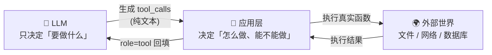

> LLM **不执行**任何函数。它只会生成一段「我想调用 `get_weather`，参数是 `{"city":"北京"}`」的**结构化文本**，真正的执行发生在你的应用层代码里。

## 你将学到

1. Function Calling 的真实分工：模型**生成**请求，应用**执行**并回填结果
2. tool schema 三个字段（`name` / `description` / `parameters`）各自如何影响模型行为
3. `tool_choice` 四种取值的差异与适用场景
4. 为什么 `arguments` 是**字符串**而不是对象，以及模型生成的 JSON 会怎样坏掉
5. 并行工具调用在 wire 层的真实形态——一个 assistant 消息带多个 `tool_calls`

## 前置要求```bash
pip install openai python-dotenv
```

`.env` 需要以下三项（见项目根 `.env.example`）：

```
MIMO_API_KEY=你的key
MIMO_BASE_URL=https://api.xiaomimimo.com/v1
MIMO_MODEL=mimo-v2.5
```

本篇只讲机制，不写完整循环。读完这篇后去 手写第一个 Agent Loop 把它跑起来。

---

## 一、最大的误解：模型「调用」了函数

中文教程里最常见的错误说法是「LLM 调用外部工具」。**LLM 做不到这件事**。它是一个纯文本输入、纯文本输出的函数——没有网络、没有文件系统、没有执行权限。

真实发生的是这样：



这个分工不是实现细节，它是**整个 Agent 安全模型的基石**：

| 环节         | 谁决定      | 你在哪里加控制                    |
| ---------- | -------- | -------------------------- |
| 要不要调工具     | 模型       | `tool_choice`、prompt、工具描述  |
| 调哪个工具      | 模型       | 工具集合的暴露范围（不给就不会调）          |
| 参数是什么      | 模型       | `parameters` schema、校验、默认值 |
| **是否真的执行** | **你的代码** | ✅ 权限、沙箱、审计日志、人工确认          |
| 执行结果给多少    | 你的代码     | 截断、脱敏、错误信息设计               |

最右列是关键。**模型提出的只是一个「申请」，批不批是你的代码说了算**。后面阶段 7 讲权限与最小代理原则时，全部挂在这一层。

> ⚠️ 反过来推：如果你写了一个 `run_bash(command: str)` 工具然后无条件执行，你就把「是否执行」的决定权完全交给了模型。这不是 Function Calling 的缺陷，是设计者放弃了自己的位置。

## 二、一次完整调用的消息序列```mermaid
sequenceDiagram
    autonumber
    participant U as 👤 用户
    participant A as 🔧 应用层
    participant M as 🧠 LLM
    participant T as 🌍 真实函数

    U->>A: "北京今天多少度？"
    A->>M: messages=[system, user]<br/>tools=[get_weather schema]
    Note over M: 模型内部推理：<br/>这个问题需要真实数据
    M->>A: assistant 消息<br/>content=null<br/>tool_calls=[{id:"call_abc",<br/>name:"get_weather",<br/>arguments:'{"city":"北京"}'}]
    Note over A: ★ 执行发生在这里
    A->>T: get_weather(city="北京")
    T->>A: {"temp_c": 28, "condition": "晴"}
    A->>M: messages=[system, user, assistant, <br/>tool(tool_call_id="call_abc", content="{...}")]
    Note over M: 这次没有再要求调工具
    M->>A: assistant 消息<br/>content="北京今天 28°C，晴"
    A->>U: "北京今天 28°C，晴"
```

注意三个细节，它们在手写循环时会变成报错来源：

1. 第二轮的 assistant 消息里 `content` 是 `null`，**不是空字符串**。部分兼容接口对 `content: null` 挑剔，所以序列化时要处理（见 Agent Loop 里的 `exclude_none=True`）。
2. `tool` 消息靠 `tool_call_id` 与 `assistant` 消息里的 `id` 配对，**不是靠顺序猜**。
3. 至少两轮请求。一次工具调用 = 一次额外的完整 LLM 往返，这是成本与延迟的基本单位。

## 三、tool schema 三字段解剖

一份工具定义只有三个字段，但每个字段回答的是不同的问题：

```python
{
    "type": "function",
    "function": {
        "name": "get_weather",              # ← 「我叫什么」
        "description": "查询指定城市今天的天气。只支持中国城市。",  # ← 「我干什么、什么时候用我」
        "parameters": {                      # ← 「我接受什么」
            "type": "object",
            "properties": {
                "city": {"type": "string", "description": "城市中文名，如 '北京'"},
            },
            "required": ["city"],
        },
    },
}
```

### `name`：模型在 `tool_calls` 里回填的字符串

它**不只是一个标识符，本身就是 prompt**。模型在决定调哪个工具时，看到的就是这个名字。

- `f1` / `do_stuff` / `helper` —— 模型只能靠 description 猜，选择准确率下降
- `get_weather` / `search_orders` / `send_email` —— 名字自带语义，选择准确率明显更高

命名约定：`动词_名词`，小写下划线，全项目统一。改名字**是破坏性变更**——历史会话里存的 `tool_calls` 会找不到实现，所以生产环境建议把老名字保留为别名。

### `description`：决定「模型什么时候想到用它」

这是三字段里**投入产出比最高**的一个。它同时承担三件事：

1. **正向说明**——我做什么
2. **触发条件**——什么情况下应该用我
3. **负向边界**——什么情况下**不**要用我、我不支持什么

反例（网上抄来最典型的那种）：

```python
"description": "查询天气。"
```

模型不知道：支持哪些城市？历史天气还是实时？摄氏度还是华氏度？失败会返回什么？于是它会在不该调的时候调，调了以后拿到错误再乱猜。

正例：

```python
"description": (
    "查询指定城市**今天**的实时天气，返回摄氏度与天气状况。"
    "只支持中国主要城市的中文名（如 '北京'、'上海'）。"
    "查询历史天气或未来预报请改用 get_forecast。"
)
```

> ⚠️ **待验证**：描述长度对选择准确率的影响在 MiMo 上未做对照实验。经验法则是「像给一个新同事写 API 文档」——足够解释，不要写小说。超长描述会挤占上下文预算。

### `parameters`：决定「模型能不能把参数填对」

它是一段 JSON Schema。关键点：

| 写法 | 效果 |
|------|------|
| `"required": ["city"]` | 模型会尽量填；漏填的概率大幅下降，但**不保证** |
| `"enum": ["北京","上海","广州"]` | 把可选值写死，是抑制幻觉参数最有效的手段 |
| 属性级 `description` | 告诉模型格式，如「ISO 8601，如 2026-09-19」 |
| 不给 `required` | 模型倾向于**编造**可选参数（见第六节） |

**`enum` 值得单独强调**。如果你希望模型填「北京」而不是「北亰」「北京市」「Beijing」，直接把枚举列出来，比在 description 里写十遍「请使用标准中文城市名」都管用。

## 四、`tool_choice` 的四种取值

`tool_choice` 控制「这一轮允不允许调工具」，是**应用层对模型的硬约束**：

| 取值                                                      | 含义             | 什么时候用                   |
| ------------------------------------------------------- | -------------- | ----------------------- |
| `"auto"`                                                | 模型自己决定调不调、调哪个  | **默认值**。绝大多数 Agent 场景   |
| `"none"`                                                | 禁止调用，必须直接输出文本  | 需要总结/收尾时；或工具集太大想省 token |
| `"required"`                                            | **必须**调用至少一个工具 | 强制结构化输出；或已知这轮一定要取数据     |
| `{"type":"function","function":{"name":"get_weather"}}` | 强制调用**指定**这一个  | 流程编排里确定的下一步；意图已被规则判定的场景 |

两个容易踩的点：

- `"required"` **不保证参数正确**，它只保证「有 tool_calls」。模型可能为了满足要求而硬填一个不存在的城市。
- 部分 OpenAI 兼容服务对 `"required"` 和指定函数形式的支持程度不一致。**待验证**：MiMo 上这两种取值的行为未实测，接入时先用一个最小请求验证。

> 💡 一个实用技巧：循环跑到接近 `max_iterations` 时，把 `tool_choice` 切成 `"none"`，能逼模型用现有信息给一个「尽力而为」的答案，而不是硬停在报错上。这个技巧在 停止条件与预算控制 里会展开。

## 五、`arguments` 是字符串，不是对象

这是手写时**第一个必踩的坑**。看模型返回的东西：

```python
call = msg.tool_calls[0]
print(type(call.function.arguments))   # <class 'str'>  ★ 不是 dict
print(call.function.arguments)         # '{"city": "北京"}'
```

最直觉的写法直接炸掉：

```python
# ❌ TypeError: string indices must be integers
city = call.function.arguments["city"]
```

正确写法是自己 parse：

```python
args = json.loads(call.function.arguments)   # ✅
result = get_weather(**args)
```

**为什么设计成字符串？** 因为模型本质上是逐 token 生成文本的，`arguments` 就是它「写」出来的那段 JSON 文本。服务端**不会**替你做 parse——parse 失败时它更愿意把原始文本交给你，让你自己决定怎么补救。这个设计在流式场景下尤其重要（见 流式输出与事件流：`arguments` 是分片到达的，不拼完根本 parse 不了）。

### 模型生成的 JSON 会怎样坏掉

三种坏法，**全都要防**：

**坏法 1：语法非法**

```python
json.loads('{"city": "北京",}')   # JSONDecodeError: 多余的逗号
json.loads("{'city': '北京'}")     # JSONDecodeError: 单引号（模型常见笔误）
```

**坏法 2：合法 JSON 但不符合 schema**

```python
json.loads('{"city": 123}')        # 通过了，但 city 是数字，函数签名要 str
json.loads('{"city_name": "北京"}') # 参数名幻觉，键名错了
json.loads('{"city": "北京", "unit": "celsius", "lang": "zh"}')  # 编造了未声明的参数
```

**坏法 3：幻觉出不存在的东西**

```python
{"city": "北亰"}      # 错别字
{"city": "北京市朝阳区"}  # 粒度超出工具支持范围
{"city": "东京"}       # 超出「只支持中国城市」的声明边界
```

**坏法 3 是最阴险的**：JSON 完全合法、schema 完全通过，但语义上工具根本处理不了。如果你在第一层就 `json.loads` 完直接 `**args` 调进去，函数内部再抛异常，循环就崩了。

所以执行侧必须**分三层防御**：

```python
try:
    args = json.loads(call.function.arguments)          # 防坏法 1
except json.JSONDecodeError as exc:
    result = {"error": f"参数不是合法 JSON：{exc}"}      # ← 转字符串，不抛
else:
    try:
        result = TOOL_IMPL[name](**args)                # 防坏法 2（TypeError）
    except TypeError as exc:
        result = {"error": f"参数与工具签名不匹配：{exc}，应为 {signature}"}
    # 坏法 3 由工具自己判断，返回 {"error": "..."} 而不是 raise```

注意每个分支都是**把错误转成字符串回填给模型**，而不是往外抛。这条原则在 工具错误回传与重试 里完整展开——核心是：工具的失败是「观察结果」，不是「异常」。

## 六、并行工具调用在 wire 层长什么样

模型可以一次返回**多个** `tool_calls`。这不是「循环调了三次」，而是**一个 assistant 消息里带了三个数组元素**：

```json
{
  "role": "assistant",
  "content": null,
  "tool_calls": [
    {
      "id": "call_a1",
      "type": "function",
      "function": { "name": "get_weather", "arguments": "{\"city\":\"北京\"}" }
    },
    {
      "id": "call_a2",
      "type": "function",
      "function": { "name": "get_weather", "arguments": "{\"city\":\"上海\"}" }
    }
  ]
}
```

你的应用层要回填**两条** `tool` 消息：

```json
[
  { "role": "tool", "tool_call_id": "call_a1", "content": "{\"temp_c\": 28}" },
  { "role": "tool", "tool_call_id": "call_a2", "content": "{\"temp_c\": 32}" }
	]
```

### 为什么必须每个都有对应结果

OpenAI 兼容接口在服务端做**配对校验**：`assistant.tool_calls` 里的每一个 `id`，都必须能找到一条 `tool_call_id` 相同的 `tool` 消息，且在其之后。

漏一条 → 400。顺序错 → 400。中间插别的消息 → 400。

这条校验有两个重要推论：

1. **并行执行时结果顺序会乱，但回填顺序不能乱**。用 `ThreadPoolExecutor` 必须用 `pool.map`（保序）或自己按 `call.id` 归位。
2. **历史裁剪时不能从中间切断**，必须「吸附」到完整的 assistant + 全部 tool 结果这一组边界上。这是 历史裁剪与边界吸附 那一节的全部内容。

### 模型什么时候会并行

通常当两个调用**互不依赖**时。上面的「北京和上海哪个热」是典型例子。

但注意：**模型不并行不代表不能并行**。它是概率行为，同一个 prompt 跑几次可能得到 1 个 call 也可能得到 2 个。所以：

- 不能依赖模型帮你并行，需要并行就在应用层拆
- 反过来，模型给了并行请求时，要检查工具之间有没有依赖（一个写文件、一个读同一文件），有依赖就必须降级为串行

`pi` 的做法是给工具加 `executionMode: "sequential" | "parallel"` 标记，**只要这一批里有一个标了 sequential，整批退化成串行**。这个「批量降级」的取舍在 Agent Loop 里已经讲过，不再重复。

> ⚠️ **待验证**：MiMo 是否稳定支持一次返回多个 `tool_calls` 未做统计。跑 Agent Loop 的示例时，如果只看到一次一个 call，不代表不支持，只代表这次没触发。

## 七、常见坑

### 坑 1：模型编造可选参数

**可复现场景**：schema 里 `required` 只写了 `city`，但 properties 里还有 `unit` 和 `date`。你会发现模型**经常**把这两个也填上——`{"city":"北京","unit":"celsius","date":"2026-09-19"}`。它「以为」填全文更安全。

如果函数签名是 `get_weather(city: str)`，这一下就是 `TypeError: unexpected keyword argument 'unit'`。

**修法**（按优先级）：

1. 能用 `**kwargs` 兜住就兜住，忽略多余参数
2. 函数签名里显式声明所有 optional 参数并给默认值
3. 在 `parameters` 里**别写**你不打算处理的属性——模型看到就会想填

### 坑 2：工具描述写给人看不给模型看

**可复现场景**：description 写成 `"调用后端 /api/v2/weather 接口，返回 UnifiedWeatherResponse 对象"`——这是给同事看的。模型不知道 `/api/v2/...` 是什么、不知道 `UnifiedWeatherResponse` 有哪些字段，只能猜什么时候该用。

**判据**：把 description 单独摘出来，给一个完全不了解你系统的人读。他能说出「什么时候该用、什么时候不该用、参数填什么格式」吗？不能就是写坏了。

### 坑 3：把工具的返回做成了给人类看的自然语言```python
return "北京今天 28 度，天气晴朗，空气质量良，建议穿短袖。"
```

模型能读懂，但：
- 你没法在代码里判断成功/失败（没有稳定的字段）
- 结构化数据被压成自然语言后**信息有损**，模型的后续推理质量下降
- 无法做断言和评估

**推荐**：返回 `dict`，`json.dumps(result, ensure_ascii=False)` 后回填。要给人看的部分由 UI 渲染。

### 坑 4：工具太多

一次塞 50 个工具，模型的选择准确率会显著下降，而且 schema 本身占掉大量上下文。

阶段 4 会讲 技能与渐进式发现——先给模型一个「搜索工具」的元工具，按需加载具体工具 schema，而不是一次全给。

## 八、🔬 参考实现里的对应位置

这些机制在真实 agent harness 里对应到哪些代码？

| 机制 | `pi`（TypeScript） | `pi-agent`（Python） |
|------|-------------------|---------------------|
| 工具执行前的统一入口 | `prepareToolCall` | `prepareToolCall` |
| 参数解析失败的处理 | 转成失败的 tool result | 同 |
| 异常兜底 | — | `registry.run` 的 `except Exception` |
| 截断保护 | `stopReason === "length"` → 整批判失败 | — |

`pi-agent` 的三段式扩展点很值得记：

```
prepareToolCall → executePreparedToolCall → finalizeExecutedToolCall
```

**为什么切三段而不是一个大函数？** 因为每一段的权限和失败语义不同：prepare 阶段还能改参数（补默认值、做校验），execute 阶段是真正碰外部世界（要沙箱、要 AbortSignal 支持取消），finalize 阶段是收拾现场（清理临时文件、格式化结果）。全程贯穿一个 `AbortSignal`，让用户在工具跑一半时能取消。

> 本篇引用的两个同名项目要区分清楚：`earendil-works/pi` 是 TypeScript monorepo（MIT），`Ashutosh0428/pi-agent` 是 Python 小型学习项目。前者 star 数在 10w 量级，但这个数字来自第三方聚合站，**本机 `github.com` 直连被网络策略拦截无法核验，有出入**。

---

## ✅ 学习检查点

- [ ] 能用一句话说清「模型生成请求、应用执行函数」的分工，并说出这个分工的安全意义
- [ ] 能默写一份 tool schema，并解释三个字段各自影响模型的哪个行为
- [ ] 能列出 `tool_choice` 四种取值及各自适用场景
- [ ] 能解释为什么 `arguments` 是字符串，并说出模型生成的 JSON 的三种坏法
- [ ] 能画出「一个 assistant 消息带两个 tool_calls」时的 wire 层 JSON 与回填顺序
- [ ] 知道漏回填一个 `tool` 结果会发生什么（400），以及为什么并行执行必须保序回填
- [ ] 亲手跑一次：把 `get_weather` 的 description 改成「查询天气。」，观察模型是否还在该调的时候调

## 📖 相关文档

- [OpenAI Function Calling](https://platform.openai.com/docs/guides/function-calling) — 消息格式与 `tool_choice` 的权威来源
- [JSON Schema](https://json-schema.org/) — `parameters` 字段的规范，写复杂 schema 时查
- [Anthropic · Tool use](https://docs.anthropic.com/en/docs/build-with-claude/tool-use) — 对照看另一家的工具调用设计差异
- [Anthropic · Writing tools for agents](https://www.anthropic.com/engineering/writing-tools-for-agents) — 工具描述怎么写才有效
- [earendil-works/pi](https://github.com/earendil-works/pi) — 本篇引用的三段式工具调用扩展点
- [Ashutosh0428/pi-agent](https://github.com/Ashutosh0428/pi-agent) — Python 版，`registry.run` 的异常兜底值得逐行读

## ➡️ 下一步

→ 手写第一个 Agent Loop —— 现在去把它写出来，不写等于没学
