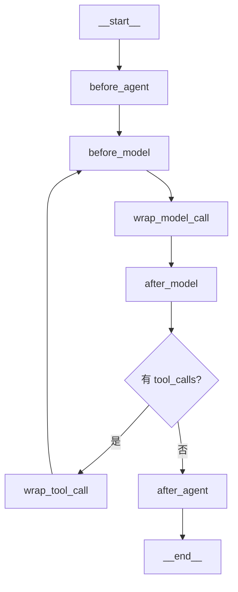

> **📋 摘要：为什么单独讲中间件**
> 中间件是 LangChain 1.x 相比旧版最大的新增能力，也是**从「写个 Demo」到「上生产」的分水岭**。
> 人机协同、PII 脱敏、上下文摘要、调用限额、模型降级——这些原本要自己写一堆胶水代码的能力，
> 现在都是一行配置。
>
> 本页所有代码实跑验证过，包括自定义中间件的真实执行轨迹。

---

## 一、六个钩子

中间件就是在 Agent 循环的特定位置插入逻辑。六个挂载点：



| 钩子 | 位置 | 典型用途 |
|---|---|---|
| `before_agent` | 整个图开始前 | 加载用户资料、初始化上下文 |
| `before_model` | 每次调模型前 | 注入动态提示词、记录日志 |
| `wrap_model_call` | 包裹模型调用 | 重试、降级、缓存、埋点 |
| `after_model` | 模型返回后 | 内容审核、结果改写 |
| `wrap_tool_call` | 包裹工具执行 | 审计、权限校验、异常兜底 |
| `after_agent` | 整个图结束后 | 写操作日志、清理资源 |

> **📝 说明：`before_*` / `after_*` 是「观察者」，`wrap_*` 是「包装者」**
> - `before_model` / `after_model` 只做副作用，**不能改变流向**
> - `wrap_model_call` / `wrap_tool_call` 拿到底层 `handler`，可以选择调不调、调几次、改参数
>
> 需要控制流程就用 `wrap_*`，只需要旁路观察就用 `before/after_*`。

---

## 二、写一个自定义中间件```python
from langchain.agents.middleware import before_model, wrap_tool_call

audit: list[str] = []


@before_model
def log_before(state, runtime) -> None:
    audit.append(f"before_model: 当前 {len(state['messages'])} 条消息")


@wrap_tool_call
def audit_tool(request, handler):
    name = request.tool_call["name"]
    audit.append(f"tool_call 开始: {name}")
    result = handler(request)          # 真正执行工具
    audit.append(f"tool_call 结束: {name}")
    return result


agent = create_agent(
    model=model,
    tools=[echo],
    middleware=[log_before, audit_tool],
)
```

**实跑输出的真实执行轨迹**（一次带工具调用的请求）：

```
before_model: 1 条消息
tool_call 开始: echo
tool_call 结束: echo
before_model: 3 条消息
```

> **💡 提示：从轨迹能看出的三件事**
> 1. `before_model` 被调了**两次**——工具调用会回到模型节点，中间件每次都生效
> 2. 第二次时消息数是 3（原始 1 条 + AIMessage + ToolMessage）
> 3. `wrap_tool_call` 的 `handler(request)` 是**必须显式调用**的，不调就等于把工具吞了
>
> 第 3 点是最常见的 bug：写完包装逻辑忘了调 `handler`，工具静默不执行，模型拿不到结果。

### 2.1 `wrap_model_call` 做重试与降级```python
@wrap_model_call
def resilient_model(request, handler):
    for attempt in range(3):
        try:
            return handler(request)
        except Exception:
            if attempt == 2:
                raise
            time.sleep(2 ** attempt)     # 指数退避
```

---

## 三、内置中间件

### 3.1 人机协同 `HumanInTheLoopMiddleware`

**高危操作必须加闸。** 写数据库、发邮件、转账、删文件——执行前暂停，等人审批。

```python
from langchain.agents.middleware import HumanInTheLoopMiddleware

agent = create_agent(
    model="openai:gpt-4o-mini",
    tools=[send_email, delete_file],
    middleware=[
        HumanInTheLoopMiddleware(
            interrupt_on={
                "send_email": True,                      # 简单形式：需要审批
                "delete_file": {
                    "allowed_decisions": ["approve", "reject", "edit"],   # 允许改参数
                },
            },
            description_prefix="工具执行需要人工审批",
        ),
    ],
)
```

实测签名：

```python
HumanInTheLoopMiddleware(
    interrupt_on: dict[str, bool | InterruptOnConfig],
    *,
    description_prefix: str = "Tool execution requires approval",
    edit_notice: str = ...,
    interrupt_mode: InterruptMode = "batched",
)
```

执行到被拦截的工具时，图会暂停并返回 `__interrupt__`：

```python
result = agent.invoke(input, config)
if result.get("__interrupt__"):
    # 把审批请求推给前端/IM，等人点「同意」...
    result = agent.invoke(Command(resume={"decision": "approve"}), config)
```

> **⚠️ 注意：人机协同**必须配 checkpointer****
> 没有 checkpointer，图暂停后无法恢复（会报 `No checkpointer set`）。
> 人机协同 + 持久化是绑定出现的，见 15-检查点、中断与持久化。

### 3.2 PII 脱敏 `PIIMiddleware````python
from langchain.agents.middleware import PIIMiddleware

PIIMiddleware(
    pii_type="email",                    # email / credit_card / ip / mac_address / url / 自定义
    strategy="redact",                   # block / redact / mask / hash
    apply_to_input=True,                 # 默认就对输入生效
    apply_to_output=False,               # 输出默认不处理，按需开
    apply_to_tool_results=False,         # 工具结果默认不处理，按需开
)
```

> **🚫 危险：`apply_to_output` 默认是 `False`**
> 这意味着**模型返回里的手机号、身份证号默认不会被脱敏**。
> 如果业务要求输出也不能带 PII，必须显式打开，否则你以为脱敏了其实没有。

### 3.3 上下文摘要 `SummarizationMiddleware`

长会话必然撞上下文窗口。这个中间件在接近上限时自动压缩历史。

```python
from langchain.agents.middleware import SummarizationMiddleware

SummarizationMiddleware(
    model="openai:gpt-4o-mini",           # 用便宜模型做摘要
    trigger=("fraction", 0.8),            # 用到 80% 窗口时触发
    keep=("messages", 20),                # 保留最近 20 条原文
    trim_tokens_to_summarize=4000,
)
```

`trigger` 支持三种度量：`("fraction", 0.8)` / `("tokens", 100000)` / `("messages", 100)`。

> **💡 提示：摘要会丢信息，这是取舍不是银弹**
> 摘要后的历史一定丢失细节。对**要求精确回忆**的场景（代码审查、合同审阅），
> 宁可换长上下文模型，也不要用摘要。

### 3.4 其他常用内置中间件

| 中间件 | 作用 |
|---|---|
| `ModelCallLimitMiddleware` | 限制模型调用次数（防死循环 + 控成本） |
| `ToolCallLimitMiddleware` | 限制工具调用次数 |
| `ModelFallbackMiddleware` | 主模型失败自动切备用模型 |
| `ModelRetryMiddleware` | 模型调用重试 |
| `ToolRetryMiddleware` | 工具调用重试 |
| `ToolErrorMiddleware` | 工具异常转成 `ToolMessage` 还给模型 |
| `TodoListMiddleware` | 给 Agent 加待办清单能力 |
| `ContextEditingMiddleware` | 编辑上下文（清理工具结果等） |
| `LLMToolSelectorMiddleware` | 工具太多时先让模型选子集 |
| `SummarizationMiddleware` | 上下文摘要 |

---

## 四、中间件的执行顺序```python
agent = create_agent(
    model=model,
    tools=[...],
    middleware=[a, b, c],
)
```

`wrap_*` 类按列表顺序**由外到内**包裹：`a` 在最外层，`c` 最靠近真实调用。
所以请求路径是 `a → b → c → 真实调用 → c → b → a`。

> **💡 提示：排序的实用原则**
> - **限额/限流放最外层**（`middleware=[...]` 的第一个）—— 不满足条件直接短路，不消耗内层资源
> - **日志埋点放最外层** —— 才能记录到完整的耗时和最终结果
> - **重试放内层** —— 它只该包住真实调用

---

## 五、验收清单

- [ ] 能说出六个钩子及各自位置
- [ ] 理解 `wrap_*` 必须显式调用 `handler(request)`
- [ ] 写过一个自定义中间件，并理解「`before_model` 会被调用多次」
- [ ] 给高危工具配了 `HumanInTheLoopMiddleware`
- [ ] 知道 `PIIMiddleware` 的 `apply_to_output` 默认 `False`
- [ ] 给生产 Agent 配了调用限额与模型降级

---

## 相关笔记

- 12-工具调用与 Agent 循环 — 上一页，中间件挂在循环的哪些位置
- 14-LangGraph 核心原语 — 中间件本质上是往图里插节点
- 15-检查点、中断与持久化 — 人机协同的必备前提
- 10-LangChain 与 LangGraph 索引

---
- 返回 10-LangChain 与 LangGraph 索引
