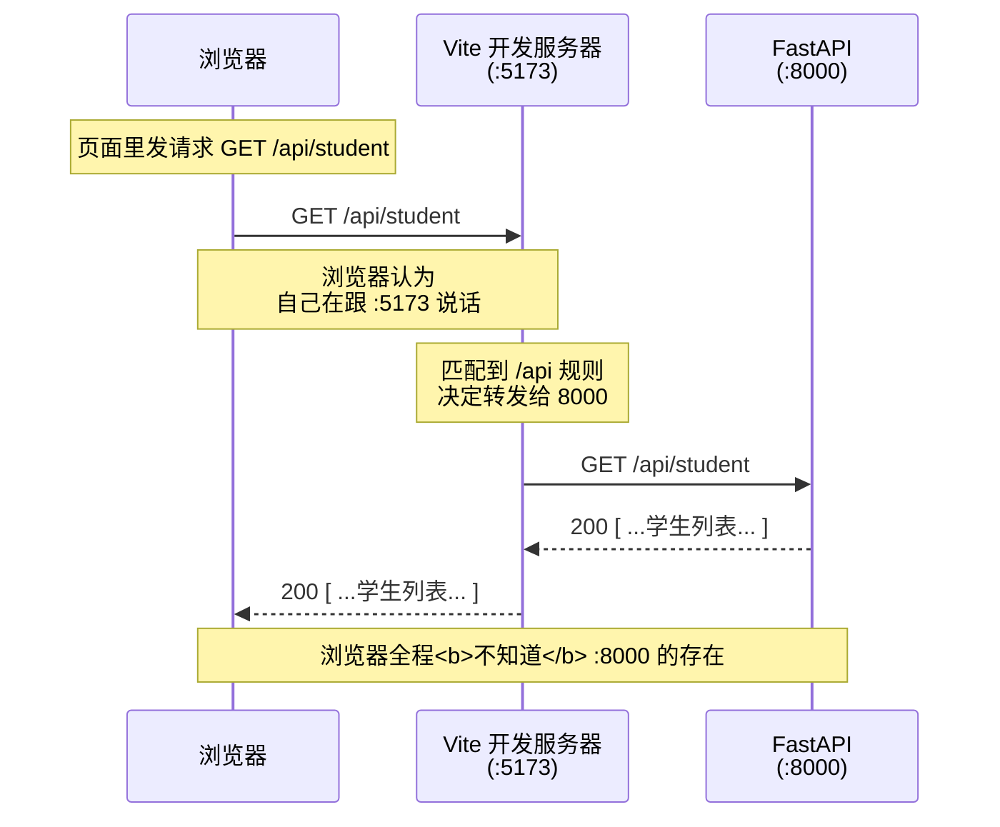
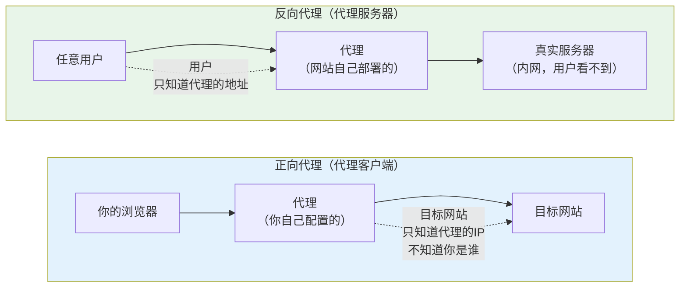
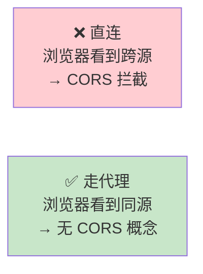
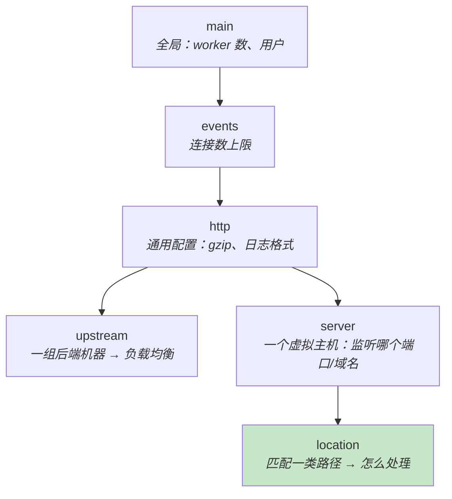

上级：00-首页 · 相关：Q-06-企业级技术体系全景 · Q-05-工程化实践清单

> **❓ 问题：原始问题**
> 「nginx 反向代理又是个什么东西，详细讲一下」

> **ℹ️ 信息：一句话结论**
> 反向代理就是**挡在服务器前面的一个"接线员"**：
> 所有请求先打到它，由它决定转给后面哪台机器、哪个服务。
> 对浏览器来说，**它看起来就是服务器本身**。
>
> 而最关键的真相是：**你已经有一个反向代理在跑了**——
> `houtai/vite.config.js:22-27` 那段 `proxy` 配置，
> 就是一个**用 Node 写的开发环境反向代理**。Nginx 只是把它换成生产版本。

---

## 🎯 一、先破除神秘感：你早就在用了

看你的前端配置（实测 `houtai/vite.config.js:18-28`）：

```js
server: {
  host: true,
  port: 5173,
  // 将 /api 请求代理到后端，规避跨域
  proxy: {
    '/api': {
      target: process.env.VITE_BACKEND_TARGET || 'http://127.0.0.1:8000',
      changeOrigin: true,
    },
  },
},
```

**这段配置在干的事，就是反向代理**：

| 你写的东西 | 翻译成人话 |
| :--- | :--- |
| `'/api'` | 匹配规则：**凡是路径以 `/api` 开头的请求** |
| `target: 'http://127.0.0.1:8000'` | 转给谁：**后端那台机器** |
| `changeOrigin: true` | 转发时**改写 `Host` 头**，让后端以为请求是直接来的 |



> **📝 说明：划重点：浏览器不知道后端的存在**
> 这是反向代理的**本质特征**——
> 浏览器眼里，从头到尾它只跟 `localhost:5173` 一个地址打交道。
> `127.0.0.1:8000` 这个地址**从未出现在浏览器里**，
> 自然也就**不触发跨域检查**（跨域的前提是"目标地址和当前页面不同源"，
> 现在目标地址和页面同源，都是 `:5173`）。

> **💡 提示：这就是你 Q-05 里那个疑问的答案**
> 我在 Q-05 §6.3 里说过：
> 「你后端的 CORS 配置**至今没被真实验证过**，因为开发走代理，浏览器根本不触发 CORS 检查」。
> 根源就是它——**Vite 的反向代理把跨域问题"绕过"了，而不是"解决"了**。
> 真正的解决要等 Nginx 上场（或者后端配置正确的 CORS）。

---

## 🔄 二、正向代理 vs 反向代理（核心概念）

> **📝 说明：一句话区分**
> **正向代理代理的是「客户端」，反向代理代理的是「服务器」。**
>
> 换个说法：**正向代理是"我替你去拿"，反向代理是"我替你接待"。**



### 2.1 两者的完整对比

| 维度 | 正向代理 | 反向代理 |
| :--- | :--- | :--- |
| **代理谁** | 客户端 | 服务器 |
| **谁部署的** | 用户自己（或用户信任的第三方） | **服务提供方自己** |
| **谁需要配置** | **客户端要主动配置**（设置代理服务器地址） | **客户端完全无感**，什么都不用配 |
| **目标服务器知道真实客户端吗** | ❌ 不知道，只看到代理 | ❌ 不知道，以为代理就是客户端 |
| **客户端知道真实服务器吗** | ✅ 知道（是客户端指定要访问的） | ❌ **不知道**，以为代理就是服务器 |
| **典型用途** | 科学上网、企业内网出口、爬虫、抓包（Charles/Fiddler） | 负载均衡、HTTPS 终结、隐藏后端、静态资源 |
| **典型软件** | Shadowsocks、Charles、Fiddler、公司网关 | **Nginx**、HAProxy、Traefik、云 SLB |

> **💡 提示：一个记忆技巧**
> 看**谁被隐藏了**：
> - 正向代理 → **隐藏了客户端**（服务器不知道你是谁）
> - 反向代理 → **隐藏了服务器**（你不知道背后有多少台机器）
>
> 还有一个更实用的判据：**需要你手动改设置的，是正向代理**。
> 你从来不需要为了访问淘宝而"配置一个代理"——因为淘宝用的是反向代理，对你透明。

### 2.2 为什么叫"反向"

> **📝 说明：字面理解**
> 「**反**向」是相对于「**正**向」而言的：
> - 正向代理**顺着请求的方向**（客户端 → 代理 → 服务器），代理站在客户端这一侧
> - 反向代理**逆着请求的方向**（代理站在服务器这一侧），对外代表服务器
>
> 对**用户**来说，反向代理"就是"服务器；对**服务器**来说，
> 反向代理"就是"用户。两边都把它当成对方。

---

## 🎯 三、反向代理到底解决什么问题

> **📝 说明：不是为了"显得专业"，每一类都是实际问题**
> 下面 8 个问题，**每一个都在你的项目里真实存在或即将存在**。

### 3.1 ① 解决跨域（CORS）

**你的问题**：前端 `:5173`，后端 `:8000`——**不同端口就是不同源**。
如果前端直接调 `http://127.0.0.1:8000/api/student`，浏览器会拦。

**反向代理的解法**：让浏览器"以为"前后端同一个源。
前端只请求 `/api/student`（相对路径，就是 `:5173/api/student`），
由代理在**服务端**转发给 `:8000`。



> **⚠️ 注意：但注意：跨域是**浏览器**的限制，不是 HTTP 的限制**
> 代理转发时是**服务器到服务器**的 HTTP 请求，
> 浏览器管不着，所以**根本不经过 CORS 检查**。
> 这也解释了为什么你用 curl 调后端永远成功，用浏览器就报跨域。
>
> 顺便复习：你后端现在 `main.py:18-24` 的
> `allow_origins=["*"] + allow_credentials=True` 是**非法组合**
> （浏览器规范禁止），见 Q-06 §5.2。

### 3.2 ② 统一入口（一个域名搞定所有）```mermaidflowchart TD
    U["用户只访问<br/>https://example.com"]
    U --> N["Nginx :443"]
    N -->|"/  → 静态文件"| W["前端 dist/"]
    N -->|"/api/ → 转发"| A["FastAPI :8000"]
    N -->|"/uploads/ → 静态"| F["上传的文件"]

    style U fill:#e3f2fd
    style N fill:#ffe0b2
```

**好处**：
- 用户只需要记一个域名，不用记端口
- HTTPS 证书只需要配一处
- 前端路径天然同源，跨域问题消失

### 3.3 ③ HTTPS 终结（TLS Termination）

**问题**：证书、私钥、加密解密，这些事让 Nginx 干，业务代码完全不用管。

```
浏览器 ←—HTTPS—→ Nginx ←—HTTP（内网）—→ FastAPI
        ↑ 加密在这段        ↑ 内网明文，性能更好
```

> **💡 提示：现在这件事有多简单**
> Let's Encrypt 的 `certbot` 一条命令自动签证书 + 自动续期：
> ```bash
> certbot --nginx -d example.com
> ```
> 免费、自动、业界标准。**不要自己手搓证书。**

### 3.4 ④ 负载均衡（多实例分流）

**问题**：一台机器扛不住，起了 3 个 FastAPI 实例。

```nginx
upstream backend {
    server 127.0.0.1:8000;
    server 127.0.0.1:8001;
    server 127.0.0.1:8002;
}

server {
    location /api/ {
        proxy_pass http://backend;   # ← 指向 upstream 名字，不是具体地址
    }
}
```

常见策略：

| 策略 | 配置 | 说明 |
| :--- | :--- | :--- |
| **轮询**（默认） | `upstream backend { server a; server b; }` | 依次分发 |
| **权重** | `server a weight=3;` | a 拿 3/4 流量 |
| **IP 哈希** | `ip_hash;` | 同一 IP 固定打到同一台（**会话粘性**） |
| **最少连接** | `least_conn;` | 给最闲的那台 |
| **故障转移** | `server a max_fails=3 fail_timeout=30s;` | 连续失败就暂时剔除 |

> **⚠️ 注意：负载均衡会打破"有状态"**
> 你的 JWT 是**无状态**的，所以天然支持负载均衡 ✅。
> 但如果哪天改用了**服务端 Session**（存在进程内存里），
> 用户第一次请求打到实例 A、第二次打到实例 B，就会"莫名其妙掉登录"。
> 两种解法：`ip_hash`（会话粘性）或**把 Session 存到 Redis**（更好）。
>
> **这也是 JWT 无状态的优势之一**——它让水平扩容变得不需要额外考虑。

### 3.5 ⑤ 静态资源服务

Nginx 直接读磁盘上的文件，**比 FastAPI 返回快得多**
（FastAPI 要经过 Python 解释器，Nginx 是 C 写的、直接 `sendfile`）。

所以标准做法是：**前端 `dist/` 打包产物直接交给 Nginx，不走后端**。

### 3.6 ⑥ 隐藏后端 + 安全加固

**问题**：直接暴露 `:8000`，等于告诉全世界"我用的是 uvicorn"。

反向代理后，外网只能看到 Nginx：
- 后端端口**只监听 `127.0.0.1`**，外网完全不可达
- 可以在这里加**限流**（`limit_req`）、**IP 黑名单**、**防盗链**
- 可以隐藏真实的服务器数量、技术栈、错误页面

```nginx
# 限流：给你的登录接口加一道
limit_req_zone $binary_remote_addr zone=login:10m rate=5r/m;

location /api/user/login {
    limit_req zone=login burst=3 nodelay;   # 每分钟 5 次，突发允许 3
    proxy_pass http://backend;
}
```

> **💡 提示：这其实就是 Q-06 里验证码体系的"限流那一半"**
> 那次我说「只做验证码不做限流 = 攻击者直接跳过验证码接口刷登录」。
> 现在你看到限流的**另一种实现位置**：不一定非要在 Python 里写，
> **Nginx 层面就能做**，而且性能好得多（请求根本进不到 Python 进程）。

### 3.7 ⑦ 压缩 / 缓存 / 缓冲

| 能力 | 配置 | 效果 |
| :--- | :--- | :--- |
| **gzip 压缩** | `gzip on;` | JSON 响应体积减少 60~80% |
| **静态资源缓存** | `expires 30d;` | 浏览器不再重复下载 |
| **请求缓冲** | `proxy_buffering on;` | 慢客户端不占用后端连接 |

### 3.8 ⑧ 灰度发布 / 蓝绿部署```nginx
# 让 10% 的流量去新版本
split_clients "${remote_addr}" $version {
    10%     new;
    *       old;
}

location /api/ {
    proxy_pass http://backend_$version;
}
```

**这是"出事能回滚"的关键能力**——新版本先接 10% 流量，没问题再全量。
对应 Q-06 里说的企业级四问之一。

---

## 🧩 四、Nginx 核心概念（5 个就够）

> **📝 说明：Nginx 配置文件的结构**
> 从外到内是「**块套块**」：
> `main` → `events` → `http` → `upstream` / `server` → `location`



| 概念 | 作用 | 类比 |
| :--- | :--- | :--- |
| **`http`** | 所有 HTTP 相关的配置容器 | 一栋楼 |
| **`upstream`** | 一组后端服务器 | 一个部门（多个人） |
| **`server`** | 一个虚拟主机（监听端口 + 域名） | 一个房间 |
| **`location`** | **匹配 URL 路径，决定怎么处理** | 房间里的**分机规则** |
| **`proxy_pass`** | **把匹配到的请求转给谁** | 转接给谁 |

> **📝 说明：`location` + `proxy_pass` 是 90% 场景的全部**
> 你不需要懂 Nginx 的其他东西，只要会写：
> 「**什么路径**（location）→ **转给谁**（proxy_pass）」。

### 4.1 location 的匹配优先级```nginx
location = /api/health { }      # ① 精确匹配（最高优先级）
location ^~ /api/static/ { }    # ② 前缀匹配，且不再检查正则
location ~ \.php$ { }           # ③ 正则匹配（区分大小写）
location ~* \.(jpg|png)$ { }    # ④ 正则匹配（不区分大小写）
location /api/ { }              # ⑤ 普通前缀匹配（最长匹配优先）
location / { }                  # ⑥ 兜底（所有请求都匹配）
```

优先级：**精确 `=` > `^~` > 正则 `~` / `~*` > 最长前缀 > `/`**

> **💡 提示：实用建议：能用 `location /api/` 就别用正则**
> 正则匹配虽然灵活，但**每次请求都要跑一遍正则**，且容易写出意料之外的优先级。
> 你的场景（一个 `/api` 前缀）用普通前缀匹配完全够。

---

## 💻 五、实战：给你项目写一份 Nginx 配置

> **📝 说明：当前状态**
> 实测：项目里**没有任何 nginx / Dockerfile / 部署配置**
> （`find` 搜索 `*nginx*` / `Dockerfile` / `*.conf` 无结果）。
> 下面这份是从零开始的生产配置。

### 5.1 部署全貌```mermaidflowchart LR
    B["浏览器<br/>https://example.com"]
    N["Nginx :443<br/><i>唯一对外入口</i>"]

    subgraph inner["内网（外部不可达）"]
        W["前端静态文件<br/>/var/www/houtai/dist"]
        A["FastAPI :8000<br/><i>只监听 127.0.0.1</i>"]
        D[("MySQL :3306<br/><i>只监听 127.0.0.1</i>")]
    end

    B -->|HTTPS| N
    N -->|"/ → 读文件"| W
    N -->|"/api/ → 转发"| A
    A -->|aiomysql| D

    style N fill:#ffe0b2
    style A fill:#c8e6c9
```

### 5.2 完整配置```nginx
# /etc/nginx/conf.d/student.conf

# ① 定义后端机器组（现在只有一台，将来加机器只要在这里加一行）
upstream student_api {
    server 127.0.0.1:8000;
    keepalive 32;                    # 与后端保持长连接，省去反复握手
}

# ② 登录接口限流（配合验证码，见 Q-06 §3.2）
limit_req_zone $binary_remote_addr zone=login_limit:10m rate=5r/m;

server {
    listen 80;
    server_name example.com;
    # ③ 80 端口全部跳转到 HTTPS
    return 301 https://$host$request_uri;
}

server {
    listen 443 ssl http2;
    server_name example.com;

    # ④ HTTPS 证书（certbot 自动生成的位置）
    ssl_certificate     /etc/letsencrypt/live/example.com/fullchain.pem;
    ssl_certificate_key /etc/letsencrypt/live/example.com/privkey.pem;

    # ⑤ 前端静态资源
    root /var/www/houtai/dist;
    index index.html;

    # ⑥ gzip 压缩（JSON 响应体积能减少 60~80%）gzip on;
    gzip_types text/css application/javascript application/json;
    gzip_min_length 1024;

    # ⑦ SPA 路由兜底 ⚠️ 关键！见下方坑点 2location / {
        try_files $uri $uri/ /index.html;
    }

    # ⑧ 带 hash 的构建产物可以永久缓存
    location /assets/ {
        expires 1y;
        add_header Cache-Control "public, immutable";
    }

    # ⑨ 登录接口：限流 + 转发
    location = /api/user/login {
        limit_req zone=login_limit burst=3 nodelay;
        proxy_pass http://student_api;              # ⚠️ 无斜杠！见坑点 1
        include /etc/nginx/proxy_params.conf;
    }

    # ⑩ API 统一转发
    location /api/ {
        proxy_pass http://student_api;              # ⚠️ 无斜杠！
        include /etc/nginx/proxy_params.conf;
    }

    # ⑪ 健康检查（给负载均衡器/监控用）
    location = /health {
        access_log off;
        proxy_pass http://student_api/docs;
    }
}
```

**公共转发参数** `/etc/nginx/proxy_params.conf`：

```nginx
proxy_http_version 1.1;
proxy_set_header Connection "";              # 配合 upstream keepalive

# 🔑 把真实客户端信息传给后端
proxy_set_header Host              $host;
proxy_set_header X-Real-IP         $remote_addr;
proxy_set_header X-Forwarded-For   $proxy_add_x_forwarded_for;
proxy_set_header X-Forwarded-Proto $scheme;
proxy_set_header X-Forwarded-Host  $host;

# 超时
proxy_connect_timeout 5s;
proxy_send_timeout    60s;
proxy_read_timeout    60s;

# 上传大小限制
client_max_body_size 10m;
```

> **📝 说明：为什么必须传 `X-Real-IP` / `X-Forwarded-For`**
> 走代理后，**后端看到的客户端 IP 永远是 `127.0.0.1`**（代理的地址），
> 所有用户的 IP 都一样。
>
> 后果：
> - 日志里记录的 IP 全是代理的，**排查问题时毫无用处**
> - 按 IP 限流/封禁会**把所有用户一起封掉**
> - 审计日志失去意义（Q-06 §3.1 的⑥审计层）
>
> Nginx 把真实 IP 放在这两个头里，**后端要主动去读**。
> FastAPI 里可以用 `request.client.host` 配合 `ProxyHeadersMiddleware`，
> 或显式读 `request.headers.get("x-forwarded-for")`。

---

## ⚠️ 六、五个必踩的坑

### 坑点 1 🔴 `proxy_pass` 末尾的斜杠（最经典的坑）

> **🚫 危险：有无斜杠，行为完全不同**
> ```nginx
> location /api/ {
>     proxy_pass http://backend;      # ← 无斜杠：保留完整原始路径
> }
> location /api/ {
>     proxy_pass http://backend/;     # ← 有斜杠：把 /api/ 替换掉
> }
> ```

| 原始请求 | `proxy_pass .../backend`（无斜杠） | `proxy_pass .../backend/`（有斜杠） |
| :--- | :--- | :--- |
| `/api/user/login` | `/api/user/login` | `/user/login` |

**规则**：`proxy_pass` 后面**带了 URI（哪怕只是一个 `/`）**，
Nginx 就会**把 `location` 匹配到的那部分替换掉**；不带则原样透传。

> **⚠️ 注意：对你的项目，**必须用无斜杠版本****
> 因为你的后端 `/api` 前缀是**真实存在的**——
> `core/config.py:11` 的 `api_url`，`main.py:14-17` 用它做 `include_router` 的 prefix。
> ```python
> app.include_router(user_router, prefix=settings.api_url)   # prefix = "/api"
> ```
> 所以：
> - `proxy_pass http://student_api;` → 后端收到 `/api/user/login` ✅ **正确**
> - `proxy_pass http://student_api/;` → 后端收到 `/user/login` → **404** ❌
>
> **这是部署时最高频的 404 原因**，而且报错信息完全不会提示是代理配错。

> **💡 提示：少踩这个坑的应急方案：用 `rewrite` 显式写清楚**
> ```nginx
> location /api/ {
>     rewrite ^/api/(.*)$ /$1 break;    # 显式剥离 /api
>     proxy_pass http://student_api/;   # 此时用带斜杠的
> }
> ```
> 可读性更好，但**没必要**——记住那条规则就行。

### 坑点 2 🔴 SPA 刷新 404（`try_files`）

**你的项目必然会遇到**：`houtai/src/router/index.js:52` 用的是
`createWebHistory`（**HTML5 History 模式**，不是 hash 模式）。

**现象**：
- 在首页点"学生管理"跳转 → ✅ 正常（前端路由处理，不发请求）
- **直接在地址栏输入 `/student` 回车** → ❌ **404**

**原因**：History 模式下地址栏是 `/student`，
浏览器会**真的向服务器请求 `/student` 这个路径**，
而 Nginx 在磁盘上找不到这个文件（只有 `index.html`）。

```nginx
location / {
    try_files $uri $uri/ /index.html;   # ← 找不到就交给 index.html
}
```

**读法**：依次尝试 `$uri`（这个文件）→ `$uri/`（这个目录）→ 都失败就返回 `index.html`，
剩下的事交给 Vue Router。

> **📝 说明：为什么 hash 模式（`createWebHashHistory`）没这个问题**
> 因为 hash 部分（`#/student`）**不会发送给服务器**，
> 浏览器请求的永远是 `/`。代价是 URL 难看（`example.com/#/student`）。
> 两种模式各有取舍，你选了 History 模式（更专业），就得配 `try_files`。

### 坑点 3 🟠 WebSocket 需要额外配置

Nginx 默认按 HTTP/1.0 转发，**会切断 WebSocket 的长连接**。

```nginx
location /ws/ {
    proxy_pass http://student_api;
    proxy_http_version 1.1;                        # ← 必须
    proxy_set_header Upgrade    $http_upgrade;     # ← 必须
    proxy_set_header Connection "upgrade";         # ← 必须
    proxy_read_timeout 3600s;                      # WebSocket 要长超时
}
```

> **📝 说明：你的项目现在不需要**
> `requirement.txt` 里有 `websockets==17.1`，
> 但那是 **uvicorn 的依赖**（FastAPI 的 WebSocket 支持），
> 你目前没有 WebSocket 接口。将来做实时通知/在线状态才需要。

### 坑点 4 🟠 超时与上传大小

| 现象 | 原因 | 配置 |
| :--- | :--- | :--- |
| 大文件上传 413 | 默认限制 1MB | `client_max_body_size 10m;` |
| 接口偶发 504 | 后端处理慢，代理等超时了 | `proxy_read_timeout 60s;` |
| 批量导入超时 | FastAPI 要处理很久 | 要么调大超时，**要么改成异步任务**（更对）|

> **💡 提示：504 的正确解法往往不是"调大超时"**
> 如果一个请求要跑 30 秒，说明它**不该是同步接口**。
> 正确做法是：接口立刻返回"任务已提交"，用后台任务处理，
> 前端轮询或推送结果。这正是 Q-06 里**消息队列**的用武之地。

### 坑点 5 🟡 后端别监听 `0.0.0.0`

**错误**：
```bash
uvicorn main:app --host 0.0.0.0 --port 8000   # 全网都能直接访问 8000
```
**正确**：
```bash
uvicorn main:app --host 127.0.0.1 --port 8000  # 只有本机能访问，外网必须走 Nginx
```

> **⚠️ 注意：这一点是"反向代理有没有意义"的分水岭**
> 如果后端仍然监听 `0.0.0.0`，那攻击者可以**直接访问 8000 端口绕过 Nginx**——
> 你配的限流、IP 封禁、HTTPS 全部形同虚设。
> **反向代理的安全价值，建立在"后端不可直达"这个前提上。**

---

## 🆚 七、四层 vs 七层代理

| | **四层（L4）** | **七层（L7）** |
| :--- | :--- | :--- |
| 工作层 | TCP/UDP（传输层） | HTTP（应用层） |
| Nginx 模块 | `stream {}` | `http {}` |
| 能看懂的 | IP、端口 | **URL、Header、Cookie** |
| 能做 | 转发、负载均衡 | 转发 + **按路径路由** + 改写 Header + 限流 + 缓存 |
| 性能 | 更快（不解包） | 稍慢（要解析 HTTP） |
| 你的需求 | ❌ 不需要 | ✅ **就是这个** |

> **📝 说明：一句话**
> **能按 `/api` 路径做路由的，一定是七层。**
> 四层只看得到"这是一个到 8000 端口的 TCP 连接"，看不到里面是 `/api/student` 还是 `/api/user`。
> 你需要的全部功能都在七层。

---

## 🔍 八、怎么确认代理生效了 / 怎么排查

### 8.1 看请求到底走到哪了```bash
# ① 看响应头，有没有 Nginx
curl -I https://example.com

# ② 看后端有没有收到（对比两边日志）
#    Nginx 日志
tail -f /var/log/nginx/access.log
#    FastAPI 日志（uvicorn 默认打控制台）```

### 8.2 Nginx 日志要记录真实 IP```nginx
log_format main '$remote_addr - $remote_user [$time_local] '
                '"$request" $status $body_bytes_sent '
                '"$http_referer" "$http_user_agent" '
                'rt=$request_time uct=$upstream_connect_time urt=$upstream_response_time';
access_log /var/log/nginx/access.log main;
```

> **💡 提示：`$request_time` 和 `$upstream_response_time` 的区别**
> - `$request_time`：**Nginx 从收到请求到发完响应**的总耗时
> - `$upstream_response_time`：**后端处理**的耗时
>
> **两者相减 ≈ 网络 + Nginx 自身开销**。
> 如果 `request_time` 远大于 `upstream_response_time`，说明**瓶颈在网络或 Nginx**，
> 不在你的 Python 代码——这个判断能省下大量无谓的代码优化。

### 8.3 常用命令```bash
nginx -t                    # 🔑 改完配置先测语法，别直接 reload
nginx -s reload             # 热重载（不中断服务）
nginx -T                    # 打印完整生效配置（含 include 进来的）
systemctl status nginx      # 看服务状态
```

> **🚫 危险：一定要先 `nginx -t`**
> 配置语法错误时 `reload` 会失败，但**旧进程还在跑**，
> 你会以为"配置生效了但行为没变"，实际是根本没加载。
> **`nginx -t` 是改配置后的第一步，不是可选项。**

---

## 📋 九、速查总结

> **🧪 示例：记住这五条就够用**
> 1. **反向代理 = 挡在服务器前面的接线员**，浏览器不知道后端的存在
> 2. **你已经有一个了**——Vite 的 dev proxy（`vite.config.js:22-27`），Nginx 是它的生产版
> 3. **核心就两句**：`location`（匹配什么路径）+ `proxy_pass`（转给谁）
> 4. **🔴 `proxy_pass` 末尾别加斜杠**（对你的项目而言），加了会 404
> 5. **🔴 SPA 必须配 `try_files $uri $uri/ /index.html`**，否则刷新页面 404

> **💡 提示：最小可用配置（抄这一份就够）**
> ```nginx
> upstream student_api { server 127.0.0.1:8000; }
>
> server {
>     listen 80;
>     server_name example.com;
>     root /var/www/houtai/dist;
>
>     location / {
>         try_files $uri $uri/ /index.html;      # SPA 兜底
>     }
>     location /api/ {
>         proxy_pass http://student_api;          # 无斜杠
>         proxy_set_header Host $host;
>         proxy_set_header X-Real-IP $remote_addr;
>         proxy_set_header X-Forwarded-For $proxy_add_x_forwarded_for;
>     }
> }
> ```

---

## ⚠️ 十、注意事项

> **⚠️ 注意：六条**
> 1. **反向代理"绕过"跨域，不是"解决"跨域**。改成前后端分域部署时，CORS 问题会立刻回来。
> 2. **后端必须监听 `127.0.0.1`**，否则反代的安全价值为零（可被直连绕过）。
> 3. **必须传 `X-Real-IP`**，否则日志里所有用户 IP 都是 `127.0.0.1`，限流/封禁会误伤全体。
> 4. **改配置先 `nginx -t`**，再 `reload`。
> 5. **`proxy_pass` 斜杠规则**：带 URI 会替换 location 匹配的部分，不带则原样透传。
> 6. **504 超时优先考虑改架构**（异步任务），而不是无脑调大 `proxy_read_timeout`。

> **⚠️ 注意：标注「需实测确认」的部分**
> 本文的**项目现状描述全部经实测**（Read `vite.config.js` / `main.py` / `core/config.py`，
> `find` 搜索确认无 nginx/Docker 配置）。
> 但下列属于通用方案，**未在你的机器上跑过**：
> - 你的部署目标机是 Linux 还是 Windows（Windows 上 Nginx 也可用，但生态和资料少得多）
> - 是否用 Docker 部署（若用，`127.0.0.1` 要改成容器服务名，见 Q-05 §7 坑点 1）
> - Let's Encrypt 需要**公网可访问的域名**才能签证书，纯内网要用自签证书或内部 CA
>
> 这些动手前需要先确定部署环境。

---

## 🔗 相关笔记

- Q-06-企业级技术体系全景 — 反向代理在「① 接入层」的位置
- Q-05-工程化实践清单 — Docker 部署与 Nginx 的配合（含 `try_files` 坑点）
- Q-04-JWT之后的功能路线图 — CORS 修正（§⑤）
- 接口总览 — 后端全局前缀 `/api` 的来源（决定 `proxy_pass` 写法）
- 项目架构 — 请求从浏览器到数据库的完整链路
