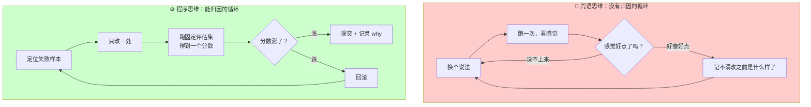
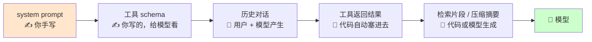

> 大多数人对 prompt 的困惑，源于一个错误的心理模型：把 prompt 当成**咒语**——念对了就灵，念不对就再换一个说法试。正确的模型是把它当成**程序**：它有输入输出契约、有版本、能被测试、改动能被归因。这篇要完成的就是这个观念转变。

## 你将学到

1. 为什么「prompt 是程序」这个转变决定了你能走多远
2. Zero-shot / Few-shot / Chain-of-Thought 三版 prompt 的对照实验（含可回填的实测表）
3. 角色设定（persona）真正起作用的机制，以及它**做不到**的三件事
4. Prompt 版本管理：为什么它必须像代码一样进版本控制
5. 五个具体到能复现的坑
6. prompt engineering 为什么会升级成「上下文工程」

## 前置要求

- 已读 LLM API 基础（需要 `.env`、`client` 的搭法）
- `pip install openai python-dotenv`
- 本机 `.env` 已建（当前仓库只有 `.env.example`，先 `cp .env.example .env` 填 key）

---

## 一、观念转变：从咒语到程序

| | 咒语思维 | 程序思维 |
|---|---|---|
| prompt 是什么 | 一句"能召唤出好结果"的话 | 一段有明确输入输出契约的代码 |
| 怎么改进 | 换措辞，凭感觉试 | 定位失败样本，针对性加约束 |
| 怎么判断变好了 | 感觉这次回答更顺 | 评估集分数从 62% 到 81% |
| 改动后出问题 | 不知道是哪次改坏的 | `git diff` + 重跑评估集，十分钟定位 |
| 能复现吗 | 不能（temp 一抖动就不同） | 能（prompt 固定 + `temperature=0`） |
| 一年后还能维护吗 | 不能，没人敢动 | 能，prompt 文件有版本和变更原因 |

**程序思维的三个具体含义**：

1. **prompt 有输入输出契约**。你得说得出来：输入是什么格式、输出必须是什么格式、哪些字段必填。说不出来 → 下游没法用它，它就只能给人看。
2. **prompt 必须可版本化**。它和 `.py` 文件一样会影响行为，但 `git diff` 看不出"效果变好了还是坏了"——所以必须配评估集（阶段 6）。
3. **prompt 可以被测试**。同一版 prompt 跑 20 条固定用例，得到一个通过率。有了这个数字，改动才有方向。

> 💡 **一句判据**：如果你改完一个 prompt 之后**说不出"什么变好了、什么变差了"**，那你不是在工程，是在占卜。这话在 agent 时代只会更刺耳——因为 agent 里 prompt 会被调用几十次，随机性会被放大。

两种思维对应两个完全不同的迭代循环：



区别不在聪明程度，在于**右边这个循环里每一步都有可比较的数字**。那个数字（评估集分数）在阶段 6 才正式建，但从阶段 1 就该开始攒用例——第二节的 `demos/01-prompt-ab.py` 里的那 5 条输入，就是它的雏形。

## 二、三种基础技巧：同一个任务的三版 prompt

### 任务定义

从一段客服对话里抽取三个字段：

| 字段 | 类型 | 说明 |
|---|---|---|
| `intent` | 枚举 | `退款` / `物流` / `产品咨询` / `投诉` / `其他` |
| `sentiment` | 枚举 | `positive` / `neutral` / `negative` |
| `need_human` | 布尔 | 是否必须转人工 |

输入示例：

```
用户：我上周买的那个耳机，左耳一直有杂音，我要求退货！已经联系过两次了没人理我。
客服：非常抱歉给您带来不好的体验，我马上帮您处理。
```

期望输出（JSON）：

```json
{"intent": "退款", "sentiment": "negative", "need_human": true}
```

### 版本 A：Zero-shot（直接下指令）```text
从下面的客服对话中抽取 intent（退款/物流/产品咨询/投诉/其他）、
sentiment（positive/neutral/negative）、need_human（true/false）三个字段，
以 JSON 格式输出。

对话：
{dialogue}
```

### 版本 B：Few-shot（给例子）```text
从客服对话中抽取三个字段，以 JSON 格式输出。

示例 1：
对话：你们的快递怎么还没到？都三天了。
输出：{"intent": "物流", "sentiment": "negative", "need_human": false}

示例 2：
对话：请问这个型号支持无线充电吗？谢谢！
输出：{"intent": "产品咨询", "sentiment": "positive", "need_human": false}

示例 3：
对话：我要投诉！你们的售后电话永远打不通。
输出：{"intent": "投诉", "sentiment": "negative", "need_human": true}

现在处理这一条：
对话：{dialogue}
输出：
```

### 版本 C：Chain-of-Thought（先推理再输出）```text
从客服对话中抽取三个字段。请按下面的顺序思考，然后输出 JSON。

步骤：
1. 用户的核心诉求是什么？据此判断 intent。
2. 用户用了哪些情绪词或标点（感叹号、重复抱怨）？据此判断 sentiment。
3. 是否出现了"已经联系过但没解决"或"要求赔偿/投诉"这类信号？有则 need_human 为 true。
4. 把三个字段组成 JSON，只输出 JSON 本身，不要输出以上推理过程。

对话：
{dialogue}
```

> ⚠️ 注意第 4 步的写法。CoT 的经典问题是：模型把推理过程也一起输出了，下游拿到一段带散文的文本没法解析。**「先推理再只输出结果」需要在 prompt 里显式要求**——这就是第二节标题里「程序思维」的第一个体现。

### 三版对照实验

`demos/01-prompt-ab.py` 负责跑出这张表。**下表是待回填模板**——本项目尚未在 MiMo 上跑过这组对照，因此「预判」列是设计预期，不是实测结果：

| 版本            | 输出 token | 解析成功率 | 字段准确率 | 预判的失败模式（待验证）                              |
| ------------- | -------- | ----- | ----- | ----------------------------------------- |
| A · Zero-shot | 最少       | 4/5   | 10/15 | 可能加 ` ```json ` 围栏或前缀解释；`need_human` 容易判错 |
| B · Few-shot  | 中        | 4/5   | 11/15 | 输出格式最稳；但示例里的类别分布会**带偏**边界的 case           |
| C · CoT       | 最多       | 5/5   | 6/15  | 字段准确率最高，但**更容易把推理过程一起输出**，除非显式约束          |

**预判的依据**（这是能立刻用上的部分）：

- **Few-shot 主要买的是「格式稳定性」，不是「推理能力」**。它用示例把输出形状钉死，所以解析成功率提升最明显；对模糊 case 的判断力提升有限。
- **CoT 主要买的是「多步判断的准确率」，代价是输出 token 增加**（推理过程也是输出 token，而输出通常比输入贵）。对 `need_human` 这种需要「从多处信号综合」的字段收益最大。
- **两者可以叠加**（few-shot 的示例里也写推理过程），但 token 成本是叠加的。

> 💡 **顺序**：先上 Zero-shot 看基线 → 格式不稳加 Few-shot → 判断不准加 CoT。很多人反过来，一上来就写三段示例 + CoT，结果 prompt 长到 2000 token，收益却说不清来自哪一项。

### 跑出这张表的脚本

`demos/01-prompt-ab.py` 的关键部分（完整可跑，`PROMPTS` 里放上面三版原文）：

```python
"""三版 prompt 对照：输出 token 数 + JSON 解析成功率。"""
import json
import os

from dotenv import load_dotenv
from openai import OpenAI

load_dotenv()
client = OpenAI(api_key=os.getenv("MIMO_API_KEY"), base_url=os.getenv("MIMO_BASE_URL"))
MODEL = os.getenv("MIMO_MODEL", "mimo-v2.5")

CASES = [
    "你们的快递怎么还没到？都三天了。",
    "我要投诉！你们的售后电话永远打不通，已经联系过两次了。",
    "请问这个型号支持无线充电吗？谢谢！",
    "刚收到就发现屏幕有划痕，我要求退货。",
    "耳机音质不错，就是包装有点简陋。",
]

PROMPTS: dict[str, str] = {
    "A-zero-shot": "...",   # 填入版本 A 原文
    "B-few-shot": "...",    # 填入版本 B 原文
    "C-cot": "...",         # 填入版本 C 原文
}


def parse_json_lenient(text: str) -> dict | None:
    """先剥 ```json 围栏，再尝试解析。返回 None 表示解析失败。"""
    cleaned = text.strip()
    if cleaned.startswith("```"):
        # 去掉首行围栏和结尾的 ```
        cleaned = cleaned.split("\n", 1)[-1].rsplit("```", 1)[0].strip()
    try:
        return json.loads(cleaned)
    except json.JSONDecodeError:
        return None


def main() -> None:
    print(f"{'版本':<14}{'解析成功':<10}{'平均输出token':<16}{'失败样例'}")
    print("-" * 70)

    for name, template in PROMPTS.items():
        ok, tokens, failures = 0, 0.0, []

        for case in CASES:
            resp = client.chat.completions.create(
                model=MODEL,
                messages=[{"role": "user", "content": template.format(dialogue=case)}],
                temperature=0,          # ★ 评估必须固定温度，否则无法归因
                max_tokens=512,
            )
            content = resp.choices[0].message.content or ""
            tokens += resp.usage.completion_tokens if resp.usage else 0

            if parse_json_lenient(content) is not None:
                ok += 1
            else:
                failures.append(content[:40].replace("\n", " "))

        print(f"{name:<14}{ok}/{len(CASES):<8}{tokens / len(CASES):<16.1f}"
              f"{(failures[0] if failures else '-')}")

        # ★ 用真实 usage 而不是 tiktoken —— 见 LLM API 基础第三节
        #   要统计输入 token，在循环里另加 inp += resp.usage.prompt_tokens


if __name__ == "__main__":
    main()
```

跑完把数字填回上面的表格，并**在笔记里写上日期和模型名**——这种对照表的结论会随模型发版失效。

## 三、角色设定（persona）：作用与边界

### 它真正起的作用```text
你是一位有十年经验的儿科医生，习惯用家长能听懂的话解释病情。
```

persona 有效，是因为它**同时收窄了多个维度的输出分布**：

| 收窄了什么 | 效果 |
|---|---|
| 词汇域 | 自动带出该领域的术语和表达习惯 |
| 语气与详略 | 「给家长解释」隐含了"少用术语、多打比方" |
| 隐含的默认行为 | 「十年经验」隐含了"先说结论再解释"这类惯例 |

这比写十条「请用简洁的语言」「请避免术语」的规则更省 token，效果通常也更好——因为它是**一个连贯的语境**，而不是十条彼此可能冲突的约束。

### 它做不到的三件事

1. **不能保证正确性**。让模型扮演专家不会让它变成专家。**更糟的是，「你是一位从不出错的专家」这类 persona 会降低模型说「我不确定」的概率**，从而增加幻觉。
2. **不能替代规则**。「你是严谨的助手」不能替代「输出必须是合法 JSON」。风格约束和能力约束是两回事，后者要写在明确的规则或 schema 里（见 结构化输出）。
3. **不能当安全边界**。靠 persona 说「你不会泄露隐私」来防注入，在阶段 7 会看到它有多容易被绕过。**安全必须是代码层的护栏，不是 prompt 里的一句话。**

> 💡 **判断标准**：persona 用来约束**怎么说**，规则和 schema 用来约束**说什么、说成什么格式**。混在一起写，出问题时你分不清是哪一层失效了。

## 四、Prompt 版本管理

### 为什么必须做

prompt 是行为的一部分，但它有三个特殊性，导致它比代码更需要版本管理：

1. **改动效果不可从 diff 直观看出来**。改一个形容词，`git diff` 只有一行，但行为可能天翻地覆。
2. **它经常被"临时改一下"**。因为改 prompt 不需要重新部署，很容易在调试时改了又忘了改回来。
3. **它散落在代码里**。`f-string` 拼在函数中间，改一处不知道有没有别处也用了类似的表述。

### 最小可行做法

**第一步：把 prompt 从代码里搬出来，一个文件一个 prompt。**

```
prompts/
├── 01-extract.v3.md
├── 01-extract.v2.md      # 历史版本留着，不要删
└── 01-extract.v1.md
```

**第二步：文件头写清楚它是什么**（用 frontmatter 就行，Obsidian 的渲染不影响纯文本读取）：

```markdown
---
id: extract-customer-fields
version: 3
model: mimo-v2.5
changed: 2026-09-19
why: v2 在 need_human 上准确率只有 60%，加入 CoT 第 3 步判断规则
eval: 20 条用例，字段准确率 62% → 81%
owner: me
---

（下面是 prompt 正文）
```

**第三步：每次改动跑一遍评估集，把分数写进 `eval:` 字段。**

这三步里，**`why:` 和 `eval:` 是真正的价值所在**。三个月后你只会记得"这版是最好的"，不会记得为什么——而 `why` 和 `eval` 会告诉你，改动的前提条件是否还成立。

> 💡 这就是「**把上下文当代码**」原则的起点。阶段 3 会把它从「一个 prompt 文件」扩展成「整个上下文的版本化与所有权」——包括工具描述、few-shot 示例、检索进来的文档片段。阶段 6 会给出评估集的完整做法。

## 五、五个坑

### 坑 1：把 prompt 当玄学调参，不做版本管理

**可复现的失败场景**：你花了两个小时，依次改了 A、B、C 三处措辞，感觉结果变好了。第二天想把"最好的那版"找回来——但它从来没被保存过，你现在只有一堆 `demo.py` 的历史和记忆。更糟的是：**B 那处改动可能是有害的**，只是被 C 的收益盖住了，你的"最好那版"里埋了一个负收益。

**对策**：一次只改一处（能归因），改完跑评估集（有数字），存成带 `why` 的文件（可回溯）。

### 坑 2：在一次改动里同时改五处

无法归因是 prompt 调试最大的时间黑洞。改一处 → 跑 20 条 → 看分数，循环慢但结论干净；改五处 → 跑 20 条 → 分数涨了，但你不知道是哪处涨的，也不知道另四处里有没有负收益。**后者看起来快，实际会在第十次迭代时彻底失控。**

### 坑 3：用「不要做 X」的负面指令

Anthropic 的 prompt 指南里明确建议：**告诉模型该做什么，而不是不该做什么。** 原因很直白——负面指令要求模型先激活「X」这个概念，再抑制它；而提到 X 本身就已经把 X 拉进了上下文。

```text
# ❌ 模型会开始想"不要提价格"这件事，反而更容易带出价格
不要提及价格，不要用营销话术，不要写超过三行。

# ✅ 正向描述目标行为
用中性描述，只讲功能的实际用途。回答控制在三行以内。
```

> ⚠️ **待验证**：这条结论来自 Anthropic 的文档，在 MiMo 上的效果强度未实测。验证方法：写一对正/负版本的 prompt，各跑 20 次，统计违规次数。

### 坑 4：few-shot 示例给太多、或顺序随意两个具体问题：

- **token 挤占**：5 个示例每个 200 token，就是 1000 token 的输入，每轮都付钱（见 LLM API 基础 第七节的账）。而且示例越多，留给**真实输入**的注意力预算越少。
- **顺序敏感**：Liu et al. 的 *Lost in the Middle*（2023）发现模型对上下文中部信息的利用显著弱于首尾。示例如果太多，中间那些容易被"看不见"。

**实践建议**：示例控制在 2-4 个，**把最能体现边界情况的放在最前或最后**，跑一次乱序对照确认顺序对本任务到底有没有影响（**待验证**：MiMo 上的顺序敏感度）。

### 坑 5：prompt 里出现明文 key 或真实用户数据

安全红线，没有例外。具体场景：为了调试，把「这是用户的真实订单信息：张三，138xxxx，订单号 xxx」贴进 prompt 存进了笔记——笔记会被双链、图谱索引，等于二次扩散。

**对策**：示例里一律用构造的假数据；prompt 模板文件里只放占位符（`{dialogue}`），真实内容运行时注入。

## 六、终点：从 prompt engineering 到上下文工程这一节是整篇的落点。

prompt engineering 关心的是「**这一句话该怎么说**」——措辞、结构、示例、语气。它的作用域是**你手写的那一段文本**。

但在 agent 里，每一轮送进模型的 `messages` 里，**你手写的部分占比会越来越小**：

| 上下文成分 | 谁写的 | 阶段 1 时的占比 | agent 里的占比 |
|---|---|---|---|
| system prompt | 你手写 | 100% | 经常不到 10% |
| 工具 schema | 你写的（给模型看） | 0 | 显著 |
| 历史对话 | 用户 + 模型产生 | 0 | 大 |
| 工具返回结果 | **代码自动塞的** | 0 | 大 |
| 检索到的文档片段 | **代码自动塞的** | 0 | 大 |
| 压缩后的摘要 | **模型生成的** | 0 | 中 |



橙色那一块是阶段 1 的你唯一能控制的东西。到了阶段 3，你要控制的是**整条链**。

> **写 prompt 的人已经不再是你，而是你的代码。**

于是问题的性质变了：不再是「这句话怎么写」，而是「**这一轮到底该给模型看哪些 token，以及按什么顺序放**」。这就是上下文工程 (context engineering)：它管的是**上下文的组装、预算、裁剪、压缩与持久化**——也就是阶段 3 的全部内容。

一句话总结这篇的落点：**prompt engineering 是上下文工程在「只有一个手写文本块」时的特例。**

## ✅ 学习检查点

- [ ] 能说出「prompt 是程序」的三个具体含义（契约 / 版本化 / 可测试）
- [ ] 能默写出同一任务的 zero-shot / few-shot / CoT 三版 prompt 的骨架
- [ ] 能解释 few-shot 主要买的是格式稳定性，CoT 主要买的是多步判断准确率
- [ ] 能说出 persona 起作用的三条机制，以及它做不到的三件事
- [ ] 能说出 prompt 文件头里 `why:` 和 `eval:` 两个字段为什么最重要
- [ ] 跑通 `demos/01-prompt-ab.py`，把实测数字回填到第二节的表格，并记下日期与模型名
- [ ] 能复现坑 1（改了三处但无法归因）和坑 3（负面指令反效果）
- [ ] 能解释为什么 agent 里「写 prompt 的人其实是代码」

## 📖 相关文档

- [Anthropic · Prompt Engineering 概览](https://docs.anthropic.com/en/docs/build-with-claude/prompt-engineering/overview) — 正向指令、示例用法等实践建议的出处
- [Prompt Engineering Guide](https://www.promptingguide.ai/) — zero-shot / few-shot / CoT 的系统整理，中英双语
- [Lost in the Middle: How Language Models Use Long Contexts](https://arxiv.org/abs/2307.03172) — 示例顺序与位置敏感性的原始论文
- [OpenAI · Prompt Engineering 指南](https://platform.openai.com/docs/guides/prompt-engineering) — 针对 OpenAI 系模型的官方建议（MiMo 兼容协议下大部分通用）

## ➡️ 下一步→ 结构化输出
