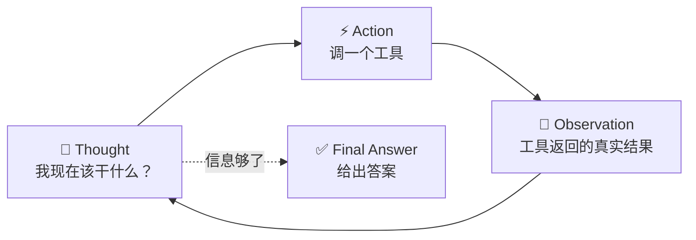
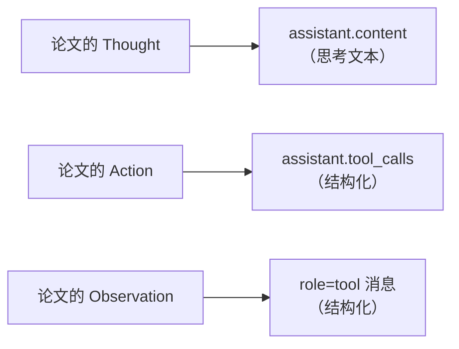
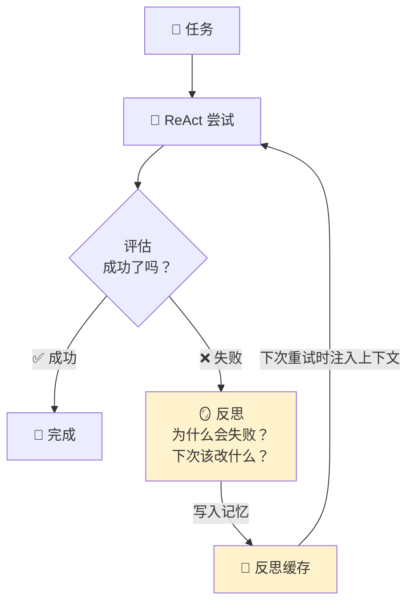

> ReAct = **Reasoning + Acting**。它最核心的贡献不是「让模型用工具」——而是证明了**思考和行动必须交替进行**：想一步、做一步、看结果、再想下一步。

## 你将学到

1. ReAct 论文（arXiv:2210.03629）到底提出的是什么，以及它和 CoT 的本质差别
2. 为什么现代实现**不再**解析文本里的 `Action:` 字样，改用原生 function calling
3. 怎么用 system prompt + 工具让 `content` 字段自然承载 Thought
4. Reflexion（arXiv:2303.11366）如何补上 ReAct 缺的「从失败中学习」
5. 最常见的失败模式：**只让模型输出思考，不接真实环境反馈** → 幻觉出「已完成」

## 前置要求```bash
pip install openai python-dotenv
```

`.env` 需要 `MIMO_API_KEY` / `MIMO_BASE_URL` / `MIMO_MODEL`（见 `.env.example`）。

前置阅读：Function Calling 原理、手写第一个 Agent Loop。本篇假设你已经能跑通一个最小循环。

---

## 一、ReAct 之前：两种各自缺一半的做法

Yao et al. 2022 的论文 *ReAct: Synergizing Reasoning and Acting in Language Models* 提出的出发点，是当时的两条路线各有硬伤：

| 路线 | 做法 | 缺什么 |
|------|------|--------|
| **CoT**（Chain-of-Thought） | 让模型写「让我们一步步思考」 | 只有内部推理，**接不到外部世界**。知识过时就是过时，算错就是算错，中途错了也不会知道 |
| **Act-only**（当时的行为克隆/工具调用） | 让模型直接输出动作 | 没有推理痕迹，**动作之间不连贯**。模型容易在长任务里丢失目标，也说不清为什么选这个动作 |

ReAct 的观察很简单但很强：**这两件事应该交替做**。推理帮助决定下一步动作，动作的结果又反过来修正推理。



这个循环的**关键约束**是：`Observation` 必须来自**真实环境**，不能由模型自己编。一旦 Observation 是模型想象的，整个循环就退化成 CoT 加了一段表演。

## 二、纯 CoT vs ReAct：一张对比图```mermaidgraph TD
    subgraph COT["🧠 纯 CoT"]
        C1["问题"] --> C2["思考 1"]
        C2 --> C3["思考 2"]
        C3 --> C4["思考 3"]
        C4 --> C5["答案"]
        C2 -.->|"❌ 无外部输入"| C3
        C3 -.->|"❌ 无法验证"| C4
    end

    subgraph REACT["🔁 ReAct"]
        R1["问题"] --> R2["💭 思考：需要查天气"]
        R2 --> R3["⚡ 动作：get_weather 北京"]
        R3 --> R4["👀 观察：28°C"]
        R4 --> R5["💭 思考：还需要上海的"]
        R5 --> R6["⚡ 动作：get_weather 上海"]
        R6 --> R7["👀 观察：32°C"]
        R7 --> R8["💭 思考：可以算了"]
        R8 --> R9["⚡ 动作：calculator 32-28"]
        R9 --> R10["👀 观察：4"]
        R10 --> R11["✅ 答案：上海热 4 度"]
    end

    style REACT fill:#e6f3ff
    style COT fill:#fff0f0
```

差别不在步数，在于**每个 Thought 后面都跟着一个来自外部的事实**。CoT 的第 3 步建立在第 2 步的推测上；ReAct 的第 5 步建立在第 4 步的实测上。**误差不会累积**。

> 💡 一个直接推论：ReAct 的答案质量，**上限由工具质量决定，不由模型智商决定**。给模型一个返回假数据的 `get_weather`，再强的模型也只能输出假答案。这在阶段 6 做评估时是个大坑——你测出来的分数里混着工具的错误率。

## 三、为什么现代实现不再解析 `Action:` 文本

论文里的 ReAct 是这样工作的：

```text
Thought: 我需要知道北京的天气
Action: get_weather[北京]
Observation: 28°C, 晴
Thought: 我还需要上海的
Action: get_weather[上海]
...
```

应用层用正则去抓 `Action:` 那一行、解析方括号里的参数、执行、再把 `Observation:` 拼回去。**这在 2026 年已经不该这么写了**，原因是三重的：

### 原因 1：文本解析是脆弱的

模型不会老老实实只输出这些行。实际会遇到的变体：

```text
Action: get_weather(北京)          # 用了圆括号
Action: get_weather["北京"]         # JSON 风格
动作: get_weather[北京]             # 换了中文标签（模型跟随用户语言漂移）
Thought: 让我调用 get_weather[北京]  # 动作混在思考行里
I'll use the get_weather tool for 北京.   # 完全不用 Action 格式了
```

每一个变体都要加一条正则，正则之间还会互相干扰。**你写的是一个概率性文本格式的 parser，不是协议。**

### 原因 2：格式漂移 (format drift) 会随上下文增长而恶化

对话越长、系统提示里的示例越少、few-shot 例子被挤出窗口，模型遵循自定义格式的稳定性就越低。而**恰恰是长会话里才最需要工具可靠调用**。

### 原因 3：原生 function calling 已经解决了这个问题

function calling 的本质是**把「模型输出结构化动作」这件事从 prompt 层提到了 API 层**：

| | 文本解析 ReAct | 原生 function calling |
|---|---|---|
| 动作格式 | 靠 prompt 约定，软约束 | 模型侧专门训练 + API 层约束，硬得多 |
| 参数解析 | 正则 / 括号匹配 | 返回 JSON 字符串，`json.loads` |
| 并行调用 | 得自己约定多条 `Action:` 行 | 一个消息带多个 `tool_calls` |
| 失败信号 | 正则没匹配上，你不知道是模型没想调还是格式错了 | `tool_calls` 为空 = 明确没调 |
| 消息配对 | 无 | `tool_call_id` 服务端校验 |

**但 ReAct 没有被淘汰——它的「Thought → Action → Observation 交替」思想活了下来，只是编码方式换了。** 现在的对应关系是：



Thought 依然在 `content` 字段里，只是 Action 和 Observation 从「需要解析的文本」变成了「一等公民的消息类型」。

> ⚠️ 一个例外：如果你明确需要**模型输出的思考过程可被审计**（比如合规场景），要注意 `content` 里的思考是模型自愿写的，你不加提示它可能什么都不写。见第五节。

## 四、用 function calling 实现 ReAct：可跑代码

下面这段的核心技巧是：**在 system prompt 里显式要求「先写一句话说明你为什么调这个工具，再调」**，Thought 就会自然出现在 `content` 里。

```python
# demos/03-react.pyimport jsonimport os

from dotenv import load_dotenv
from openai import OpenAI

load_dotenv()

client = OpenAI(
    api_key=os.getenv("MIMO_API_KEY"),
    base_url=os.getenv("MIMO_BASE_URL"),
)
MODEL = os.getenv("MIMO_MODEL", "mimo-v2.5")

# ---------- 工具：注意返回的是 dict，不是自然语言 ----------

_FAKE_WEATHER = {"北京": (28, "晴"), "上海": (32, "多云"), "广州": (35, "雷阵雨")}


def get_weather(city: str) -> dict:
    """教学用假数据，真实项目里换成 HTTP 调用。"""
    if city not in _FAKE_WEATHER:
        # ★ 关键：业务错误以「带上下文的结果」返回，不是抛异常
        return {"error": f"暂不支持城市 {city!r}", "supported": list(_FAKE_WEATHER)}
    temp, cond = _FAKE_WEATHER[city]
    return {"city": city, "temp_c": temp, "condition": cond}


def calculator(expression: str) -> dict:
    allowed = set("0123456789+-*/(). ")
    if not set(expression) <= allowed:
        return {"error": f"表达式含非法字符：{expression!r}，只允许四则运算"}
    try:
        return {"result": eval(expression, {"__builtins__": {}}, {})}
    except Exception as exc:
        return {"error": f"计算失败：{exc}"}


TOOL_IMPL = {"get_weather": get_weather, "calculator": calculator}

TOOLS = [
    {
        "type": "function",
        "function": {
            "name": "get_weather",
            "description": "查询指定中国城市今天的实时天气。支持：北京、上海、广州。",
            "parameters": {
                "type": "object",
                "properties": {"city": {"type": "string", "enum": list(_FAKE_WEATHER)}},
                "required": ["city"],
            },
        },
    },
    {
        "type": "function",
        "function": {
            "name": "calculator",
            "description": "计算四则运算表达式。做任何算术时都必须用这个工具，不要心算。",
            "parameters": {
                "type": "object",
                "properties": {"expression": {"type": "string"}},
                "required": ["expression"],
            },
        },
    },
]

# ---------- ★ ReAct 的 prompt 层实现 ----------

SYSTEM_PROMPT = """你是一个使用 ReAct 模式工作的助手。

每一轮你必须严格按这个顺序：
1. **Thought**：先用一句中文说明你当前掌握了什么、还缺什么、下一步打算做什么。
   把这句话写在正文（content）里，让用户能看到你的推理。
2. **Action**：如果需要外部信息或计算，调用相应的工具。
   如果信息已经足够，直接在正文里给出最终答案，不要调用工具。

规则：
- 绝不凭记忆回答天气，必须调用 get_weather。
- 绝不做心算，必须调用 calculator。
- 工具返回的 error 字段说明这次调用失败了，请阅读错误信息并修正后重试，
  不要忽略它继续往下猜。
"""


def run_react(user_input: str, max_iterations: int = 10, verbose: bool = True) -> str:
    messages = [
        {"role": "system", "content": SYSTEM_PROMPT},
        {"role": "user", "content": user_input},
    ]

    for step in range(max_iterations):
        resp = client.chat.completions.create(
            model=MODEL, messages=messages, tools=TOOLS, tool_choice="auto",
        )
        msg = resp.choices[0].message
        messages.append(msg.model_dump(exclude_none=True))

        # ★ Thought 就在这里：模型写在 content 里的推理
        if verbose and msg.content:
            print(f"\n💭 Thought[{step}]: {msg.content.strip()}")

        if not msg.tool_calls:
            return msg.content or ""

        for call in msg.tool_calls:
            name = call.function.name
            args: dict | None = None          # parse 失败时保持 None，供日志使用
            try:
                args = json.loads(call.function.arguments)
                result = TOOL_IMPL[name](**args)
            except json.JSONDecodeError as exc:
                result = {"error": f"参数不是合法 JSON：{exc}"}
            except TypeError as exc:
                result = {"error": f"参数与签名不匹配：{exc}"}
            except KeyError:
                result = {"error": f"不存在名为 {name} 的工具"}

            payload = json.dumps(result, ensure_ascii=False)
            if verbose:
                shown = args if args is not None else call.function.arguments
                print(f"⚡ Action[{step}]: {name}({shown})")
                print(f"👀 Observation[{step}]: {payload}")

            messages.append({
                "role": "tool",
                "tool_call_id": call.id,
                "content": payload,
            })

    return f"⚠️ 达到最大迭代次数 {max_iterations}，已停止。"


if __name__ == "__main__":
    print(run_react("北京和广州今天哪个更热？热多少度？"))
```

跑起来大致是这样（`content` 里的中文就是 Thought）：

```text
💭 Thought[0]: 我需要先查北京和广州的天气。这两个查询互不依赖，我一起调用。
⚡ Action[0]: get_weather({'city': '北京'})
👀 Observation[0]: {"city": "北京", "temp_c": 28, "condition": "晴"}
⚡ Action[0]: get_weather({'city': '广州'})
👀 Observation[0]: {"city": "广州", "temp_c": 35, "condition": "雷阵雨"}

💭 Thought[1]: 北京 28°C，广州 35°C。现在需要算差值，我用 calculator 而不是心算。
⚡ Action[1]: calculator({'expression': '35-28'})
👀 Observation[1]: {"result": 7}

💭 Thought[2]: 信息齐全，可以回答了。
广州更热，比北京高 7°C（35°C vs 28°C）。
```

### 这段代码里 ReAct 的三个对应点

| ReAct 概念 | 代码位置 |
|-----------|---------|
| Thought | `msg.content`（system prompt 要求模型写在这里） |
| Action | `msg.tool_calls`（原生 function calling，不用解析） |
| Observation | `role="tool"` 消息的 `content` |

> ⚠️ **待验证**：MiMo 在 `tool_choice="auto"` 时是否**稳定**地在 `content` 里写 Thought，未做统计。模型有时会 `content=null` 直接给 `tool_calls`。经验上：system prompt 里的表述越具体（「用一句中文」「写在正文里」），遵循度越高；few-shot 示例能让遵循度再上一个台阶。如果你的应用依赖 Thought 做展示，建议加一个兜底文案而不是假设它一定存在。

## 五、最常见的坑：有思考，没反馈

这是**初学者写 ReAct 时最典型的失败**，而且失败得很隐蔽——代码能跑，输出看起来很专业。

### 失败场景（可复现）

把上面的 system prompt 改成这样，只强调「先思考」：

```python
SYSTEM_PROMPT = """你是一个会使用 ReAct 模式的助手。
请先输出你的 Thought，再给出你的 Action。
例如：
Thought: 我需要查天气
Action: get_weather[北京]
Observation: 北京 28°C

现在开始。"""
```

同时**不传 `tools` 参数**（或者工具描述写得很差导致模型不用）。

结果：模型会**自己把 Observation 编出来**。

```text
Thought: 我需要查北京的天气
Action: get_weather[北京]
Observation: 北京今天 28°C，晴
Thought: 我已经拿到数据了
最终答案：北京今天 28°C，天气晴朗。
```

**这个 Observation 完全是幻觉。** 模型只是在续写一段「看起来像 ReAct」的文本，因为它在训练数据里见过大量这种格式。它没有任何机制知道这个数字是真的还是编的。

### 为什么这个坑特别危险

1. **输出格式完全正确**，肉眼审查看不出来
2. **不会有任何报错**，没有异常、没有 400
3. 如果 Prompt 里的示例数字看起来合理，幻觉数字也会看起来合理
4. 生产环境里这意味着**用户拿到一个自信的假答案**，而且比模型直接说「我不知道」糟糕得多

### 判据与修法

**判据**：问自己——「这一轮里，模型看到的 Observation，是不是**我的代码写进去的**？」

- 是 → 真 ReAct
- 否（模型自己写出来的） → 假 ReAct，本质是 CoT 加表演

**修法**：

1. **不要把 Observation 写进 prompt 的 few-shot 示例里**（或者用明显假的值如 `XXX`），否则模型会照着编
2. **必须真的传 `tools`**，让 Action 走结构化通道
3. **断言 `tool_calls` 的存在**：如果这一轮模型没调工具却声称拿到了外部数据，你的循环应该能检测到
4. **代码里禁止模型输出 `Observation:`**——在 system prompt 明确写「不要输出 Observation，它由系统填入」

第 3 点值得写成代码：

```python
# 一个粗糙但有效的一致性检查：模型提到了工具名，但这一轮没调任何工具
if not msg.tool_calls and any(t in (msg.content or "") for t in TOOL_IMPL):
    # 可能是它在假装调用了工具
    logger.warning("模型提到了工具 %s 但没有实际 tool_calls，输出可能含幻觉", ...)
```

> 💡 更彻底的做法：在阶段 6 做**过程评估**而不只看结果——检查每一轮的 `tool_calls` 与 `content` 是否自洽。见 为什么 Agent 必须做评估。

## 六、Reflexion：给 ReAct 补上「从失败中学习」

ReAct 有一个明显的局限：**它是无记忆的**。同一个任务失败 3 次，第 4 次它还会用同样的思路失败，因为在它的上下文里前 3 次根本没发生过（循环结束时那些消息就被丢了）。

Reflexion（Shinn et al., 2023, arXiv:2303.11366）补的正是这一块：**失败之后，让模型用自然语言写一段「反思」，存进记忆，下次重试时带上**。



三个组成部分：

| 组件 | 作用 |
|------|------|
| **Actor** | 就是 ReAct 循环，负责做 |
| **Evaluator** | 判断这次尝试成没成（可以是单测、规则、或另一个 LLM） |
| **Self-Reflection** | 失败时生成一段可复用的经验教训 |

**关键设计点**：反思是**自然语言**，不是模型权重更新。它通过「写进下一次的上下文」起作用，所以：

- 见效快，不需要训练
- 但受上下文窗口限制，反思条目多了会挤爆（阶段 3 的 压缩与摘要策略 要处理这个）
- 反思质量依赖 Evaluator 的质量——**Evaluator 判错了，反思会学到错误的教训**

> 💡 Reflexion 和 Plan-and-Execute 与 Reflection 里的 Reflection 是同一族思路，但那篇讲的是**单次任务内的自我批判**（refine 当前输出），Reflexion 讲的是**跨尝试的经验积累**。两者常一起用。

### 一个最小 Reflexion 骨架```python
def solve_with_reflexion(task: str, max_attempts: int = 3) -> str:
    reflections: list[str] = []   # ← 跨尝试累积的经验

    for attempt in range(max_attempts):
        # 把历史反思注入到 prompt 里，这是 Reflexion 的全部魔法extra = ""
        if reflections:
            extra = "\n\n你之前的失败经验（务必避免重蹈覆辙）：\n" + "\n".join(
                f"- {r}" for r in reflections
            )

        result = run_react(task + extra)

        if evaluate(task, result):          # ★ 必须有外部判据，不能让模型自评
            return result

        reflections.append(
            reflect(task, result)           # 另一次 LLM 调用，产出「教训」
        )

    return f"⚠️ {max_attempts} 次尝试均未通过评估。最后结果：{result}"
```

**注意 `evaluate()` 必须是外部的**。如果让模型自己判断「我成功了吗」，它几乎总是回答「成功了」——这正是 Reflection 那篇里要讲的自我评估偏差。

## 七、什么时候不该用 ReAct

ReAct 不是万能解。下面几种情况它反而是错的工具：

| 场景 | 为什么 ReAct 不合适 | 该用什么 |
|------|-------------------|---------|
| 任务步骤**完全固定**（如 ETL 三步） | 让模型每步都「思考」纯属浪费 token 和延迟 | 直接写代码调 |
| 需要**全局规划**（20 步的重构） | 逐步即兴会跑偏，走到第 10 步发现方向错了 | Plan-and-Execute |
| 单轮问答，无需外部信息 | 没有 Action 可做，ReAct 退化成 CoT | 直接调 LLM |
| 延迟极敏感（< 1s） | 每次工具调用 = 一次完整 LLM 往返 | 预取数据 / 缓存 |

> 💡 Anthropic 的 *Building Effective Agents* 里有一句值得记住的话，大意是：**能用最简单方案解决的，不要上 agent**。ReAct 循环带来的自主性，代价是延迟、成本、和不可预测性。这三样在 demo 里看不出来，在生产里是主要矛盾。

---

## ✅ 学习检查点

- [ ] 能说出 ReAct 论文解决的是哪两个已有路线的缺陷
- [ ] 能画出 Thought → Action → Observation 循环，并解释「Observation 必须来自真实环境」
- [ ] 能列出至少三条「不用文本解析 `Action:` 而用原生 function calling」的理由
- [ ] 能说出 ReAct 的三个概念分别对应到 wire 层的哪个字段
- [ ] 能复现「假 ReAct」失败场景：去掉 `tools` 参数，看模型如何自己编出 Observation
- [ ] 能说出 Reflexion 与 ReAct 的关系，以及为什么 `evaluate()` 必须是外部的
- [ ] 亲手跑通 `demos/03-react.py`，把 `get_weather` 的 `enum` 删掉再跑，观察模型填了什么城市

## 📖 相关文档

- [ReAct: Synergizing Reasoning and Acting in Language Models](https://arxiv.org/abs/2210.03629) — ReAct 原始论文（Yao et al., 2022）
- [Reflexion: Language Agents with Verbal Reinforcement Learning](https://arxiv.org/abs/2303.11366) — 用自然语言反思替代梯度更新
- [Anthropic · Building Effective Agents](https://www.anthropic.com/engineering/building-effective-agents) — 五种 agent 模式的总览，ReAct 只是其中一种
- [OpenAI Function Calling](https://platform.openai.com/docs/guides/function-calling) — Action/Observation 在 wire 层的真实格式
- [Chain-of-Thought Prompting](https://arxiv.org/abs/2201.11903) — 对照理解 CoT 与 ReAct 的分界

## ➡️ 下一步

→ 停止条件与预算控制 —— ReAct 循环跑起来之后，第一个必须回答的问题是「它什么时候停」
