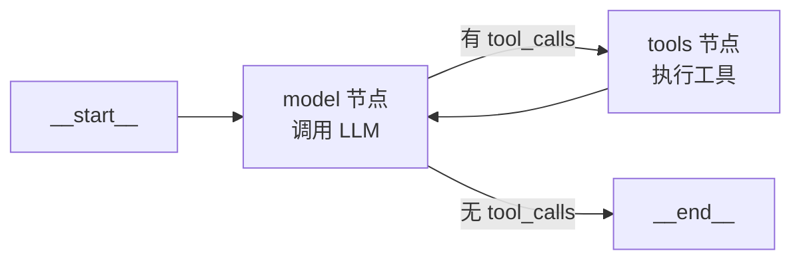

> **📋 摘要：本页回答**
> `create_agent` 到底建了一个什么东西？工具调用的循环是怎么转起来的？
> 为什么有时候 Agent 会陷入死循环？
>
> 下面的图节点名和消息轨迹都是**实机打印**出来的，不是示意图。

---

## 一、`create_agent` 返回的不是「Agent 对象」

这是最容易误解的一点。实测：

```python
agent = create_agent(model=model, tools=[get_weather], system_prompt="你是天气助手")

print(type(agent).__name__)                  # CompiledStateGraph
print(sorted(agent.get_graph().nodes.keys())) # ['__end__', '__start__', 'model', 'tools']
```

> **💡 提示：关键认知**
> **`create_agent` 返回的是一个编译好的 LangGraph 图。**
> 所谓「Agent 循环」，就是这个图里 `model` 和 `tools` 两个节点之间的一条条件边。
>
> 所以：**学 LangChain 1.x 不可能绕开 LangGraph**。你调用的每一个 `create_agent`，
> 本质上都是在用一套预设好的 LangGraph 模板。

图结构：



---

## 二、状态：`AgentState`

图的状态类型是 `AgentState`，实测它的注解：

```python
AgentState.__annotations__
# {
#   'messages': Required[Annotated[list[AnyMessage], add_messages]],
#   'jump_to':  NotRequired[Annotated[JumpTo | None, ...]],
#   'structured_response': NotRequired[Annotated[ResponseT, OmitFromInput]],
# }```

三个字段，日常只需要关心第一个：

| 字段 | 作用 |
|---|---|
| `messages` | 完整消息历史，**带 `add_messages` reducer**（见下） |
| `jump_to` | 框架内部用，控制工具执行后跳到哪 |
| `structured_response` | 用了 `response_format` 时，结构化结果放这里 |

> **📝 说明：`add_messages` 是个 reducer，不是简单赋值**
> ```python
> messages: Annotated[list[AnyMessage], add_messages]
> ```
> 它决定「节点返回 `{"messages": [...]}` 时会发生什么」：
> - **相同 ID 的消息 → 更新替换**（流式时把分片合并成完整消息就靠这个）
> - **新 ID 的消息 → 追加**
>
> 这意味着**每个节点只需要返回「新增的消息」**，不用返回整个历史。
> 自己写图时如果忘了加 reducer，新消息会把历史覆盖掉。

---

## 三、一次工具调用的完整轨迹（实测）

输入 `{"messages": [HumanMessage("北京天气如何")]}`，最终 `result["messages"]` 有 **4 条**：

| # | 类型 | 内容 | 由哪个节点产生 |
|---|---|---|---|
| 1 | `HumanMessage` | 北京天气如何 | 用户输入 |
| 2 | `AIMessage` | `tool_calls=[{name: "get_weather", args: {city: "北京"}, id: "c1"}]` | `model` |
| 3 | `ToolMessage` | `北京 晴 26℃`（`tool_call_id="c1"`） | `tools` |
| 4 | `AIMessage` | 北京今天晴，26℃，适合出门。 | `model` |

循环过程：

1. `model` 节点被调用 → 模型返回**带 `tool_calls` 的 `AIMessage`**
2. 条件边发现 `tool_calls` 非空 → 路由到 `tools` 节点
3. `tools` 节点按 `name` 找到函数、用 `args` 调用、把结果包成 `ToolMessage`
4. 回到 `model` 节点，此时模型看到了工具结果 → 生成最终回答
5. 这次 `AIMessage` 没有 `tool_calls` → 条件边路由到 `__end__`

> **💡 提示：`model` 节点背后做了什么**
> 它调用 `model.bind_tools(tools)` 得到一个「绑定了工具的模型」，
> 然后把消息历史交给它。**这就是为什么自定义模型必须实现 `bind_tools`。**
>
> 绑定做的事情是把工具的 JSON Schema 塞进请求的 `tools` 字段，
> 让模型知道有哪些工具可调、参数是什么。

---

## 四、自己查看图结构调试时非常有用：```python
# 拿 Mermaid 文本，可贴进 Markdown 或 mermaid.live
print(agent.get_graph().draw_mermaid())

# 看节点和边
g = agent.get_graph()
print(g.nodes.keys())   # dict_keys(['__start__', 'model', 'tools', '__end__'])
print(g.edges)          # 边的列表
```

---

## 五、工具的进阶控制

### 5.1 工具报错时怎么办

默认情况下工具抛异常会中断整个图。用中间件接管：

```python
from langchain.agents.middleware import ToolErrorMiddleware, ToolRetryMiddleware

agent = create_agent(
    model="openai:gpt-4o-mini",
    tools=[flaky_api],
    middleware=[
        ToolRetryMiddleware(max_retries=3, backoff_factor=2.0),  # 失败自动重试
        ToolErrorMiddleware(),                                    # 兜底：把异常转成 ToolMessage 给模型
    ],
)
```

> **💡 提示：让模型看到错误，比直接崩掉更好**
> `ToolErrorMiddleware` 会把异常信息包成 `ToolMessage` 返回给模型，
> 模型就能自己决定「换个参数重试」还是「告诉用户做不到」。
> 这比让异常冒泡到用户面前体验好得多。

### 5.2 一次返回「给人看的」和「给模型看的」```python
@tool(response_format="content_and_artifact")
def query_db(sql: str):
    """执行 SQL 查询

    Args:
        sql: 查询语句
    """
    rows = run_query(sql)                     # list[dict]
    return json.dumps(rows, ensure_ascii=False), rows
    #      ↑ content 给模型看            ↑ artifact 给程序用```

### 5.3 工具里访问 state 和 store```python
from langchain.tools import ToolRuntime


@tool
def get_pref(uid: str, runtime: ToolRuntime) -> str:
    """查询用户偏好

    Args:
        uid: 用户 ID
    """
    item = runtime.store.get(("users",), uid)
    return str(item.value) if item else "无记录"


agent = create_agent(
    model="openai:gpt-4o-mini",
    tools=[get_pref],
    store=store,          # 传入 Store
)
```

> **⚠️ 注意：`runtime` 参数不会暴露给模型**
> 带 `ToolRuntime` 类型注解的参数会被框架**自动注入且对模型隐藏**，
> 模型看到的工具签名只有 `uid`。这是依赖注入，不是工具参数。
>
> 同类的还有 `InjectedState`、`InjectedStore`、`InjectedToolCallId`。

---

## 六、死循环：最常见的事故

Agent 循环没有内置的最大轮次限制。如果模型反复调用同一个工具（参数错、工具永远失败），图会一直转。

**三种防护，建议全加：**

```python
from langchain.agents.middleware import (
    ModelCallLimitMiddleware,   # 限制模型调用次数
    ToolCallLimitMiddleware,    # 限制工具调用次数
    ModelFallbackMiddleware,    # 主模型失败时切换备用模型
)

agent = create_agent(
    model="openai:gpt-4o-mini",
    tools=[...],
    middleware=[
        ModelCallLimitMiddleware(thread_limit=20),      # 单个会话最多 20 次模型调用
        ToolCallLimitMiddleware(tool_limit=50),         # 单个会话最多 50 次工具调用
    ],
)
```

> **🚫 危险：限额是单次会话级的**
> `thread_limit` 指一个 `thread_id` 内的累计次数，不是单次 `invoke`。
> 所以**长会话应用（客服、 copilot）必须设这个**，否则用户聊久了必然触顶或超支。

---

## 七、验收清单

- [ ] 知道 `create_agent` 返回 `CompiledStateGraph`，图节点是 `model` + `tools`
- [ ] 能背出一次工具调用的 4 条消息轨迹
- [ ] 理解 `add_messages` reducer 的作用（追加/替换）
- [ ] 知道 `model.bind_tools` 被内部调用，自定义模型必须实现
- [ ] 会用 `get_graph().draw_mermaid()` 看图
- [ ] 给生产 Agent 加了 `ModelCallLimitMiddleware` 和 `ToolCallLimitMiddleware`

---

## 相关笔记

- 11-LangChain 1.x 心智模型与最小上手 — 上一页
- 13-中间件机制 — 本页提到的中间件详细展开
- 14-LangGraph 核心原语 — 自己画图，而不是用模板
- 10-LangChain 与 LangGraph 索引

---
- 返回 10-LangChain 与 LangGraph 索引
