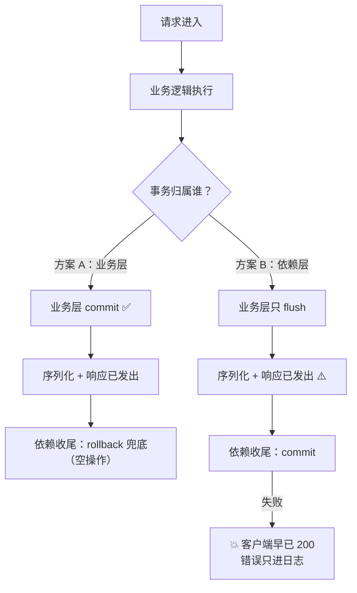

> **❓ 问题**
> 「但是不是要统一风格再 dbsession 里面提交吗，两次提交不是会出现问题吗」
>
> 拆开就是两个问题：
> 1. `db/session.py` 的 `get_db` 里**已经有** `await session.commit()`（`db/session.py:24`），
>    那是不是应该**统一由依赖层提交**，业务层别再写？
> 2. 现在业务层也 `commit()`、依赖层也 `commit()`，**提交了两次会不会出问题**？

上级：00-首页 · 前置：Q-14-修改用户密码怎么写 · 相关：异步数据库会话 · 分层架构约定

---

## 🎯 一句话回答

> **📝 说明：结论**
> **「两次提交」本身不是 bug** —— 实测第 2 次、第 3 次 `commit()` 都不报错（第 3 次连 SQL 都不发）。
>
> 但你的直觉是对的：**该统一**。真正的病根不是"提交了两次"，而是
> **事务边界没有唯一归属** —— 现在一次请求有两个地方都能结束事务，于是：
>
> | 症状 | 后果 | 级别 |
> | :--- | :--- | :--- |
> | 业务层先 commit，之后同请求再出错 | 依赖层的 `rollback` **回滚不掉已提交的部分** → 原子性没了 | 🔴 严重 |
> | `get_db` 的 commit 在**响应发出之后**才执行（实测 t=0.06s vs t=1.58s） | commit 失败时前端**早就拿到 200**，错误只进日志，连错误响应都发不出去 | 🔴 严重 |
> | 依赖层的 commit 悄悄替业务层兜底 | 忘记 `commit()` 时本地一切正常，换个调用入口就**静默丢数据** | 🟠 隐蔽 |
>
> **建议：选方案 A —— 事务边界归业务层，把 `get_db` 里那行 `commit()` 删掉，保留 `rollback` 兜底。**
> 理由和对照代码见 💻 两个方案的可复制代码。

---

## 📖 详细说明

### 一、先把事实钉死：连续 commit 到底会不会炸（✅ 实测）

> **🧪 示例：探针 1 · 复跑命令（stdin 方式，未写任何文件）**
>
```
> .venv/Scripts/python.exe - <<'PY'
> # SELECT 一行 → 连续 commit 三次 → 每次观察 in_transaction 与 SQL 日志
> PY
>
```

**实测结果**（`expire_on_commit` 实测打印为 `True`）：

| 步骤 | `in_transaction()` | 发出的 SQL | 结果 |
| :--- | :--- | :--- | :--- |
| `SELECT` 出一行 | `True` | `BEGIN (implicit)` + `SELECT` | — |
| **第 1 次** `commit()` | `True` → `False` | `COMMIT` | ✅ 成功，事务真的结束了 |
| 第 1 次 commit 后读 `u.username` | — | `BEGIN (implicit)` 后失败 | ❌ `StatementError` / `MissingGreenlet`（属性已过期，要重新 IO） |
| **第 2 次** `commit()` | `False` | `COMMIT` | ✅ **不报错**（因为上一次失败的重载尝试又开了个隐式事务） |
| **第 3 次** `commit()` | `False` | **一条 SQL 都没有** | ✅ **不报错**，纯粹的 no-op |
| `refresh(u)` 后再读属性 | — | `SELECT ... WHERE id=3` | ✅ 恢复正常 |

> **📝 说明：所以：**"两次提交"从来就不是问题本身****
> 无活动事务时 `commit()` 是空操作，既不发 SQL 也不报错。
> 项目现在的代码（业务层 10 处 `commit()` + 依赖层 1 处，见下表）**一直这么跑，从没炸过**。
>
> 但「不炸」≠「没问题」。下面两条才是真后果。

**顺带把现状数清楚**（`grep -rn "commit" server/ db/`，本次核实）：

| 位置 | 有没有 `commit()` |
| :--- | :--- |
| `db/session.py:24` `get_db` 收尾 | ✅ 有（问题就在这） |
| `server/student.py:20` `create_student` | ✅ 有 |
| `server/student.py:45` `update_student` | ✅ 有 |
| `server/student.py:50-53` `delete_student` | ❌ **没有！** ⚠️ 见 ⚠️ 注意事项 |
| `server/course.py:19 / :42 / :50` | ✅ 三处都有 |
| `server/score.py:19 / :40 / :48` | ✅ 三处都有 |
| `server/user.py:24` `create_user` | ✅ 有 |
| `server/user.py:53` `update_user` | ✅ 有 |

也就是业务层 **10 处**显式提交 + 依赖层 **1 处**兜底 —— 「两次提交」是**常态**，不是偶发。

---

### 二、真正的后果 ①：原子性被破坏（✅ 协议层实测 + 逻辑推论）

> **🧪 示例：探针 5 · 复跑方式**
> 模拟「业务层先 commit，之后同请求内再抛异常」：
>
```
> await s.execute(text("SELECT 1"))   # 只读，不碰业务表
> await s.commit()                    # 业务层提交
> raise RuntimeError("后续步骤出错")    # 业务层后来出错了
> # get_db 的 except 分支：await s.rollback()
>
```

**实测结果**：

```text
BEGIN (implicit)
SELECT 1
COMMIT                                ← 提交真的发到了 MySQL，事务已结束
handler after commit, in_transaction = False
get_db 捕获异常: 后续步骤出错 -> 执行 rollback
rollback 前 in_transaction = False
rollback 后 in_transaction = False
（日志里没有任何 ROLLBACK 语句）
```

> **🚫 危险：结论：**依赖层的 rollback 救不了已经提交的东西****
> `COMMIT` 一旦发到 MySQL，那部分数据就是持久的。
> 之后 `get_db` 的 `rollback()` —— 实测**连一条 `ROLLBACK` SQL 都没发**
> （SQLAlchemy 在无活动事务时不会发），因为它**没有任何东西可回滚**。
>
> **一个具体的坏场景**：将来你做「改密码 + 写审计日志」两步写：
>
```
> await db.commit()                       # ① 密码改了，已落库 ✅
> await db.add(AuditLog(...))             # ② 写审计日志
> await db.commit()                       # ② 这里失败了 💥
> # → 密码已改、日志没写，数据不一致；get_db 的 rollback 无能为力
>
```
> 只要业务层**提前** commit 过一次，这个请求在数据库眼里就**不再是原子操作**了。

---

### 三、真正的后果 ②：响应先于提交（✅ 实测，且比想象中更糟）

> **🧪 示例：探针 3 · 依赖收尾的执行时机**
> 用真实 uvicorn + `Depends` 里 `yield` 后 `await asyncio.sleep(3)` 模拟慢 commit：
>
```
> dep-enter            t=0.09s
> handler              t=0.09s
> dep-exit-begin       t=0.09s
> client got b'{"ok":1}' t=0.09s   ← 客户端已经拿到 200
> dep-exit-end         t=3.10s     ← 依赖收尾 3 秒后才结束
>
```

**源码依据**：`fastapi/routing.py:140-147`

```python
async with AsyncExitStack() as request_stack:     # :140 ← request 作用域的依赖收尾栈
    ...
    response = await f(request)                    # :144 跑路由函数
    await response(scope, receive, send)           # :145 ✅ 响应已经发给客户端了
    # :147 ← 退出 with，request_stack.__aexit__ 才执行 → get_db 的 commit 在这
```

`get_db` 属于 **request 作用域**的 `AsyncExitStack`，它的收尾**排在响应发送之后**。

> **🚫 危险：探针 4 · 提交失败时客户端到底收到什么（✅ 实测，用**项目真实的异常处理器**）**
> 用 `register_exception_handler(app)`（`core/exceptions.py:21`）注册项目自己的处理器，
> 依赖 `yield` 之后抛 `UserNotFound`：
>
>
```
> client got status=200 body=b'{"ok":1}'   t=0.06s   ← 客户端：干净的 200
> dep-exit: 模拟 commit 失败 -> raise UserNotFound  t=1.58s
> RuntimeError: Caught handled exception, but response already started.
>
```
>
> 两个后果叠加，比"错误只进日志"还严重：
> 1. **客户端拿到的是完整的 200 成功响应**，连 `code/msg` 错误体都收不到；
> 2. 服务端连"优雅地返回一个错误响应"都做不到 —— Starlette 检测到响应已经开始，
>    直接抛 `RuntimeError("Caught handled exception, but response already started.")`
>    （源码：`starlette/_exception_handler.py:55-56`），最终由最外层中间件记成
>    `ERROR: Exception in ASGI application`。
>
> **→ 用户以为改密码成功了，其实数据库里什么都没发生。这是最难查的一类 bug。**

---

### 四、真正的后果 ③：兜底越聪明，bug 藏得越深（🟡 代码阅读 + 实测佐证）

依赖层会 commit，意味着**业务层忘了 commit 也能"正常工作"**。项目里就有一个活例子：

`server/student.py:50-53`

```python
async def delete_student(db: AsyncSession, student_id: str) -> None:
    obj = await get_student_by_id(db, student_id)
    await db.delete(obj)      # ← 只是"标记删除"
    return None               # ← 既没 flush，也没 commit！
```

> **🧪 示例：探针 6 · `await db.delete(obj)` 到底发不发 SQL（✅ 实测，操作后已 rollback，净零改动）**
>
```
> SELECT user... (取值)
> session.deleted = ['zhangsan']
> 此时 in_transaction = True（日志里**没有任何 DELETE 语句**）
> ROLLBACK
> rows(id=3) still = 1
>
```
> **DELETE 是延迟到 flush/commit 才发出的。** 所以 `delete_student` 能跑通，
> **100% 靠的是 `get_db` 在响应之后补的那一刀 commit** —— 它自己一个字都没提交。

> **⚠️ 注意：这就是「掩盖效应」的代价**
> `delete_student` 现在「能用」，于是没人发现它漏了 `commit()`。
> 一旦有人把这个函数拿去写脚本 / 定时任务 / 别的 service 复用（没有 `get_db` 了），
> **它会静默什么也不做**：接口返回 200，库里记录还在。
>
> > [!tip] 反直觉但重要的那句
> > **依赖层兜底不是"更安全"，而是"更晚才发现"。**
> > 聪明的兜底会把 bug 从「当场报错」变成「三年后数据对不上」。
>
> 而且：`delete_student` 的 DELETE 也发生在**响应之后** —— 万一它失败，
> 客户端同样已经收到 200 了（原因见上文「真正的后果 ②」）。

---

### 五、两个自洽方案（二选一，别混着来）

> **📝 说明：判据：一次请求的事务**只能有唯一归属****
> 要么业务层说"何时算一次完整业务"，要么依赖层说"一次请求就是一次事务"。
> 现在的问题是**两边都在说**，而业务层的话（commit）**先说了算**，
> 依赖层的话（rollback）就永远说不上了。

#### 方案 A：事务边界归**业务层**（推荐 ✅）

- `server/*` 显式 `await db.commit()` —— **和现有代码一致**（10 处都是这么写的）
- `get_db` 只留 `yield` + `rollback` + `close`，**删掉 `commit()`**
- 多步写要自己收成一次事务（一个 `commit()` 覆盖多步）

| 优点 | 代价 |
| :--- | :--- |
| 改动最小：只需删 `db/session.py:24` 一行 + 补 `delete_student` | 业务层忘写 `commit()` → 静默丢数据（需要测试/人工把关盖） |
| 错误能在**响应之前**被捕获，变成正常的 4xx/5xx | 事务粒度由写代码的人决定，容易一个人一个风格 |
| 和现有 10 处写法一致，读代码不用切换心智模型 | 跨 service 复用时，调用方要记得提交（但这是显式的） |
| 函数自包含：拿出去写脚本/定时任务也是对的 | — |

#### 方案 B：Unit of Work —— 事务边界归**依赖层**

- `server/*` 只 `flush()`，**绝不 commit**
- `get_db` 统一 `commit()` / `rollback()`
- 一次请求 = 一个事务，最"优雅"

| 优点 | 代价 |
| :--- | :--- |
| 事务边界天然唯一，业务层不可能忘提交 | 🔴 **承袭「响应先于提交」**：commit 在响应之后，失败时前端已收 200（探针 3/4） |
| 一次请求内多步写**自动原子** | 🔴 **INSERT 后必须 `refresh()`**：探针 2 实测，不 refresh 就连 `create_time` 都读不出来 → 序列化炸 500 |
| 业务层代码更短（少一行 commit） | ⚠️ 全项目重构（10 处 commit 要改成 flush），且函数**脱离 FastAPI 就不完整** |
| 与 待办与已知问题 #11 的建议一致 | ⚠️ 长连接 / SSE / 文件上传等场景要额外调事务隔离级别 |

> **📝 说明：探针 2 · 方案 B 的硬约束（✅ 实测）**
> 只 `flush()` 不 `commit()`，新建一个 `User` 后读属性：
>
> | 读什么 | 结果 |
> | :--- | :--- |
> | `username`（普通列，你自己赋的值） | ✅ `probe_03118df3` |
> | `id`（自增主键） | ✅ `18`（flush 后就有） |
> | `create_time`（`server_default`） | ❌ `StatementError` / `MissingGreenlet` |
> | `update_time`（`server_default`） | ❌ 同上 |
> | `role`（`server_default="student"`） | ❌ 同上 |
>
> `rollback()` 后回查：**临时行无残留**（✅ 确认）。
>
> 原因：这些列的**值来自数据库**（`server_default`，见 `model/user.py:11-16`），
> flush 后 SQLAlchemy 只知道"该再查一次"，于是把它们标记为**过期**。
> 而序列化发生在同步上下文里，async 驱动不让它偷偷发 IO → 炸。
> **解法只有一个：`await db.refresh(obj)`。** 这点和 INSERT 强绑定，UPDATE 不需要（见下）。

---

### 六、两个方案的事务时序对比（重点看 commit 落点）
```
sequenceDiagram
    autonumber
    participant C as 客户端
    participant R as router
    participant S as server 业务层
    participant D as get_db 依赖
    participant DB as MySQL

    rect rgb(232, 245, 233)
    Note over C, DB: ✅ 方案 A —— commit 在响应之前（业务层拥有事务）
    C->>R: PUT /api/user/update
    R->>D: Depends(get_db)
    D->>DB: BEGIN（惰性，首次 IO 时）
    R->>S: change_password(db, ...)
    S->>DB: SELECT 取用户 / UPDATE 改密码
    S->>DB: COMMIT ✅ 落点①：响应之前
    S-->>R: 返回 ORM 对象（已 refresh）
    R->>R: 序列化 UserResponse
    R-->>C: 200 数据确已落库
    Note over D: yield 之后才轮到依赖收尾
    D->>DB: rollback 兜底（无活动事务 → 空操作，连 SQL 都不发）
    D->>D: close()
    end

    rect rgb(255, 235, 238)
    Note over C, DB: ⚠️ 方案 B —— commit 在响应之后（依赖层拥有事务）
    C->>R: PUT /api/user/update
    R->>D: Depends(get_db)
    D->>DB: BEGIN（惰性）
    R->>S: update_user(db, ...)
    S->>DB: SELECT 取用户 / UPDATE 改密码
    S->>DB: flush()（发 SQL，不提交）
    S->>DB: refresh() 必须！否则 server_default 列 MissingGreenlet
    S-->>R: 返回 ORM 对象
    R->>R: 序列化 UserResponse
    R-->>C: 200 ⚠️ 落点②：此刻数据还没提交
    Note over D: 响应已发出，依赖才开始收尾
    D->>DB: COMMIT 或 ROLLBACK
    Note over C, D: commit 若失败 → 客户端早已 200，<br/>Starlette 抛 RuntimeError，<br/>错误只进服务端日志
    end
```

对照流程图（谁在什么时刻"结束"事务）：



> **💡 提示：一句话记法**
> **方案 A：先落库，后回话。方案 B：先回话，后落库。**
> 对「用户点了保存，结果到底存没存」这件事，A 才是能给出诚实回答的那个。

---

### 七、一个反直觉的推论：`update_user` 里那句 `refresh()` 是在还债

`server/user.py:47-55` 现在是这样：

```python
async def update_user(db: AsyncSession, user: User, password: update_password) -> User:
    ...
    user.password = get_password_hash(password.new_password)
    await db.commit()
    await db.refresh(user)      # ← :54 为什么"必须"写这句？
    return user
```

Q-14-修改用户密码怎么写 已经实测过：**`commit()` 之后不 `refresh()` 就 `MissingGreenlet`**。
但把因果捋直，会得到一个反直觉的结论：

> **📝 说明：`refresh()` 不是在"拿新数据"，是在**给"提交得太早"还债****
> 链条是这样的：
> `业务层先 commit()` → `expire_on_commit=True` 让对象全部属性过期 → `return user` 后
> 序列化在同步上下文里读属性 → 要发 IO → `MissingGreenlet`。
> **`refresh()` 存在的唯一理由，就是把 commit 造成的那次"过期"补齐。**
>
> 而如果换成**方案 B 的 UPDATE 场景**，这句可以不要。
> 探针 7 实测（改一个普通列 → `flush()` → 回滚，净零改动）：
>
>
```
> UPDATE user SET email=%s WHERE user.id = %s
> after UPDATE flush
> in_transaction = True
> expired_attributes = []          ← 什么都没过期！
> read id -> 3
> read username -> zhangsan
> read create_time -> 2026-09-07 19:03:56   ← 读得出来，不炸
> read update_time -> 2026-09-07 19:03:56
> read role -> student
>
```
>
> **UPDATE + flush 不会让对象过期**（因为列的值是你自己赋的，不缺数据）；
> 只有 **INSERT + flush** 才会过期那些 `server_default` 列。
>
> > [!caution] 但别急着照抄这个"优化"
> > 探针 7 里 `update_time` 读到的是**旧值** `2026-09-07 19:03:56` ——
> > MySQL 那句 `ON UPDATE CURRENT_TIMESTAMP` 改了库里的值，SQLAlchemy 并不知道。
> > 本接口的 `UserResponse` 只含 `id / username / create_time`（`schema/user.py:8-12`），
> > 所以不会暴露成 bug。**将来谁在响应模型里加上 `update_time`，这里就静默返回旧值。**
> > 结论：**方案 B 下 UPDATE 可以省 `refresh()`，但省之前先确认响应模型里没有 DB 生成的列。**

---

## 💻 两个方案的可复制代码

### ✅ 方案 A（推荐）

**① `db/session.py:20-29` —— 删掉那行 `commit()`**

```python
async def get_db() -> AsyncSession:
    async with AsyncSessionLocal() as session:
        try:
            yield session
            # ❌ 删掉它：事务边界归业务层，依赖层不该替谁做决定
            # await session.commit()
        except Exception as e:
            # ✅ 保留：业务层没提交就被异常打断时，这里保证整个事务被撤掉
            await session.rollback()
            raise                      # raise e 等价；用裸 raise 保留原始 traceback
        finally:
            await session.close()
```

**② 业务层保持现状（不用改），但两点必须做**

```python
# server/student.py:50-53 —— 唯一漏提交的地方，补上
async def delete_student(db: AsyncSession, student_id: str) -> None:
    obj = await get_student_by_id(db, student_id)
    await db.delete(obj)
    await db.commit()          # ← 补这一行；DELETE 是延迟执行的，不 commit 就什么都不会发生
```

```python
# 多步写：务必收成一个事务，别中途 commit
async def change_password_with_audit(db: AsyncSession, user_id: int, data: PasswordUpdate) -> User:
    db_user = await get_user_by_id(db, user_id)
    if not verify_password(data.old_password, db_user.password):
        raise AuthError("原密码错误")
    db_user.password = get_password_hash(data.new_password)
    db.add(AuditLog(user_id=user_id, action="change_password"))   # 第二步写
    await db.commit()          # ← 一次提交覆盖两步 → 原子 ✅（若第二步失败，密码也不会改）
    await db.refresh(db_user)  # 仍然必须：序列化要读 create_time
    return db_user
```

> **⚠️ 注意：方案 A 的代价，必须配一条测试盖住**
> 从此「业务层忘了 `commit()`」的后果是**静默丢数据**（接口 200，库没变），
> 不再是"依赖层偷偷救回来"。补一个最朴素的守卫：**写操作的集成测试必须查库校验**，
> 不能只看接口返回码。
>
> > [!note] 我试过用「哨兵」自动检测，结论是**不可靠**（实测）
> > 想在 `get_db` 收尾时判断"业务层是不是忘了提交"，比如看
> > `session.new / session.dirty / session.deleted`。实测四个场景：
> >
> > | 场景 | `in_transaction()` | `new` | `dirty` | `deleted` |
> > | :--- | :--- | :--- | :--- | :--- |
> > | 只读请求（纯 SELECT） | `True` | 0 | 0 | 0 |
> > | UPDATE 后 `flush()` 未 commit | `True` | **0** | **0** | 0 |
> > | INSERT 后 `flush()` 未 commit | `True` | **0** | **0** | 0 |
> > | `delete()` 标记后未 flush | `True` | 0 | 0 | **1** |
> >
> > `flush()` 一旦发出 SQL，`new` / `dirty` 就**被清空了**；只剩 `deleted` 还留着。
> > 而 `in_transaction()` 对"只读请求"也是 `True` → **必然误报**。
> > **所以"忘了提交"这件事在会话里没有可靠的自动信号，只能靠测试。**

### ⚠️ 方案 B（Unit of Work）

**① `db/session.py:20-29` —— 提交统一在依赖层**

```python
async def get_db() -> AsyncSession:
    async with AsyncSessionLocal() as session:
        try:
            yield session
            await session.commit()     # ✅ 一次请求 = 一次事务，唯一的提交点
        except Exception as e:
            await session.rollback()
            raise
        finally:
            await session.close()
```

**② 业务层：只 `flush()`，绝不 `commit()`，且 INSERT 后必须 `refresh()`**

```python
# server/student.py:9-22 —— INSERT：flush 之后必须 refresh
async def create_student(db: AsyncSession, data: StudentCreate) -> Student:
    exists = await db.get(Student, data.student_id)
    if exists:
        raise StudentExists(f"学号 {data.student_id} 已存在")
    obj = Student(...)
    db.add(obj)
    await db.flush()               # 拿到自增主键，但不提交
    await db.refresh(obj)          # ✅ 必须！否则 server_default 列过期 → 序列化 MissingGreenlet
    return obj                     # commit 交给 get_db


# UPDATE：对象不会过期，refresh 可以不要（前提：响应模型里没有 DB 生成的列）
async def update_user(db: AsyncSession, user: User, password: update_password) -> User:
    if not verify_password(password.old_password, user.password):
        raise AuthError("旧密码错误")
    user.password = get_password_hash(password.new_password)
    await db.flush()               # 只发 SQL，不提交
    return user                    # 实测 expired_attributes = []，不会 MissingGreenlet
```

> **🚫 危险：方案 B 的两个硬约束，写下来贴墙上**
> 1. **commit 在响应之后**（探针 3：响应 t=0.06s，收尾 t=1.58s）。
>    commit 失败 → 客户端 200 + Starlette `RuntimeError`，错误**永远到不了前端**。
>    对「改密码 / 下单 / 支付」这类需要确定性的写操作，这就是**不可接受**的。
> 2. **INSERT 后必须 `refresh()`**，落一个就是 500。这不是风格问题，是硬性要求。
> 3. 补充：业务函数从此**不能脱离 FastAPI 单独调用**（没有 `get_db` 就没人提交）。
>    脚本 / 定时任务要么也套一个同样的上下文管理器，要么另外写一套 —— 双份维护。

---

## 📊 决策表：什么情况下选哪个

| 判据 | 方案 A（业务层提交） | 方案 B（依赖层提交） |
| :--- | :--- | :--- |
| 事务边界唯一吗 | ✅ 唯一（在 service） | ✅ 唯一（在依赖） |
| commit 落点 | **响应之前** ✅ | 响应之后 ⚠️ |
| commit 失败能否返回错误响应 | ✅ 能（变成正常 4xx/5xx） | ❌ **不能**，客户端已 200 |
| 多步写原子性 | ✅ 自己收成一个 commit | ✅ 自动原子 |
| 业务函数能否脱离 FastAPI 复用 | ✅ 能 | ❌ 不能 |
| 忘记 commit 的后果 | 静默丢数据（需测试盖） | 不可能忘（依赖兜底） |
| 要改的地方 | `db/session.py` 删 1 行 + `delete_student` 补 1 行 | 全项目 10 处 `commit()` → `flush()`，逐处补 `refresh()` |
| 与现有 10 处写法的一致性 | ✅ 一致 | ⚠️ 全部要改 |
| 与 待办与已知问题 #11 建议 | ⚠️ 相反（建议改的那条已过期） | ✅ 一致 |

> **📝 说明：我的建议：**选 A****
> 理由按权重排：
> 1. **响应先于提交** 是致命的 —— 探针 4 实测客户端拿到的是干净的 200，连错误体都不是。
>    对一个「保存」类接口，这等于对用户撒谎。
> 2. **改动面小** —— 删 1 行 + 补 1 行 vs 重构 10 处。
> 3. **和现有代码一致** —— 现有的 `create_user` / `update_student` 都是业务层提交，
>    B 方案要全项目一起改，Q-13-项目下一步往哪发展 里已经有一堆优先级更高的事。
> 4. 方案 A 的那个缺点（忘记 commit → 静默丢数据）**用测试兜**，比方案 B 的缺点好兜。
>
> **落地三步**：
>
```
> ① db/session.py:24  删掉 await session.commit()
> ② server/student.py:52  补 await db.commit()
> ③ 全项目 grep -n "await db.commit()" 对照一遍，确认每个写操作都有、且多步写只提交一次
>
```

---

## ⚠️ 注意事项

> **⚠️ 注意：坑 1：「旧密码错误」现在返回 **400**，不是 401**
> `server/user.py:47-51` 当前的两条校验分支都抛 `ValidationError`：
>
```
> if not verify_password(password.old_password, user.password):
>     raise ValidationError("旧密码错误")            # :49 → code 400001 → HTTP 400
> if password.new_password == password.old_password:
>     raise ValidationError("新密码不能与旧密码相同")   # :51 → code 400001 → HTTP 400
>
```
> `ValidationError` 的 code 是 `PARAM_INVALID = 400001`（`core/errors.py:46`）。
> 实测（`await update_user(None, fake_user, data)`，命中第二条分支，不碰数据库）：
>
```
> type       : core.errors.ValidationError
> code       : 400001
> http_status: 400
>
```
> 代码是对的、import 也是全的（`server/user.py:8` 的 `ValidationError` 来自 `core.errors`）。
> **只是错误码语义值得掂量**：「旧密码不对」本质是**认证失败**（401/403），
> 现在被归到「参数不合法」400。前端通常会拿 401 触发"清 token / 跳登录"，
> 拿 400 只看字段报错 —— 改密时旧密码输错会走到后者。
> 是否要改成 `AuthError`（→ 401，`core/errors.py:47`）是个取舍，
> 建议和 Q-16-改密代码复查还有问题吗 的结论保持一致，别两个接口两种语义。
>
> > [!note] 与 Q-16-改密代码复查还有问题吗 的说法有一处出入 —— **以代码为准**
> > Q-16 说这里的 `ValidationError` "从 pydantic 导入 → 本该 400 的分支实测返回 500"。
> > 我在**同一时刻**实测的结果**不是**这样：`server/user.py:8` 的 import 行是
> > `from core.errors import AuthError, UserExists, UserNotFound,ValidationError`，
> > 抛出来的就是 `core.errors.ValidationError`（400001 / 400），没有 500 也没有 `debug` 泄漏。
> >
> > 两种可能：① Q-16 记录的是**修复前**的状态、之后已被修好；② 两轮工作交叠、各自对着不同版本的文件下的结论。
> > **若将来有人把 import 换成 `from pydantic import ValidationError`，这条分支确实会变成 500**
> > （pydantic v2 的 `ValidationError` 不能这么构造）—— 所以这条值得留个心，别改错 import。

> **🚫 危险：坑 2：`delete_student` 是"靠兜底活着"的函数**
> `server/student.py:50-53` 既没 `flush()` 也没 `commit()`（探针 6 实测 DELETE 是延迟发出的）。
> 它现在能用完全是因为 `get_db` 收了尾。**方案 A 落地时必须同步补上**，
> 否则删学生的接口会变成「返回 200，记录还在」。这是同一批改动里的**必改项**。

> **📝 说明：坑 3：异步数据库会话 与 待办与已知问题 #11 的建议会和本文冲突**
> 两处都写着「Service 层只用 `flush()`，commit 统一交给依赖」——
> **那是方案 B**，本文推荐的是方案 A。而且 待办与已知问题 说「第二次 commit 无害」，
> 这点实测正确，但它没看到**"响应先于提交"**和**"rollback 回滚不掉已提交部分"**这两个真后果。
> 建议把这两处措辞从「统一交给依赖」改成「**二选一，本项目选 A**」。
> （我不擅自改这两篇，等你确认。）

> **📝 说明：坑 4：改了 `get_db` 记得 `raise` 不要 `raise e`**
> `db/session.py:27` 现在是 `raise e`。两者行为基本等价，但裸 `raise` 更规范：
> 保留原始 traceback 且少一次异常链包裹。顺手改掉。

> **⚠️ 注意：坑 5：别在同一个项目里"两个方案各用一半"**
> 最糟的中间态是：`get_db` 仍然 commit，同时某些新函数只 `flush()`。
> 这样新函数的提交时机**取决于调用者**，而调用者是谁完全看不出来 ——
> 会比现在更难排查。**要么全 A，要么全 B。**

---

## 🔗 相关笔记

- Q-14-修改用户密码怎么写 — 前置问题；`commit()` + `refresh()` 为什么成对、`expire_on_commit` 的实测
- 异步数据库会话 — `get_db` 的 commit / rollback / close 时序（⚠️ 该篇「双重 commit」小节的建议与本文相反，见坑 3）
- 分层架构约定 — 「事务控制（commit / rollback）」被明确写进了 server 层的职责表
- 全局异常处理 — 提交失败时为什么错误响应发不出去（`RuntimeError: response already started`）
- Q-09-异常处理现状评估 — 全局处理器的实测体检；本文探针 4 用到了它注册的处理器
- 待办与已知问题 — #11「双重 commit」；本文建议改写它的结论
- 学生模块 — `delete_student`（坑 2）所属的接口
- 用户模块 — `update_user` / `create_user` 所在的接口
- Q-01-添加JWT登录鉴权 — 请求作用域依赖与鉴权依赖的对比
- 变更记录 — 落地改动后记一笔
