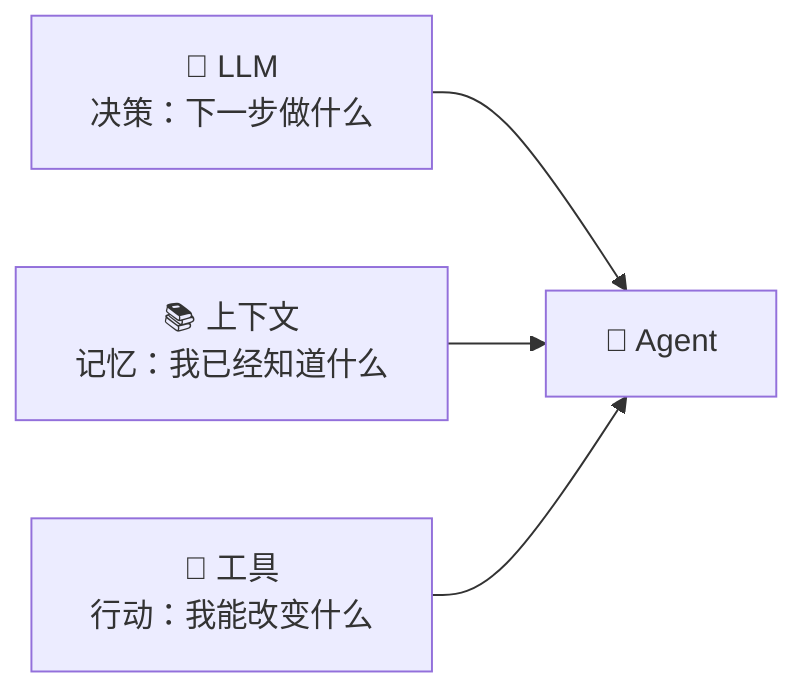
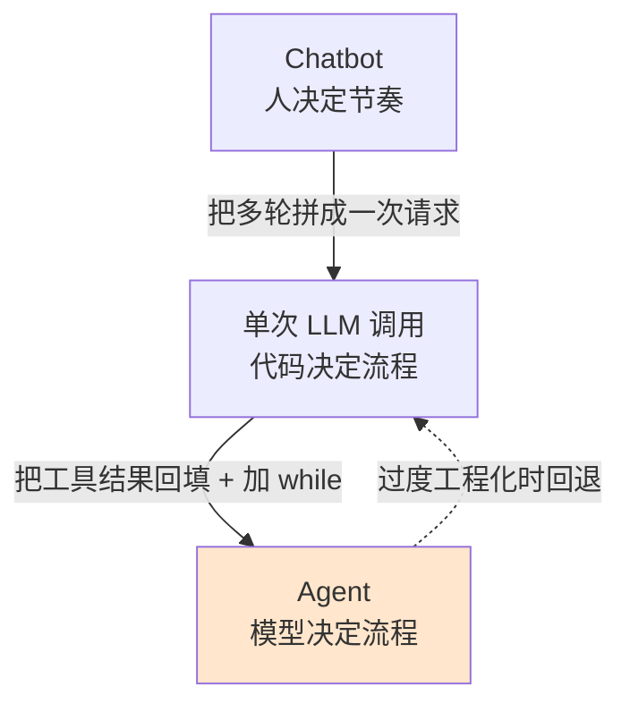
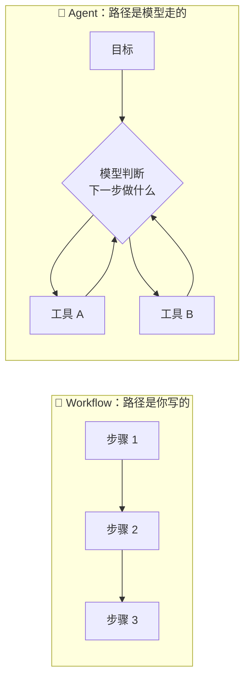
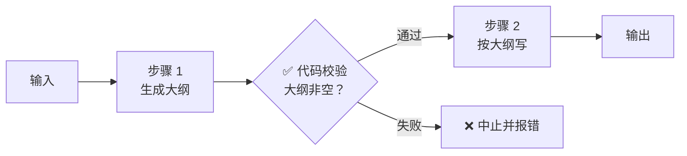
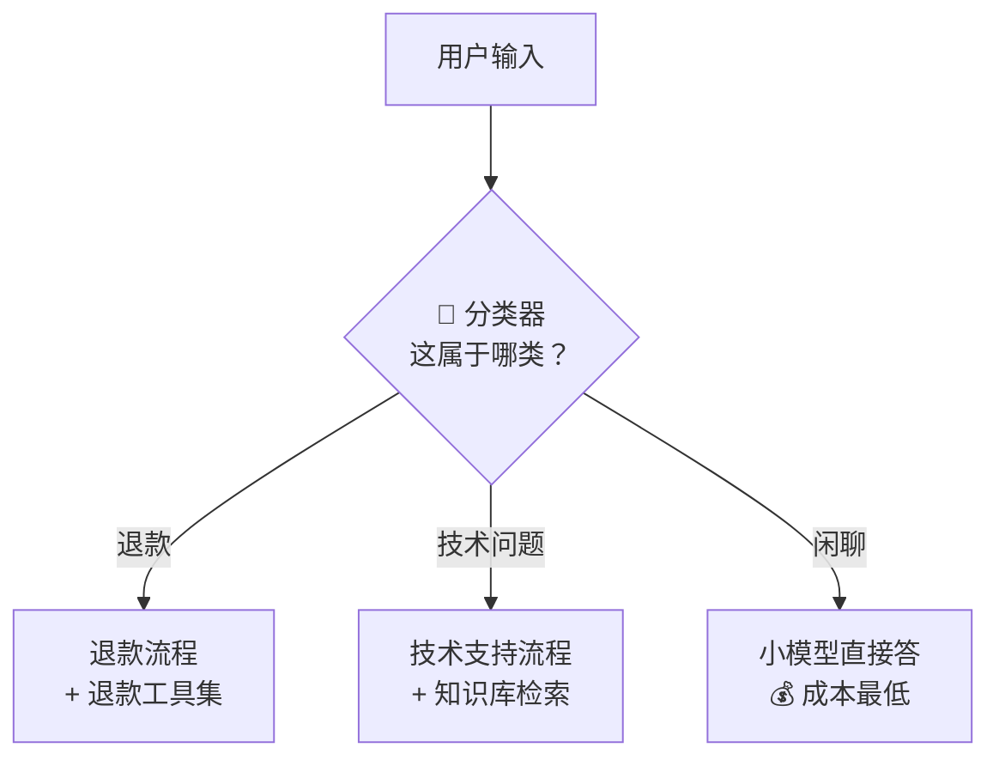
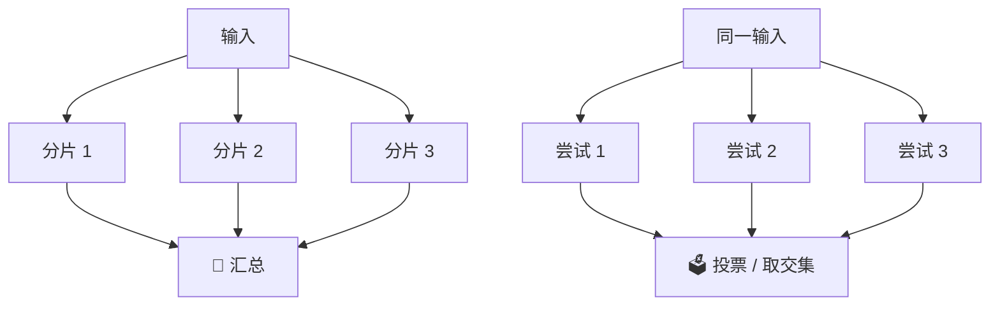
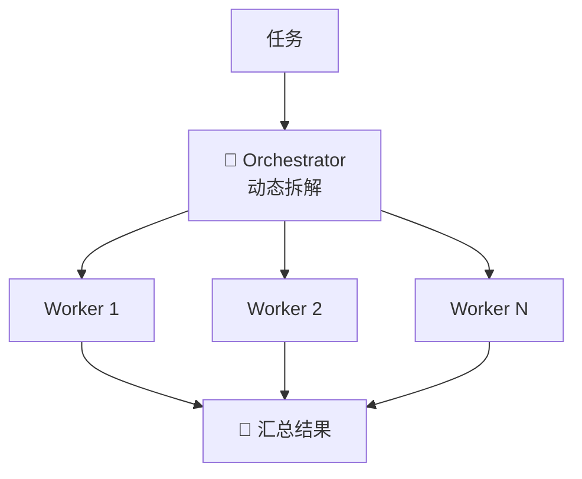
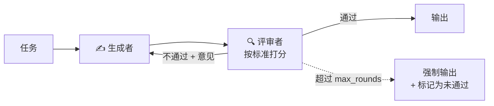
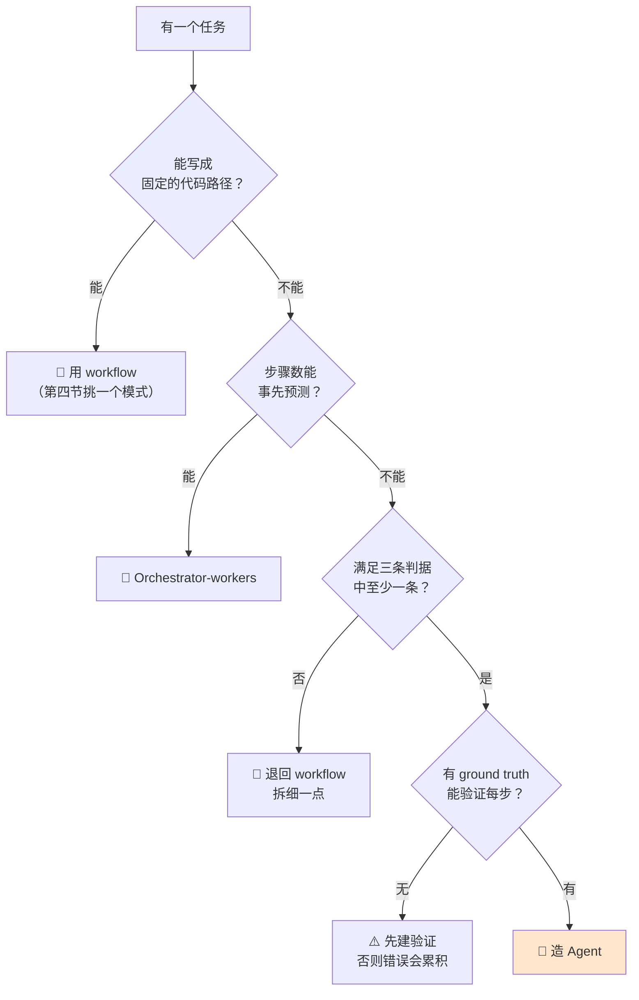

> Agent 不是「更聪明的 ChatGPT」。它是一个**能自己决定下一步做什么**的程序：LLM 负责决策，上下文负责记忆，工具负责改变世界。三者缺一，它就退回成一个聊天机器人——而很多时候，退回成聊天机器人反而是**正确的工程选择**。

## 你将学到

1. 核心公式 `Agent = LLM + 上下文 + 工具` 里，每一项到底在解决什么问题
2. 用**一条判据**分清 Agent / LLM 调用 / Chatbot
3. Workflow 与 Agent 的边界，以及为什么大多数场景你**应该**用 workflow
4. 五种 workflow 模式（Anthropic 归纳），每种配适用场景
5. Agent 的三个必备件，以及工具的三分类（data / action / orchestration）
6. 造 Agent 的三条判据，以及 OpenAI 明确的「什么不算 Agent」
7. 错误累积的数学：为什么 10 步、每步 85% 的 agent 成功率只有约 20%

## 前置要求

- Python 3.12 基础，能读懂函数、字典、列表推导
- **本篇不需要装任何包，也不跑代码**——它只建立概念。想跑代码从 LLM API 基础 开始
- 建议先扫一眼 学习路径总览 的 9 阶段图，知道自己在哪

---

## 一、核心公式：三个词，一条路线

> **Agent = LLM + 上下文 + 工具**

这个提法来自李博杰《深入理解 AI Agent》（全书开源在 [github.com/bojieli/ai-agent-book](https://github.com/bojieli/ai-agent-book)）。整个 v2 路线的 9 个阶段，就是这个公式的反复加深。



拆开看，每一项都在补一个具体的短板：

| 项 | 解决什么问题 | 拿掉它会怎样 | 在哪个阶段深挖 |
|---|---|---|---|
| 🧠 LLM | 决策：从「一堆可能」里选一个 | 你写的是 `if/else` 工作流——**这经常是好事** | 阶段 1 |
| 📚 上下文 | 记忆：跨轮次保持一致 | 每轮失忆，用户得重复说一遍需求 | 阶段 3 ★ |
| 🔧 工具 | 行动：突破「只能说话」 | 只能输出文本，做不了任何有副作用的事 | 阶段 2、4 |

**为什么要背这个公式**：因为它同时是**诊断表**。agent 表现不好时，先问是哪一项出的问题——

- 模型选错了工具 → 工具（描述写得太烂，模型看不懂）
- 忘了三轮前说过的约束 → 上下文（历史被裁掉了，或压缩时丢了）
- 答得对但做不了 → 工具（能力缺失）

大部分「agent 好难调」的抱怨，最后都落到这三格里的一格。不背这个公式，你只能盲目地改 prompt。

## 二、Agent vs LLM 调用 vs Chatbot

三者经常被混着说，其实用**一条判据**就能切开：

> **看「谁决定下一步」。**
> 你的代码决定下一步 → 那是 workflow / 单次调用。
> 模型决定下一步 → 那才是 agent。

| 维度 | Chatbot | 单次 LLM 调用 | Agent |
|---|---|---|---|
| 谁决定下一步 | 人（人一直打字） | 你的代码（下一步写死了） | **模型自己** |
| 跨轮状态 | 有（拼历史） | 无 | 有（拼历史 + 工具结果） |
| 能改变外部世界 | 不能 | 不能 | 能（调工具，有副作用） |
| 循环次数 | 人说了算 | 恒为 1 | 不固定，由模型决定 |
| 典型失败 | 答非所问 | 输出格式不对 | **卡在循环里烧钱** |
| 调试方式 | 看对话 | 看单次输入输出 | 看**轨迹**（trace） |



注意那条虚线：**从 Agent 退回单次调用是完全正常的工程决策**，不是失败。下一节就在讲什么时候该退。

## 三、Workflow vs Agent 的边界

这一节的核心结论来自 Anthropic 的《Building Effective Agents》（2024-12-19，作者 Erik Schluntz 与 Barry Zhang）。它是这个领域被引用最多的文章，原因不是它讲了多新的技术，而是它**劝你别乱上 agent**。

两个定义，值得逐字记住：

> **Workflow**：LLM 和工具通过**预定义的代码路径**被编排。
> **Agent**：LLM **动态决定**自己的流程和工具使用，自己掌控如何完成任务。

换成人话：workflow 里你写代码说「先摘要、再分类、再查库」；agent 里你只给一个目标，路线是模型每轮现算的。



### 为什么大多数场景该用 workflow

Anthropic 的原话是：能找到**最简单可行**的方案就用最简单的，只在确有必要时才增加复杂度。它的理由是 agent 有三个**结构性劣势**：

| 劣势 | 具体代价 |
|---|---|
| 成本不可预测 | workflow 的调用次数是常量；agent 的调用次数是变量，最坏情况你要为「模型绕了 20 圈」付钱 |
| 延迟不可预测 | 同上，P99 延迟可能比中位数高一个数量级 |
| **错误累积** | 每多一步就多一次出错机会（第五节算给你看） |

> ⚠️ **过度工程化是这个领域最常见的反模式。** 一个「把客服工单分类后转给对应队列」的需求，用 routing workflow 30 行就能写完、成本可控、延迟 800ms；换成 agent 之后要处理「模型决定先查用户历史再分类」这类不可预期的路径，调试成本翻十倍，效果还不一定更好。

### 一条可以拿去做决策的判据

Anthropic 给 agent 的适用场景是：**开放式问题，步骤数难以预测甚至无法预测，且你没法把路径写死。**

翻译成两个可操作的问题：

1. 我能不能**穷举**这个任务所有可能的步骤？能 → 写 workflow。
2. 我能不能**验证**每一步做对了没有（有 ground truth 反馈）？不能 → agent 会在错误上继续走，先把验证建起来。

## 四、五种 workflow 模式（本篇核心）

这五个模式是 Anthropic 那篇文章最有价值的部分——**它们是「不用 agent 也能做复杂事」的工具箱**。每个模式都可以和别的组合。

### 1. Prompt chaining — 串行分解

把一个任务拆成固定顺序的几步，前一步的输出是后一步的输入。**中间可以插入代码检查（gate）**，不通过就中止——这是它相对 agent 的最大优势：失败点是你指定的。

- 适用：任务能干净地拆成固定子步骤；你愿意用一点延迟换准确率。
- 反例：步骤间需要来回反复（那就不是链，是循环）。



### 2. Routing — 先分类再分派

先用一次（通常很便宜的）调用判断输入属于哪一类，再分派到专门的流程、专门的 prompt、甚至**专门的模型**。

- 适用：输入类别明显且处理方式差异大（客服工单、模型降级、简单问题走小模型）。
- 隐藏价值：**成本控制**。简单问题路由给小模型，是最容易见效的省钱手段。



### 3. Parallelization — 并行化（两个子类）

**别混淆这两个子类**，它们的目的完全不同：

| 子类             | 做法                      | 为了什么 |
| -------------- | ----------------------- | ---- |
| Sectioning（分段） | 把任务拆成**互相独立**的子任务，并行跑   | 省时间  |
| Voting（投票）     | 把**同一个**任务跑多次，取多数 / 取交集 | 提准确率 |

- Sectioning 适用：子任务之间无依赖（一个 prompt 同时查「安全性」和「性能」）。
- Voting 适用：判断类任务，且你有理由相信「多次独立判断的多数」比单次更可靠（例如「这段代码有没有安全漏洞」）。
- 代价：voting 的成本是线性的，跑 5 次就是 5 倍钱。



### 4. Orchestrator-workers — 编排者 + 工人

一个「主」LLM **动态**把任务拆成子任务，派给若干 worker，最后汇总。和并行化的区别在于：**拆成几份、拆成什么，是模型当场决定的，不是你写死的。**

- 适用：你事先不知道要拆几步的复杂任务（「改这个仓库里所有用到旧 API 的地方」——要先扫一遍才知道有几处）。
- 与 agent 的关系：orchestrator-workers **已经是 agent 的形态了**（拆解是动态的），只是 worker 本身通常不循环。它是 workflow 与 agent 之间的过渡带。



### 5. Evaluator-optimizer — 生成 + 评审循环

一个 LLM 生成，另一个 LLM 按明确标准评审并给意见，生成方据此改进，循环到通过为止。

- 适用：**存在明确的评价标准**，且「改一版」确实比「一次写好」容易（翻译润色、代码按规范重写）。
- 前提：如果连你都说不出评价标准，那 evaluator 也评不出东西——它会变成两个模型互相客套。
- 必须设上限：循环要有 `max_rounds`，否则可能永远「还能再好一点」。



### 怎么选：一张速查表

| 你的任务长什么样 | 用哪个模式 |
|---|---|
| 能拆成固定几步 | Prompt chaining |
| 输入类别明显，处理方式不同 | Routing |
| 子任务互相独立，想省时间 | Parallelization · sectioning |
| 同一判断要更可靠 | Parallelization · voting |
| 拆几步事先不知道 | Orchestrator-workers |
| 有明确评价标准，且能迭代改进 | Evaluator-optimizer |
| **步骤数无法预测，且没有固定路径** | **Agent** |

## 五、Agent 的三个必备件

如果决定造 agent，它最少要有三样东西（这是 OpenAI《A Practical Guide to Building Agents》的划分）：

| 必备件 | 作用 | 缺了会怎样 |
|---|---|---|
| **模型 (model)** | 决策核心 | 没有循环的动力 |
| **工具 (tools)** | 让模型能查、能做 | 只能空谈，无法获取真实信息 |
| **指令 (instructions)** | 定义目标、边界、停止条件 | 模型不知道做到什么程度算完 |

### 工具的三分类

工具不是随便加的，按**它让模型获得了什么能力**可分三类：

| 类别                    | 作用                      | 例子                      | 风险                            |
| --------------------- | ----------------------- | ----------------------- | ----------------------------- |
| **Data**（取数据）         | 把外部信息拉进上下文              | 查天气、读文件、检索知识库、查数据库      | 低——只读。但要注意读到了**不该读的**（`.env`） |
| **Action**（执行动作）      | 改变外部世界                  | 发邮件、写文件、下单、调 API        | **高——有副作用，必须可回滚或需确认**         |
| **Orchestration**（编排） | 让 agent 调度别的 agent / 流程 | 委派子 agent、启动一个 workflow | 中——会放大成本，且错误会跨 agent 传播       |

> 💡 **为什么这个分类重要**：它直接对应阶段 7 的权限设计。data 类工具可以宽松授权，action 类必须最小权限 + 可回滚。很多人给 agent 加 `run_bash` 的时候没意识到自己同时打开了这三类——一个 `run_bash` 既能读（data）、又能写（action）、还能起新进程（orchestration）。

## 六、什么时候该造 Agent

OpenAI 那份 34 页的 PDF 给了一张判据清单。满足**以下任意一条**，才考虑 agent：

1. **复杂决策逻辑** — 流程里有大量需要权衡的分支，规则写不清楚
2. **规则难以维护** — 你已经有一套 if/else 规则，但它又长又脆，改一处崩一处
3. **大量非结构化数据** — 输入是自然语言、文档、对话，而不是干净的字段

它同时明确划了一条线：**chatbot、单轮 LLM 调用、分类器都不算 agent。**

为什么这条否定式定义有用？因为它挡住了最常见的一种自欺：把一个 `classify()` 函数包一层 `while True` 就管它叫 agent，然后困惑于「为什么我的 agent 不稳定」。它本来就不是 agent，它是个分类器，不稳定的原因在 prompt 和标签上，不在「agent 架构」上。

> ⚠️ **待核验提示**：上面三条判据与「三种不算 agent」的说法来自 2025 年发布的该 PDF。这类方法论文档的措辞可能在新版里调整，引用时请注明版本与核对日期。

**决策流程**：



## 七、错误累积的数学

这是整篇最该记住的一节，因为它解释了**为什么 agent 必须有校验步和停止条件**——不是「最好有」，是数学上必须有。

假设 agent 每一步的准确率是 `p`，而且各步独立（这个假设偏乐观，真实情况是错误会互相放大），那么一个 `n` 步任务的成功率是：

```
P(整个任务成功) = p^n
```

`p = 0.85`（对单步来说已经相当不错）时：

| 步数 n | p=0.85 | p=0.95 | p=0.99 |
|---|---|---|---|
| 1 | 85.0% | 95.0% | 99.0% |
| 3 | 61.4% | 85.7% | 97.0% |
| 5 | 44.4% | 77.4% | 95.1% |
| **10** | **19.7%** | 59.9% | 90.4% |
| 20 | 3.9% | 35.8% | 81.8% |

**读法**：`0.85^10 ≈ 19.7%`。一个看起来「每步都挺准」的 agent，跑 10 步的任务，五次里只有一次能成功。

更糟的是这个模型还**低估**了问题：真实 agent 里，第 3 步的错误会污染第 4 步的输入，各步并不独立，实际衰减比 `p^n` 更快。

### 三种应对（对应后面三个阶段）

| 应对          | 做法                                        | 在哪讲    |
| ----------- | ----------------------------------------- | ------ |
| **缩短链路**    | 能用 3 步做完就别用 10 步（这就是第四节 workflow 模式的价值）   | 本篇第四节  |
| **让每步更容易对** | 把 0.85 提到 0.95：给工具写清楚的描述、给模型结构化的输入        | 阶段 4   |
| **加校验与重试**  | 每步检查结果，错了把错误回传让它重试（相当于把 `p` 换成「至少一次对」的概率） | 阶段 2、6 |

校验步为什么能救回来：如果每步失败后允许重试一次，单步成功率从 `p` 变成 `1-(1-p)^2`。`p=0.85` 时是 `0.9775`，10 步总成功率从 19.7% 提到 `0.9775^10 ≈ 79.6%`。**代价是平均调用次数上升**——这就是 agent 成本不可预测的数学根源。

> 💡 一句话记住：**agent 的可靠性不是「模型有多强」的函数，是「链路有多长 × 每步有没有校验」的函数。**

## 八、本项目怎么落地

本篇不跑代码，但先把环境对应关系放这里，避免后面混淆：

- 项目用**小米 MiMo**（`model="mimo-v2.5"`，`base_url="https://api.xiaomimimo.com/v1"`），走 **`openai` 裸 SDK**（OpenAI 兼容接口）
- 密钥从 `.env` 读：`os.getenv("MIMO_API_KEY")`。**任何时候都不要把 key 写进代码或笔记**
- `.env` 里同时存 `MIMO_BASE_URL` 与 `MIMO_MODEL`，代码里不要硬编码模型名——换模型时只改 `.env`

MiMo 是 OpenAI 兼容接口，所以**消息格式、工具调用的 wire 层协议与 OpenAI 一致**；但涉及 OpenAI 官方独有能力（如 `response_format` 的严格 JSON Schema 模式、prompt caching 的计费细节）的结论，在 MiMo 上都要标注「待验证」。

## ✅ 学习检查点

- [ ] 能默写出 `Agent = LLM + 上下文 + 工具`，并说出每一项缺失时的症状
- [ ] 能用「谁决定下一步」这条判据，判断一个需求该用 workflow 还是 agent
- [ ] 能说出五种 workflow 模式各自的名字和一句话适用场景
- [ ] 能解释 Parallelization 的 sectioning 和 voting 有什么本质区别（省时间 vs 提准确率）
- [ ] 能说出 OpenAI 明确的「三种不算 agent」的东西
- [ ] 能独立算出 `0.85^10` 约等于多少，并解释它为什么意味着「必须有校验步」
- [ ] 能说出工具三分类（data / action / orchestration），并指出 `run_bash` 同时属于哪几类

## 📖 相关文档

- [Anthropic · Building Effective Agents](https://www.anthropic.com/engineering/building-effective-agents) — workflow / agent 边界与五种模式的原始出处（2024-12-19，Erik Schluntz & Barry Zhang）
- [OpenAI · A Practical Guide to Building Agents](https://cdn.openai.com/business-guides-and-resources/a-practical-guide-to-building-agents.pdf) — 34 页 PDF，「该不该造 agent」的判据清单
- [李博杰 · 深入理解 AI Agent](https://github.com/bojieli/ai-agent-book) — 核心公式与三件套的出处（本机 github 直连被网络策略拦截，无法核验更新；star 数一类的数据请勿引用）
- [OpenAI · A practical guide to building agents（HTML 版摘要）](https://openai.com/business/guides-and-resources/a-practical-guide-to-building-agents/) — PDF 的网页入口，便于分享

## ➡️ 下一步→ LLM API 基础
